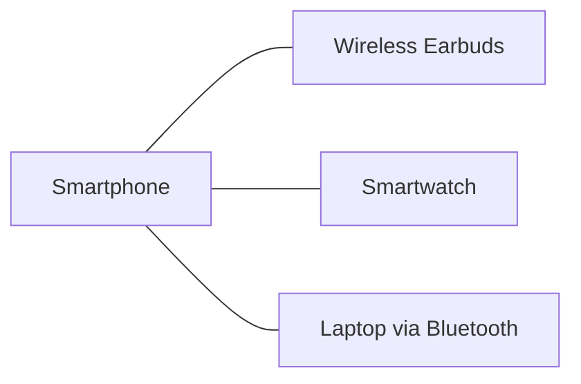
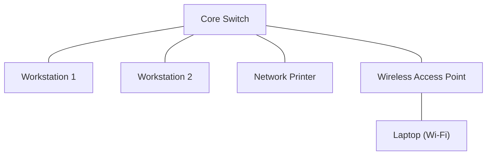
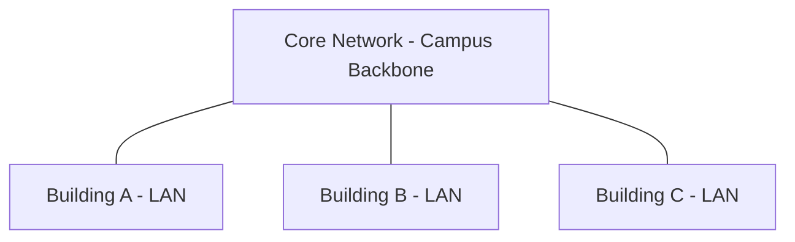
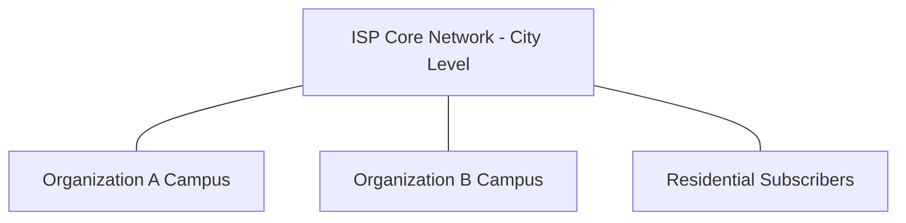
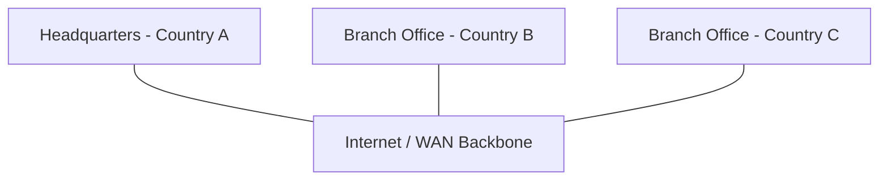
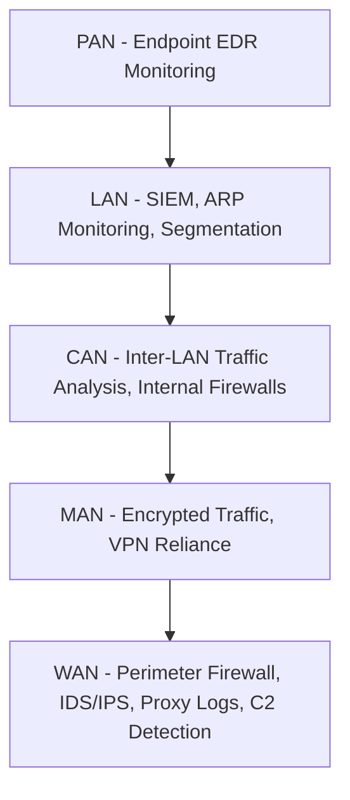

> **Goal of this section:**  
> You'll understand how networks are classified by the geographical area they cover, from the small network that connects your earbuds to your phone (PAN) all the way to the internet that connects the whole world (WAN), and why this distinction matters to you as a SOC Analyst when you analyze traffic and pinpoint the source of any anomaly.

## Table of Contents

- [Introduction](#introduction)
- [Personal Area Network (PAN)](#personal-area-network-pan)
- [Local Area Network (LAN)](#local-area-network-lan)
- [Campus Area Network (CAN)](#campus-area-network-can)
- [Metropolitan Area Network (MAN)](#metropolitan-area-network-man)
- [Wide Area Network (WAN)](#wide-area-network-wan)
- [Comparison Table](#comparison-table)
- [SOC Analyst Perspective](#soc-analyst-perspective)
- [Summary](#summary)

---

## Introduction

Computer networks are classified by the size of the geographical area they cover. The idea is that the larger the network, the more complexity and attack surface it has, and that's very important for the SOC Analyst, because each type of network needs a different way of monitoring.

The order from smallest to largest:

> [!NOTE]
> Each of these types differs not only in size but also in the technologies used and the ownership (who owns or is responsible for the network), and that affects who is responsible for its security.

---

## Personal Area Network (PAN)

A PAN is the smallest type of network. It connects the personal devices around the user over a very short range, and it's usually wireless.

| Property | Details |
|---|---|
| Coverage | 1–10 meters |
| Technologies | Bluetooth, NFC, Infrared |
| Example | Smartphone connected to wireless earbuds |
| Usage | Short-range communication between personal devices |

> [!WARNING]
> A common mistake is for people to think a PAN is always secure because it's short-range, but in reality, protocols like Bluetooth have known vulnerabilities (such as BlueBorne) that can be exploited if the device isn't updated.

From the SOC side, a PAN doesn't usually show up in traditional network monitoring (such as a SIEM or a network-level IDS), but it can be an entry point in endpoint attacks, so it's important that the EDR (Endpoint Detection and Response) monitors the Bluetooth/NFC connections on devices.

---

## Local Area Network (LAN)

A LAN connects devices in a limited area such as a home, an office, or a single building, and it provides high speed and relatively secure data transfer because it's isolated within small geographical boundaries.

| Property | Details |
|---|---|
| Coverage | Room, building, or small campus |
| Technologies | Ethernet, Wi-Fi |
| Example | Home or office network |
| Usage | Fast and secure local communication |

> [!IMPORTANT]
> The LAN is the environment the SOC Analyst works in most on a daily basis, because it's where the workstations, servers, and domain controllers are, and any lateral movement between machines usually happens here.

On the detection side, monitoring the LAN includes:
- **Windows Event ID 4624 / 4625**: Logon Success / Failure on LAN machines
- **ARP Spoofing Detection**: because a LAN usually relies on ARP for local communication, and that's a well-known weak point (MITM attacks)
- **Network Segmentation**: dividing the LAN into VLANs reduces the blast radius if a machine is compromised

> [!TIP]
> Using VLANs inside the LAN gives you an extra layer of segmentation, which makes it easier for you as an analyst to isolate an infected host without taking down the whole network.

---

## Campus Area Network (CAN)

A CAN links more than one LAN together within a single campus or a group of nearby buildings, and it's usually owned and managed by a single entity (such as a university or a company).

| Property | Details |
|---|---|
| Coverage | University or corporate campus |
| Technologies | Ethernet, Fiber Optics |
| Example | University campus network |
| Usage | Interconnecting LANs across a campus |

> [!NOTE]
> The main difference between a CAN and a LAN is that a CAN links networks (networks of networks), not individual devices, so it needs routing between the different LANs, not just switching.

From the SOC side, a CAN needs monitoring at the level of inter-LAN traffic, because any attacker who got onto a particular LAN may try to pivot to the other LANs within the same campus. Here it becomes important to use:
- **Internal Firewalls / Routers with ACLs** between the buildings
- **NetFlow / Traffic Analysis** to monitor the east-west traffic between the segments

---

## Metropolitan Area Network (MAN)

A MAN covers a larger area such as an entire city or a metropolitan area, and it's usually owned by service providers or large organizations.

| Property | Details |
|---|---|
| Coverage | City or metropolitan area |
| Technologies | Fiber Optics, Microwave, Metro Ethernet |
| Example | City-wide ISP network |
| Usage | High-speed connectivity across a city |

> [!WARNING]
> A MAN is usually completely outside the organization's control because it's owned by the ISP or the service provider, so its security isn't always under your SOC team's control, and that forces you to rely on encrypting the traffic (such as a VPN) while you move data over it.

---

## Wide Area Network (WAN)

A WAN is the largest type of network. It connects networks across entire countries or continents, and the most famous example of it is the internet itself.

| Property | Details |
|---|---|
| Coverage | Country, continent, or worldwide |
| Technologies | Leased lines, Satellite, Internet |
| Example | The Internet |
| Usage | Long-distance and global communication |

> [!IMPORTANT]
> The WAN is the main gateway for external threats, because it's the entry point that connects your internal network to the internet. Most attack vectors such as phishing, C2 communication, and external recon pass through here.

From the MITRE ATT&CK side, communication over the WAN is associated with techniques such as:
- **T1071 - Application Layer Protocol**: using protocols such as HTTP/HTTPS/DNS to communicate with Command and Control (C2) over the internet
- **T1090 - Proxy**: using proxies to hide the source of the traffic over the WAN

> [!TIP]
> Monitoring the perimeter (the boundary between the internal network and the WAN) through firewalls, IDS/IPS, and proxy logs is the first line of defense, because any unusual traffic entering or leaving here must be reviewed carefully.

---

## Comparison Table

| Network Type | Coverage | Ownership | Typical Technologies | Example |
|---|---|---|---|---|
| PAN | 1–10 meters | Individual User | Bluetooth, NFC, Infrared | Phone + Earbuds |
| LAN | Room / Building | Single Organization or Home | Ethernet, Wi-Fi | Office Network |
| CAN | Campus | Single Organization | Ethernet, Fiber Optics | University Campus |
| MAN | City | ISP / Large Organization | Fiber, Metro Ethernet, Microwave | City ISP Network |
| WAN | Country / Global | Multiple Entities / ISPs | Leased Lines, Satellite, Internet | The Internet |

---

## SOC Analyst Perspective

> [!NOTE]
> As we move from PAN to WAN, our reliance on network-level monitoring tools (such as SIEM, IDS/IPS, firewalls) increases, instead of relying on the endpoint alone. A mature SOC covers all of these layers together, not just one.

---

## Summary

- Networks are classified by the geographical area they cover: **PAN → LAN → CAN → MAN → WAN**
- **PAN**: very short range (1–10 meters), uses Bluetooth/NFC, important from an endpoint security standpoint
- **LAN**: covers a single building or location, the most important environment for the SOC Analyst's daily monitoring (Logon Events, ARP, Segmentation)
- **CAN**: links more than one LAN within a single campus, needs inter-LAN traffic monitoring
- **MAN**: covers an entire city, usually owned by an ISP, its security relies on encryption more than direct control
- **WAN**: the largest type, includes the internet itself, and is the main gateway for external threats (associated with MITRE ATT&CK T1071, T1090)
- The larger the network, the greater the attack surface and the need for stronger monitoring tools (SIEM, IDS/IPS, firewalls, EDR)

