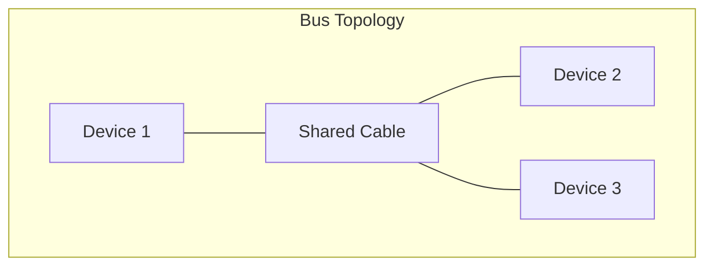
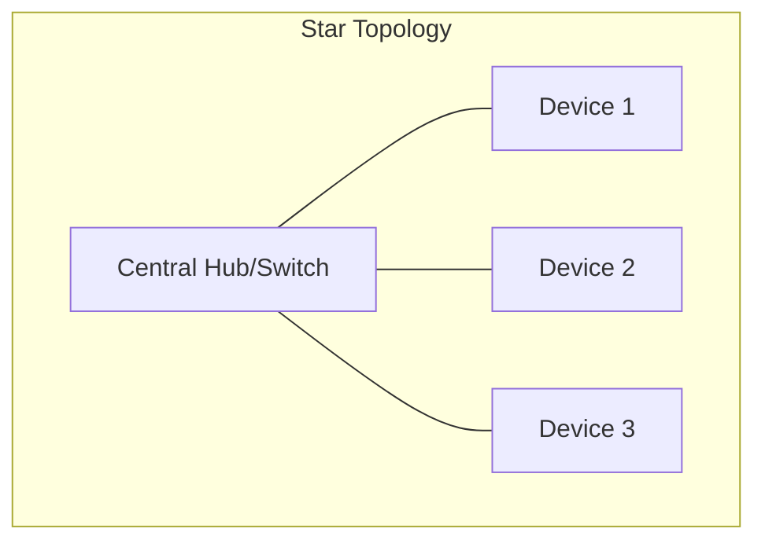
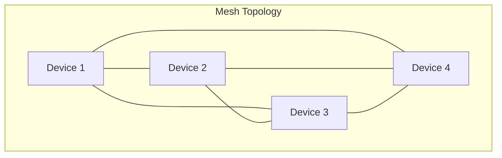
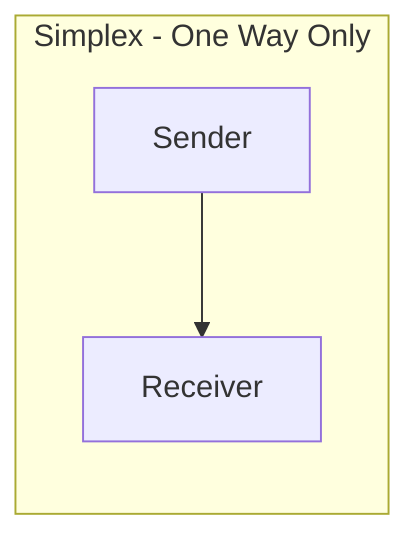
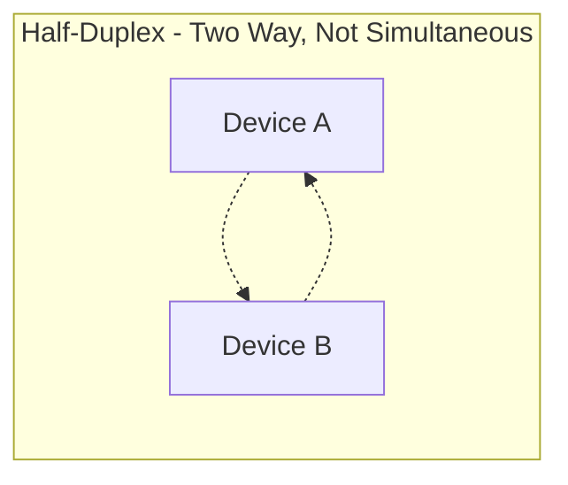
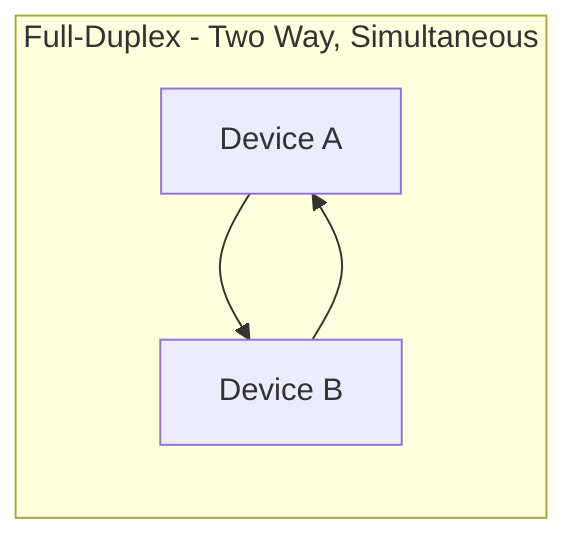

> **Goal of this section:**
>  You'll understand how the first layer of the OSI Model (the Physical Layer) works, how data is converted into physical signals and back into data again, and why physical security at this layer is a very important foundation, no matter how well the network is protected software-wise.

## Table of Contents

- [Overview](#overview)
- [How the Physical Layer Works](#how-the-physical-layer-works)
- [Key Responsibilities](#key-responsibilities)
- [Physical Layer Devices](#physical-layer-devices)
- [Functions of the Physical Layer](#functions-of-the-physical-layer)
  - [Bit Synchronization](#bit-synchronization)
  - [Bit Rate Control](#bit-rate-control)
  - [Physical Topology](#physical-topology)
  - [Transmission Mode](#transmission-mode)
- [Characteristics](#characteristics)
- [SOC Analyst Perspective](#soc-analyst-perspective)
- [Summary](#summary)

---

## Overview

The **Physical Layer** is the first and lowest layer of the OSI Model. It's responsible for establishing the physical connection between devices and transmitting data in the form of **Raw Bits** (0s and 1s).

This layer focuses only on hardware and signals, without any understanding of what the data itself means, and with no MAC addresses or IP addresses.

> [!NOTE]
> Think of this layer like the "wire" or the "air" that carries the sound in a phone call: it doesn't understand what you're saying; it just carries the signal from one place to another.

---

## How the Physical Layer Works

### Sending Data

- Converts binary data (0s and 1s) into physical signals
- Signals may be **electrical, optical, or wireless**
- Transmits signals through cables or wireless media

### Receiving Data

- Detects incoming signals
- Converts signals back into binary form
- Passes bits to the **Data Link Layer**

---

## Key Responsibilities

- Transmitting raw bits between devices
- Handling physical connections and media
- Defining signal types and hardware specifications
- Supporting higher OSI layers

---

## Physical Layer Devices

### Hub

- Broadcasts data to all connected ports
- Causes collisions and security risks
- Considered obsolete today

### Repeater

- Regenerates weak signals
- Extends network distance

### Modem

- Converts digital signals to analog and vice versa
- Connects local networks to ISPs

### Cables and Media

- Ethernet cables
- Fiber optic cables
- Wireless radio signals

> [!WARNING]
> We discussed the Hub earlier in the Network Devices lesson, and here we're emphasizing again that it's **Obsolete**, because it causes collisions and security problems by broadcasting to every device.

---

## Functions of the Physical Layer

### Bit Synchronization

It provides timing (clocking) to keep the sender and receiver synchronized at the bit level, so both know exactly when each bit starts and ends.

### Bit Rate Control

It defines the data transmission rate (bits per second), that is, how many bits are transferred each second.

### Physical Topology

It defines how devices are physically arranged in the network:

| Topology | Description | Fault Tolerance |
|---|---|---|
| Bus | All devices are connected to a single shared cable | Weak: if the main cable is cut, the whole network goes down |
| Star | All devices are connected to a central device (Hub/Switch) | Medium: a single device failure has no effect, but a failure of the center stops everything |
| Mesh | Every device is connected directly to every other device | Very strong: there are many alternative paths if one path goes down |

### Transmission Mode

It defines how data flows between devices:

| Mode | Description | Real-World Example |
|---|---|---|
| Simplex | One direction only | Keyboard to Computer |
| Half-Duplex | Two directions, but not at the same time | Walkie-Talkie |
| Full-Duplex | Two directions at the same time | Phone Call |

---

## Characteristics

- No error detection or correction
- No addressing or data interpretation
- Works only with signals and hardware
- Relies on higher layers for intelligence

> [!IMPORTANT]
> Since this layer **has no error detection or correction**, any signal problem (such as noise or attenuation) has to be handled at higher layers (such as the Data Link Layer, which uses mechanisms like CRC to verify data integrity).

---

## SOC Analyst Perspective

> [!IMPORTANT]
> Security at the Physical Layer is often neglected because the main focus is on software security, but if someone manages to physically reach a cable or a switch, they can do very serious damage even if all the software defenses are working perfectly.

Some of the most important Physical Layer risks a SOC analyst should be aware of:

| Threat | Description |
|---|---|
| Cable Tapping / Wiretapping | Connecting an unauthorized device to the cable to steal data (especially on older copper cables) |
| Rogue Device Connection | Plugging an unknown device (such as a laptop or a switch) into an empty port without the IT team's knowledge |
| Signal Jamming | Jamming wireless signals to prevent communication (Denial of Service at the signal level) |
| Physical Theft / Tampering | Stealing or tampering with the hardware itself (servers, switches, cables) |

> [!TIP]
> Some of the most important protections at the Physical Layer:
> - **Network Access Control (NAC)**: Prevents any unauthorized device from connecting, even if it physically reaches the port
> - **Port Security on switches**: Shuts down the port or raises an alert if a device with an unknown MAC address is connected
> - **Physical Security Controls**: Such as locked server rooms, surveillance cameras, and access logs

From the MITRE ATT&CK perspective, physical access attempts are often associated with:
- **T1200 - Hardware Additions**: Adding an unauthorized hardware device to the network (such as a rogue USB device or a network implant) to use as an entry point for the attack

---

## Summary

- The **Physical Layer** is the foundation of the OSI Model, and it transmits data as raw bits through electrical, optical, or wireless signals
- It includes devices such as **Hub, Repeater, Modem** and media such as copper cables, fiber, and wireless signals
- It defines core functions such as **Bit Synchronization, Bit Rate Control, Physical Topology (Bus/Star/Mesh), Transmission Mode (Simplex/Half-Duplex/Full-Duplex)**
- **It has no error detection and no addressing**; all of that happens at higher layers
- From the SOC perspective: physical security deserves real attention, because any unauthorized physical access (such as rogue devices or cable tapping) can bypass all the software layers of protection (related to MITRE T1200 - Hardware Additions)
