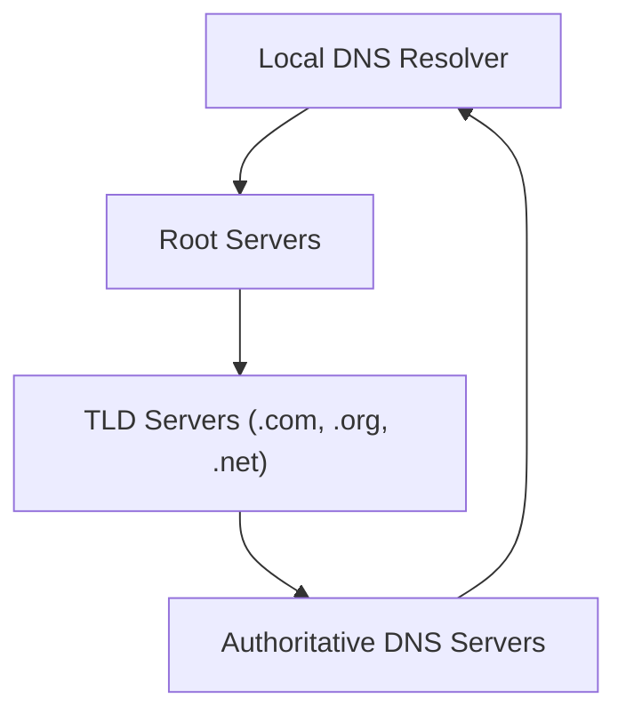
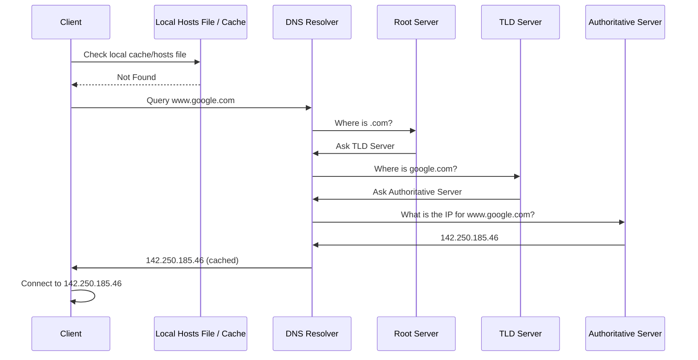
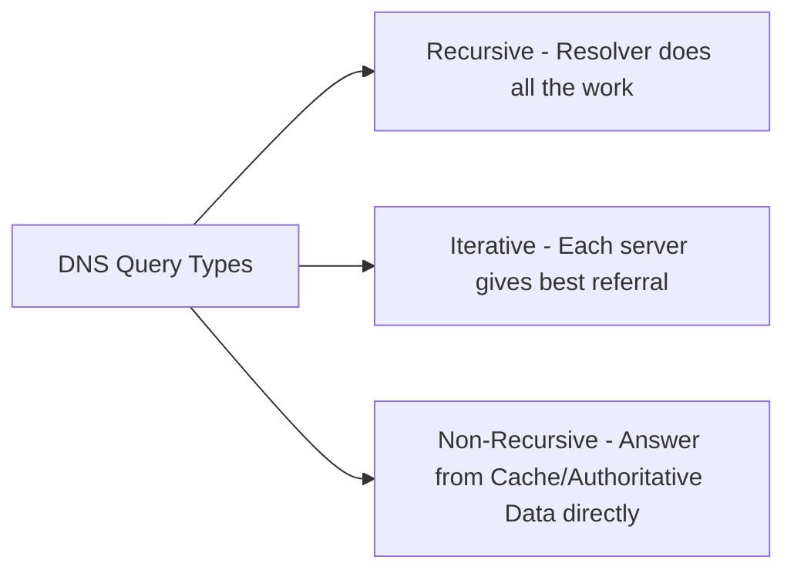
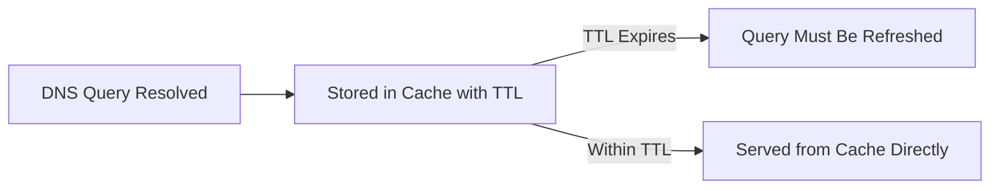
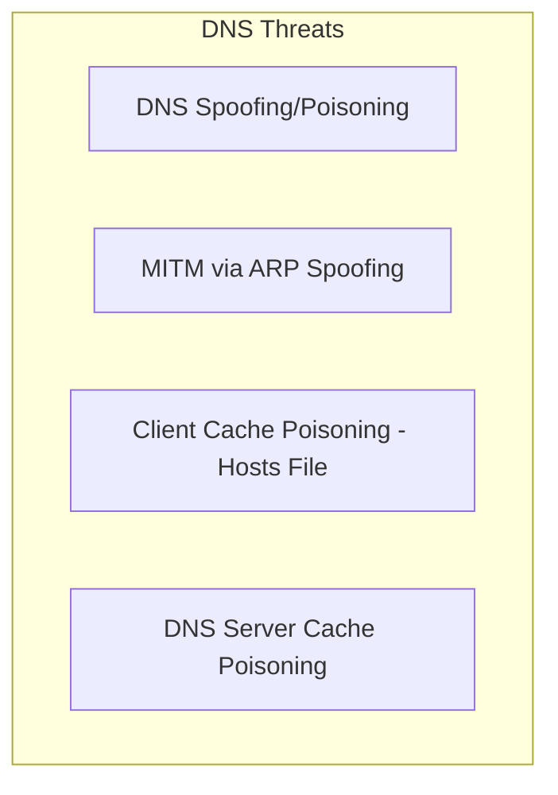
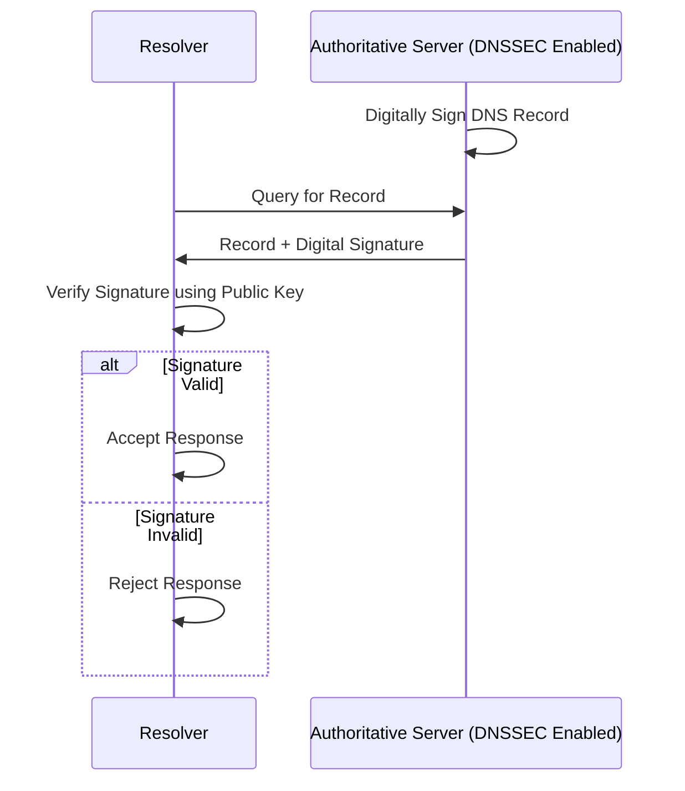

> **The goal of this section:**  
> You'll understand how DNS translates website names into IP Addresses, get to know its hierarchy from the Root Servers down to the Authoritative Server, and be able to connect that to the most dangerous attacks that target DNS, such as Spoofing and Cache Poisoning, and how DNSSEC protects it.


## Table of Contents

- [Overview](#overview)
- [DNS Hierarchy](#dns-hierarchy)
- [DNS Resolution Process](#dns-resolution-process)
- [Types of DNS Queries](#types-of-dns-queries)
- [Common DNS Record Types](#common-dns-record-types)
- [DNS Caching and TTL](#dns-caching-and-ttl)
- [Reverse DNS](#reverse-dns)
- [DNS Security Threats](#dns-security-threats)
- [DNS Security – DNSSEC](#dns-security--dnssec)
- [SOC Analyst Perspective](#soc-analyst-perspective)
- [Summary](#summary)

---

## Overview

The **Domain Name System (DNS)** is responsible for translating Human-Readable Domain Names into the IP Addresses that computers understand.

Example:

```
www.google.com → 142.250.185.46
```

DNS lets users reach websites using names instead of memorizing IP numbers. DNS usually runs on **Port 53** using **UDP** (and sometimes TCP if the response is large or for Zone Transfers).

> [!NOTE]
> Think of DNS as the internet's "phone book" - you know the person's name (Domain Name), but you need the directory to give you the actual number (IP Address) you'll call.

---

## DNS Hierarchy

DNS is a Distributed Hierarchical System made up of several levels:

1. **Root Servers**: Direct queries to the appropriate Top-Level Domain (TLD) servers
2. **TLD Servers**: Manage domain extensions such as `.com`, `.org`, and `.net`
3. **Authoritative DNS Servers**: Store the actual DNS records for a domain and provide the final IP address
4. **Local DNS Resolver**: Usually provided by an ISP or organization, responsible for performing the lookup process on behalf of the client



> [!IMPORTANT]
> Each level in the hierarchy points you to the next level rather than giving you the final answer directly (except the Authoritative Server). This is called **Delegation**, and it's what makes the DNS system distributed and scalable, instead of a single central Server that knows everything.

---

## DNS Resolution Process

When the user types a Domain name:

1. The client first checks its **Local Cache**:
   - **Windows**: `C:\Windows\System32\drivers\etc\hosts`
   - **Linux/Unix**: `/etc/hosts`
2. If it isn't there, the request is sent to the **DNS Resolver**
3. The Resolver asks, in order:
   - Root Server
   - TLD Server
   - Authoritative Server
4. The Authoritative Server returns the IP Address
5. The Resolver sends the response to the client and Caches it
6. The client connects to the final IP



> [!WARNING]
> The first step (checking the local **Hosts File**) is exactly the weak point that **Client Cache Poisoning** attacks exploit, because if the attacker modifies that file, your machine won't ask DNS at all - it will trust the fake value written locally.

---

## Types of DNS Queries

| Type | Description |
|---|---|
| Recursive | The Resolver takes on the job of getting the complete final answer on behalf of the client |
| Iterative | Each Server returns the best available Referral, and the Resolver itself carries the question on to the next stage |
| Non-Recursive | The response comes back directly from the Cache or from Authoritative data that already exists, without needing any additional queries |



---

## Common DNS Record Types

| Record | Purpose |
|---|---|
| A | Maps a domain to an IPv4 address |
| AAAA | Maps a domain to an IPv6 address |
| CNAME | Alias for another domain name |
| MX | Mail server for the domain |
| PTR | Reverse lookup (IP to domain) |

> [!TIP]
> The **MX Record** type is very important from a security standpoint - if an attacker manages to modify a domain's MX Record, they can redirect all email sent to that domain to a server under their control.

---

## DNS Caching and TTL

- DNS responses are cached to improve performance and reduce query load
- **TTL (Time To Live)** defines how long a DNS record is stored in cache before it must be refreshed



> [!NOTE]
> TTL represents a trade-off between performance and accuracy: a long TTL means higher speed but slower updates if the IP changes, while a short TTL means higher accuracy but a heavier query load on the servers.

---

## Reverse DNS

Reverse DNS does the opposite operation:

```
IP Address → Domain Name
```

It's commonly used for:

- Email server validation
- Network troubleshooting
- Security analysis

> [!TIP]
> **Reverse DNS Lookup** is an essential tool in security investigations - when you find a strange IP in the Logs, doing a Reverse Lookup on it is a quick first step that helps you find out which Domain or Service it's associated with.

---

## DNS Security Threats

### 1. DNS Spoofing / Poisoning

The attacker provides a fake IP Address for a legitimate domain, which redirects users to a malicious site.

### 2. Man-in-the-Middle (MITM)

The attacker intercepts DNS requests and responds with forged information, often using ARP Spoofing.

### 3. Client Cache Poisoning (Hosts File Manipulation)

Attackers modify the local Hosts file:

- **Windows**: `C:\Windows\System32\drivers\etc\hosts`
- **Linux/Unix**: `/etc/hosts`

This forces the system to resolve domains to malicious IPs without asking DNS at all.

### 4. DNS Server Cache Poisoning

Attackers inject fake DNS responses into the Resolver's Cache, which affects all users who rely on that server.



---

## DNS Security – DNSSEC

**DNS Security Extensions (DNSSEC)** add Cryptographic Signatures to DNS records.

### How it works

- DNS records are digitally signed by the authoritative server
- The resolver verifies the signature using public keys
- If validation fails, the response is rejected



### DNSSEC ensures

- Data integrity
- Authentication
- Protection against DNS spoofing and cache poisoning

> [!IMPORTANT]
> DNSSEC solves the **Integrity** and **Authentication** problem, but it **doesn't provide Encryption** for the queries themselves - meaning someone can still see that you're asking about a particular domain, but they won't be able to forge the response. The solution for full encryption is protocols like **DNS over HTTPS (DoH)** or **DNS over TLS (DoT)**.

---

## SOC Analyst Perspective

| Threat | MITRE ATT&CK Reference |
|---|---|
| DNS Spoofing / Poisoning | T1557 - Adversary-in-the-Middle |
| Client Cache Poisoning (Hosts File) | T1565.001 - Data Manipulation: Stored Data Manipulation |
| DNS Server Cache Poisoning | T1557 - Adversary-in-the-Middle |
| DNS Tunneling (Data Exfiltration) | T1071.004 - Application Layer Protocol: DNS |
| Domain Generation Algorithms (DGA) for C2 | T1568.002 - Dynamic Resolution: Domain Generation Algorithms |

> [!WARNING]
> Some advanced types of Malware use **Domain Generation Algorithms (DGA)** to generate random domain names daily for communicating with a C2 Server, which makes traditional domain blocking difficult because the domain keeps changing.

### Detection & Best Practices

- Monitor **DNS Query Logs** to detect abnormal patterns (such as a large number of failed NXDOMAIN queries, or random-looking domains that may indicate DGA)
- Enable **DNSSEC** on sensitive domains to ensure the integrity of the records
- Monitor any unauthorized change to the **Hosts File** on devices (EDR Rules)
- Use **DNS Sinkholing** to redirect queries for known malicious domains to a monitoring server instead of the real server
- Analyze the length and frequency of Subdomains in queries, because **DNS Tunneling** often shows up as long, strange-looking Subdomains (such as Base64-encoded Strings)

> [!TIP]
> If you notice a single device making a huge number of DNS queries to a particular domain very repeatedly, or the queries themselves contain long, strange Subdomains (not normal names), that's a very strong indicator of **DNS Tunneling** and deserves immediate investigation using tools like Wireshark or DNS Logs Analysis.

---

## Summary

- **DNS** translates domain names into IP Addresses, and runs on **Port 53 (UDP/TCP)**
- A distributed hierarchical structure: **Root Servers → TLD Servers → Authoritative Servers**, all handled through the **Local DNS Resolver**
- 3 query types: **Recursive, Iterative, Non-Recursive**
- The most important record types: **A, AAAA, CNAME, MX, PTR**
- **TTL** determines how long a record stays in the Cache before it needs refreshing
- **Reverse DNS** converts an IP to a domain, and is useful in security investigations
- The main threats: **DNS Spoofing/Poisoning, MITM, Client/Server Cache Poisoning**, plus **DNS Tunneling** and **DGA-based C2**
- **DNSSEC** protects Integrity and Authentication (but not encryption), and tools like DNS Sinkholing and DNS query analysis are essential for any SOC
