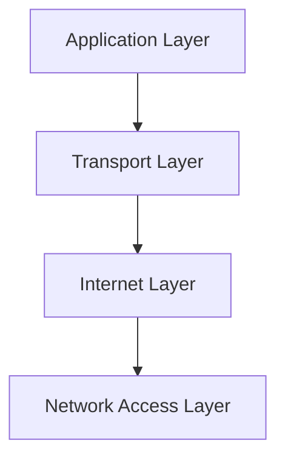
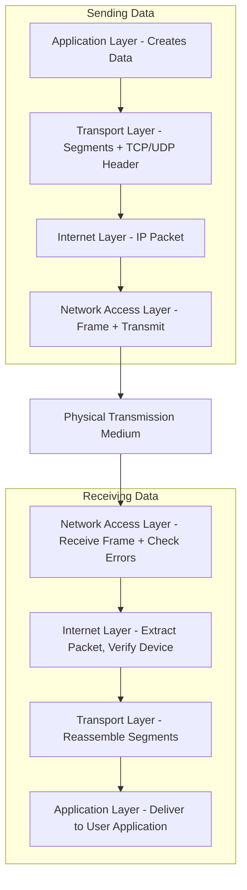
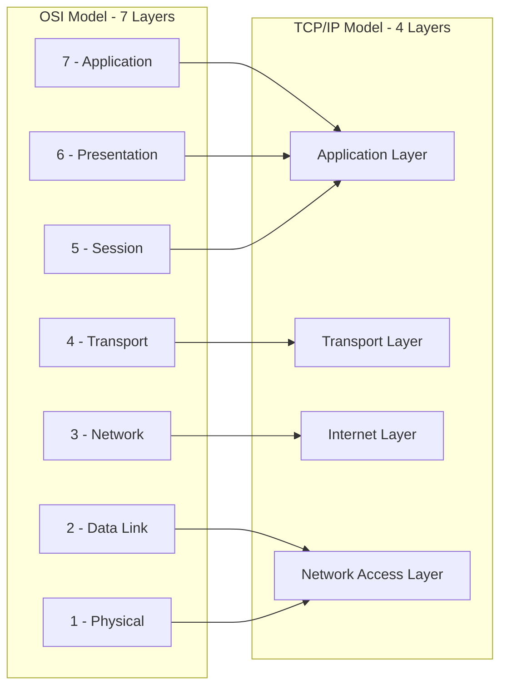
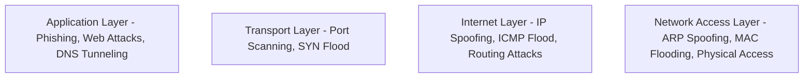

> **Goal of this section:**
>  You'll understand the TCP/IP Model and how it's the actual practical framework the internet runs on, the difference between it and the OSI Model, and how each of its layers maps to the OSI layers you studied earlier, so the full picture comes together.

## Table of Contents

- [Overview](#overview)
- [Layers of TCP/IP Model](#layers-of-tcpip-model)
  - [1. Application Layer](#1-application-layer)
  - [2. Transport Layer](#2-transport-layer)
  - [3. Internet Layer](#3-internet-layer)
  - [4. Network Access Layer (Link Layer)](#4-network-access-layer-link-layer)
- [How TCP/IP Works](#how-tcpip-works)
- [TCP/IP vs OSI Model](#tcpip-vs-osi-model)
- [Advantages of TCP/IP](#advantages-of-tcpip)
- [Limitations](#limitations)
- [Why TCP/IP is Preferred over OSI](#why-tcpip-is-preferred-over-osi)
- [SOC Analyst Perspective](#soc-analyst-perspective)
- [Summary](#summary)

---

## Overview

The **TCP/IP Model** is a layered networking framework that explains how data moves between devices across a network using Standardized Protocols to ensure reliable and efficient transfer. It is simpler and more Practical than the OSI Model, and it's considered the core framework the modern internet actually runs on.

> [!NOTE]
> The fundamental difference between OSI and TCP/IP: OSI is a **Theoretical framework** that explains the concepts in more detail (7 layers), while TCP/IP is a **Practical framework** actually built on the protocols used in the real world (4 layers).

---

## Layers of TCP/IP Model

### 1. Application Layer

- **Position**: Top layer, closest to the user
- **Function**: Interfaces applications (web browsers, email, file transfer) with the network

**Key Features**:
- Provides network services to user applications
- Supports protocols like HTTP, FTP, SMTP, DNS
- Handles data formatting, encryption, and session management

> [!NOTE]
> Notice that this layer in TCP/IP covers the functions of three OSI layers together: **Application + Presentation + Session**.

### 2. Transport Layer

- **Function**: Ensures reliable and efficient data delivery between devices

**Key Functions**:
- **Segmentation & Reassembly**: Breaks data into segments and reassembles it
- **Reliable Delivery & Error Handling**: TCP ensures correct delivery, resends lost data
- **Flow Control**: Regulates data transmission speed
- **Multiplexing**: Uses port numbers for multiple applications

**Protocols**:
- **TCP (Transmission Control Protocol)**: Connection-oriented, reliable, ordered
- **UDP (User Datagram Protocol)**: Connectionless, faster, suitable for live streaming or gaming

### 3. Internet Layer

- **Function**: Handles addressing, routing, and packaging of data for network-to-network transfer

**Key Features**:
- **Logical Addressing**: Uses IP addresses for source & destination
- **Packet Routing**: Determines the best path for packets
- **Fragmentation & Reassembly**: Splits large packets, reassembles at the destination

**Protocols**: IP, ICMP, ARP

> [!NOTE]
> This layer corresponds to the **Network Layer (Layer 3)** in the OSI Model.

### 4. Network Access Layer (Link Layer)

- **Function**: Physical transmission of data over hardware like cables or Wi-Fi

**Key Features**:
- Sends & receives raw bits
- Frames data for transmission
- Checks for errors using CRC/Checksum
- Uses MAC addresses to identify devices
- Manages medium access to avoid collisions

> [!NOTE]
> This layer covers the functions of two OSI layers together: **Data Link Layer + Physical Layer**.

---

## How TCP/IP Works

### Sending Data

1. **Application Layer**: Creates data and passes it to the Transport Layer
2. **Transport Layer**: Segments data, adds TCP/UDP info
3. **Internet Layer**: Encapsulates segments into IP packets
4. **Network Access Layer**: Converts packets to frames and transmits over physical media

### Receiving Data

1. **Network Access Layer**: Receives frames and checks for errors
2. **Internet Layer**: Extracts packets, verifies correct device
3. **Transport Layer**: Reassembles segments, corrects errors (TCP)
4. **Application Layer**: Delivers data to user application

---

## TCP/IP vs OSI Model

| TCP/IP Layer | Corresponding OSI Layer(s) |
|---|---|
| Application Layer | Application (7) + Presentation (6) + Session (5) |
| Transport Layer | Transport (4) |
| Internet Layer | Network (3) |
| Network Access Layer | Data Link (2) + Physical (1) |

---

## Advantages of TCP/IP

- Widely used in Internet & modern networks
- Platform-independent
- Reliable communication via TCP
- Scalable from small networks to the global Internet
- Open standard, free to use

---

## Limitations

- Complex for beginners
- Layer boundaries not strictly enforced
- TCP overhead for error-checking
- Basic security requires additional protocols like TLS/SSL
- Original design not optimized for real-time audio/video

> [!WARNING]
> The point "Basic security requires additional protocols like TLS/SSL" is very important - the TCP/IP Model in its original design **has no Built-in Security**, so any data protection (such as encryption) has to be added as an extra layer on top of it, which is a major reason why Application Layer Protocols need secure versions such as HTTPS instead of HTTP, and SFTP instead of FTP.

---

## Why TCP/IP is Preferred over OSI

- Simpler structure with 4 practical layers
- Protocol-driven, based on real-world protocols
- Flexible, robust, and widely adopted
- Open standard with universal acceptance
- OSI is theoretical; TCP/IP is used in actual networks

---

## SOC Analyst Perspective

> [!IMPORTANT]
> Although the OSI Model is better for understanding the theoretical concepts in detail, **TCP/IP is what actually runs** on any network you analyze, so all the Logs and Packet Captures you'll see in your daily work are built on these four layers.

| TCP/IP Layer | Common Detection Tools |
|---|---|
| Application Layer | WAF, Email Security Gateway, DNS Logs, Proxy Logs |
| Transport Layer | IDS/IPS, NetFlow, Firewall (Port/Protocol Rules) |
| Internet Layer | Firewall, Router ACLs, IP Reputation Feeds |
| Network Access Layer | Switch Port Security, Arpwatch, NAC |

> [!TIP]
> The lack of built-in security in TCP/IP's original design is the reason most modern attacks rely on exploiting old protocols (such as ARP and DNS) that were originally designed without any security considerations. So when you analyze unusual Traffic, always ask yourself: "Was this protocol originally designed with security in mind, or not?"

From a MITRE ATT&CK standpoint, most of the techniques covered in the previous OSI Layers lessons (such as **T1046, T1498, T1499, T1557, T1566, T1190**) actually map onto these same four TCP/IP layers, which confirms that understanding both models together (OSI for detail, TCP/IP for practical application) is the foundation of any strong Threat Hunting analysis.

---

## Summary

- The **TCP/IP Model** is the actual practical framework the internet runs on, and it consists of **4 layers**: Application, Transport, Internet, Network Access
- Each layer corresponds to one or more layers of the **OSI Model** (the Application Layer covers Layers 5-7, and Network Access covers Layers 1-2)
- Sending and receiving data goes through the same **Encapsulation/Decapsulation** idea you studied in the OSI Model
- Advantages: simplicity, global adoption, reliability, and scalability / Disadvantages: no built-in security, and relative complexity for beginners
- TCP/IP is preferred over OSI in practice because it's **Protocol-Driven** and built on how networks actually work, while OSI is more of a theoretical teaching tool
- From a SOC standpoint: understanding how the two models map to each other is essential for placing any Tool or Log in its correct position, and the lack of native security in TCP/IP is the root cause of most vulnerabilities in old protocols (ARP, DNS, etc.)
