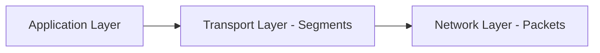
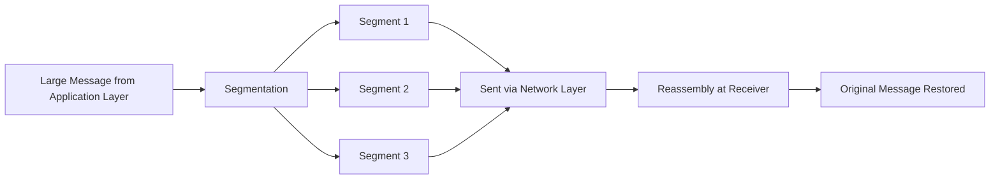
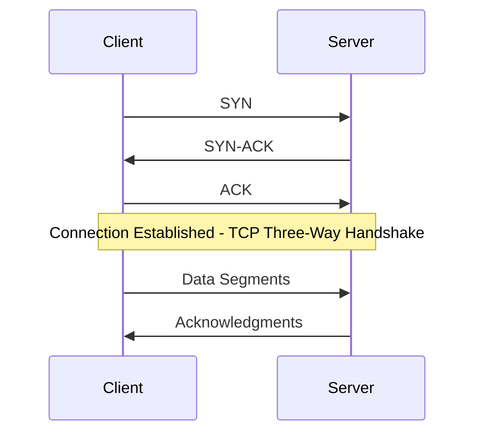
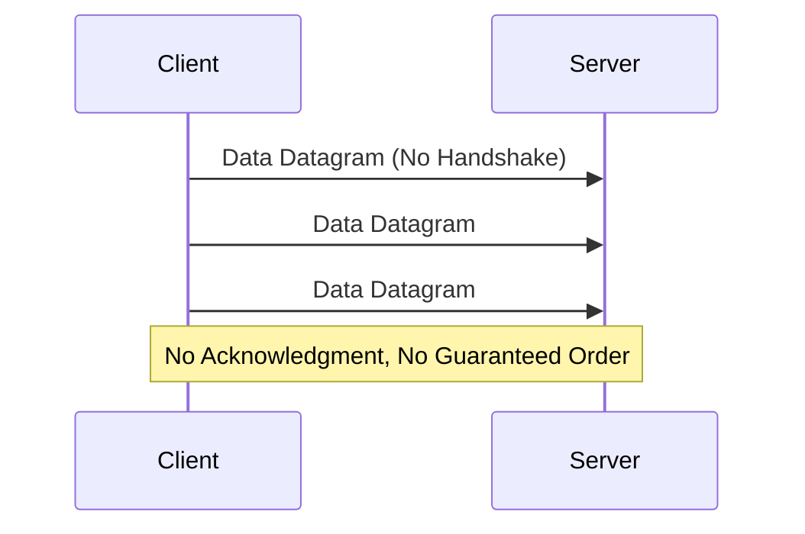
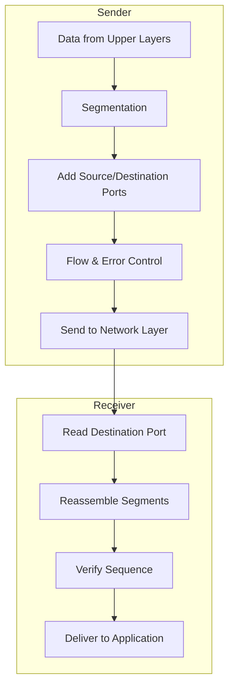

> **Goal of this section:**
> You'll understand how the Transport Layer ensures that data arrives complete and in the right order between two devices, the practical difference between TCP and UDP, and the role of Port Numbers in directing data to the right Application, and you'll be able to connect all of this to the best-known network attacks such as Port Scanning and SYN Flood.

## Table of Contents

- [Overview](#overview)
- [Key Functions of Transport Layer](#key-functions-of-transport-layer)
  - [1. End-to-End Delivery](#1-end-to-end-delivery)
  - [2. Segmentation and Reassembly](#2-segmentation-and-reassembly)
  - [3. Service Point Addressing (Port Numbers)](#3-service-point-addressing-port-numbers)
  - [4. Flow and Error Control](#4-flow-and-error-control)
- [Protocols Used in Transport Layer](#protocols-used-in-transport-layer)
- [Services Provided](#services-provided)
- [How It Works](#how-it-works)
- [SOC Analyst Perspective](#soc-analyst-perspective)
- [Summary](#summary)

---

## Overview

The **Transport Layer** is the fourth layer of the OSI Model. It provides services to the **Application Layer** and receives services from the **Network Layer**. Its main responsibility is delivering complete messages from one device to another across networks (**End-to-End Delivery**). Data at this layer is called **Segments**.

> [!NOTE]
> The difference between "End-to-End" at the Transport Layer and "Hop-to-Hop" at the Data Link Layer: the Transport Layer makes sure the data reaches the final device (Destination Device) in full, not just the next hop from one Router to another.

---

## Key Functions of Transport Layer

### 1. End-to-End Delivery

- Ensures that data is delivered from the source device to the destination device reliably
- Provides acknowledgment of successful data transmission
- Retransmits segments if errors are detected

### 2. Segmentation and Reassembly

- **Segmentation**: Divides large messages from upper layers into smaller, manageable segments
- **Reassembly**: At the receiving end, segments are combined back into the original message in the correct order

### 3. Service Point Addressing (Port Numbers)

- Each segment includes a **Source Port** and **Destination Port** in its header
- This ensures that the data is delivered to the correct application or process on the receiving device
- Example: Web applications typically use **Port 80 (HTTP)** by default

> [!IMPORTANT]
> Think of the IP Address as the building's address, and the Port Number as the apartment number inside that building. The data may reach the right device (IP), but it also needs to reach the right Application inside it (Port).

### 4. Flow and Error Control

- Controls the rate of data transmission between sender and receiver to avoid congestion (**Flow Control**)
- Detects errors in segments and requests retransmission if needed (**Error Control**)

---

## Protocols Used in Transport Layer

- **TCP (Transmission Control Protocol)**: Connection-oriented, reliable, ensures ordered delivery
- **UDP (User Datagram Protocol)**: Connectionless, faster, but less reliable

| Aspect | TCP | UDP |
|---|---|---|
| Connection | Connection-Oriented (Handshake required) | Connectionless |
| Reliability | Reliable (Acknowledgment + Retransmission) | Unreliable (No Acknowledgment) |
| Order | Guarantees ordered delivery | No order guarantee |
| Speed | Slower (due to overhead) | Faster (less overhead) |
| Use Cases | Web browsing, Email, File Transfer | Streaming, VoIP, DNS, Gaming |

---

## Services Provided

### 1. Connection-Oriented Service (TCP)

- Establishes a reliable connection between sender and receiver
- Ensures all segments arrive in order and without loss
- Provides acknowledgment and retransmission mechanisms

> [!NOTE]
> These three steps (SYN, SYN-ACK, ACK) are known as the **Three-Way Handshake**, and they're how TCP makes sure both sides are ready and agree to start the connection before any actual data is sent.

### 2. Connectionless Service (UDP)

- Sends segments without establishing a dedicated connection
- Faster but no guarantee of delivery or order
- Ideal for streaming or real-time applications like video conferencing

---

## How It Works

### At the Sender

1. Receives data from upper layers (Application/Session)
2. Segments the data into smaller units
3. Adds Source and Destination Port Numbers
4. Implements Flow Control and Error Control
5. Forwards the segments to the Network Layer

### At the Receiver

1. Reads the Destination Port to determine which application receives the data
2. Reassembles the segments into the original message
3. Ensures correct sequence of segments before delivering to the application

The Transport Layer plays a Critical Role in reliable communication across networks, and it links network services to the Applications.

---

## SOC Analyst Perspective

> [!IMPORTANT]
> The Transport Layer is one of the layers most constantly examined in any SOC, because Port Numbers and Connection States (such as TCP Flags) provide very strong indicators of suspicious activity.

### Common Ports Every Analyst Should Know

| Port | Protocol | Service |
|---|---|---|
| 20 / 21 | TCP | FTP |
| 22 | TCP | SSH |
| 23 | TCP | Telnet |
| 25 | TCP | SMTP |
| 53 | TCP/UDP | DNS |
| 80 | TCP | HTTP |
| 443 | TCP | HTTPS |
| 3389 | TCP | RDP |

### Common Layer 4 Threats

| Threat | Description | MITRE ATT&CK Reference |
|---|---|---|
| Port Scanning | The attacker probes the open Ports on a device or network to identify the running services and potential vulnerabilities | T1046 - Network Service Discovery |
| SYN Flood | Flooding the Server with a huge number of SYN Requests without completing the Handshake, with the goal of exhausting its resources (DoS) | T1499 - Endpoint Denial of Service |
| Session Hijacking | Stealing or predicting the Sequence numbers of an existing TCP connection in order to impersonate one of the parties | T1557 - Adversary-in-the-Middle |
| UDP Flood | Flooding the device with large numbers of UDP packets to consume its resources (especially since UDP has no Handshake to verify) | T1498 - Network Denial of Service |

> [!WARNING]
> The **UDP** protocol is used a lot in **Amplification/Reflection DoS** attacks (such as DNS Amplification), because it's Connectionless and has no verification of the sender's identity, so the Source IP is easy to spoof.

> [!TIP]
> If you see a single device sending a very large number of SYN Packets to different Ports in a short time without completing any Handshake, that's a very strong indicator of **Port Scanning** or a **SYN Flood** attempt, and it deserves immediate investigation in tools such as Wireshark or NetFlow Analysis.

In terms of tools:
- **IDS/IPS** monitor abnormal Connection patterns at the Port level
- **NetFlow/Firewall Logs** help detect any Scanning attempt by tracking the number of Connections to different IP addresses and Ports in a short time

---

## Summary

- The **Transport Layer** is the fourth layer, responsible for **End-to-End Delivery** of data, and its basic unit is called a **Segment**
- Its most important functions: **Segmentation & Reassembly, Port Addressing, Flow & Error Control**
- Two core protocols: **TCP** (reliable, Connection-Oriented, uses the Three-Way Handshake) and **UDP** (faster, Connectionless, with no delivery guarantee)
- **Port Numbers** identify the correct Application that should receive the data (such as Port 80 for HTTP)
- From the SOC's perspective: this layer is a key source for detecting attacks such as **Port Scanning (T1046)** and **SYN/UDP Flood (T1499/T1498)**, and tools such as IDS/IPS and NetFlow are essential for monitoring it
