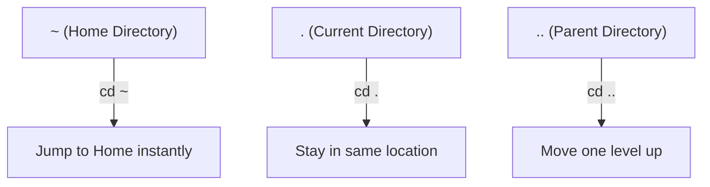

> **The goal of this section:**  
> You'll master the most important Linux commands for navigating and working with files (pwd, ls, cd, mkdir, cp, mv, touch), and you'll understand how some of these simple commands (like touch) can be used by attackers to cover their tracks, and how to detect that as a SOC Analyst.


## Table of Contents

- [Why File System Navigation Matters](#why-file-system-navigation-matters)
- [Commonly Used File System Navigation Commands](#commonly-used-file-system-navigation-commands)
  - [1. pwd – Print Working Directory](#1-pwd--print-working-directory)
  - [2. ls – List Files and Directories](#2-ls--list-files-and-directories)
  - [3. cd – Change Directory](#3-cd--change-directory)
  - [4. mkdir – Make Directory](#4-mkdir--make-directory)
  - [5. rmdir – Remove Empty Directory](#5-rmdir--remove-empty-directory)
  - [6. cp – Copy Files](#6-cp--copy-files)
  - [7. mv – Move or Rename Files](#7-mv--move-or-rename-files)
  - [8. touch – Create Empty Files & Manage Timestamps](#8-touch--create-empty-files--manage-timestamps)
- [Useful Navigation Shortcuts](#useful-navigation-shortcuts)
- [Summary Table – Linux File System Navigation Commands](#summary-table--linux-file-system-navigation-commands)
- [SOC Analyst Perspective](#soc-analyst-perspective)
- [Summary](#summary)

---

## Why File System Navigation Matters

Using navigation commands in Linux helps you:

- Move between directories quickly and efficiently
- Locate files and understand the folder hierarchy
- Manage files and directories with confidence
- Perform system administration and troubleshooting tasks

They're widely used by developers, System Administrators, and cybersecurity specialists.

> [!NOTE]
> Mastering these commands isn't just for system administration - they're the same tools you'll use as a SOC Analyst during any Live Investigation on a suspicious Linux machine.

---

## Commonly Used File System Navigation Commands

### 1. pwd – Print Working Directory

The `pwd` command displays the full path of the directory you're currently working in.

```bash
pwd
```

**Example Output**:

```
/home/kali/Templates
```

**Explanation**: you're currently inside the `Templates` directory, which is located under `/home/kali`.

### 2. ls – List Files and Directories

The `ls` command lists all the files and directories inside the current directory.

```bash
ls
```

**Use Case**: gives you a quick look at the directory's contents.

**Helpful Variants**:

```bash
ls -l   # Detailed list
ls -a   # Include hidden files
```

> [!IMPORTANT]
> `ls -a` is one of the most important commands for any security investigator, because Linux hides any file whose name starts with a dot (`.`) from the normal listing. Attackers sometimes use these hidden files to hide their tools, and a plain `ls` without `-a` won't show them to you.

### 3. cd – Change Directory

The `cd` command lets you move between directories.

**Move to a Nearby Directory**:

```bash
cd Downloads
```

**Move Using an Absolute Path**:

```bash
cd /home/username/Documents
```

### 4. mkdir – Make Directory

The `mkdir` command is used to create new directories.

```bash
mkdir GeeksForGeeks
```

**Result**: a new directory named `GeeksForGeeks` is created.

### 5. rmdir – Remove Empty Directory

The `rmdir` command deletes an empty directory.

```bash
rmdir GeeksForGeeks
```

**Important Notes**:

- The directory must be empty
- The command fails if there are files inside it

### 6. cp – Copy Files

The `cp` command copies files or directories from one place to another.

```bash
cp ~/Downloads/image.jpg ~/Pictures
```

**Explanation**: copies the file while keeping the original.

### 7. mv – Move or Rename Files

The `mv` command moves or renames files and directories.

**Move a File**:

```bash
mv ~/Downloads/image.jpg ~/Pictures
```

**Rename a File**:

```bash
mv old_name.txt new_name.txt
```

### 8. touch – Create Empty Files & Manage Timestamps

The `touch` command is used to create empty files or update a file's Timestamps without modifying its content.

**Create an Empty File**:

If the file doesn't exist, `touch` creates it.

```bash
touch file.txt
```

**Result**: an empty file named `file.txt` is created.

> [!TIP]
> **Quick Note**:
> - If the file doesn't exist → `touch` creates a new empty file
> - If the file already exists → `touch` only updates the Timestamps (Access Time & Modification Time)

**Create Multiple Files**:

```bash
touch file1.txt file2.txt file3.txt
```

**Use Case**: quickly setting up project or test files.

**Verify File Timestamps**:

```bash
stat file.txt
```

**Displays**:

- Access Time
- Modification Time
- Change Time

> [!WARNING]
> The same capability that makes `touch` useful for managing Timestamps is exactly what makes it a dangerous tool in the hands of a skilled attacker. The attacker can use `touch` to **change the modification date of a malicious file** to match the original system files; this is called **Timestomping** - a very common technique for hiding evidence during any digital forensic investigation.

---

## Useful Navigation Shortcuts

| Shortcut | Meaning | Command |
|---|---|---|
| `~` | Home Directory | `cd ~` |
| `.` | Current Directory | `cd .` |
| `..` | Parent Directory | `cd ..` |

### tree – Visualize Directory Structure

The `tree` command displays directories in a Tree-like Format.

```bash
tree
```

**Use Case**: helps you visualize the Folder Hierarchy clearly.



---

## Summary Table – Linux File System Navigation Commands

| Command | Purpose | Example |
|---|---|---|
| `pwd` | Show current directory path | `pwd` |
| `ls` | List files and directories | `ls -la` |
| `cd` | Change directory | `cd /home/user/Documents` |
| `mkdir` | Create a new directory | `mkdir NewFolder` |
| `rmdir` | Remove an empty directory | `rmdir NewFolder` |
| `cp` | Copy files or directories | `cp file.txt ~/Backup/` |
| `mv` | Move or rename files/directories | `mv old.txt new.txt` |
| `touch` | Create empty file or update timestamps | `touch file.txt` |
| `stat` | Display detailed file timestamps | `stat file.txt` |
| `tree` | Display directory structure visually | `tree` |

---

## SOC Analyst Perspective

> [!IMPORTANT]
> These simple commands are your core tools during any **Live Response** on an infected Linux machine. How fast you can navigate and check files makes a big difference in how long the investigation takes.

### Security-Relevant Notes on These Commands

| Command | Security Relevance |
|---|---|
| `ls -a` | Essential for uncovering hidden files and directories where attackers may hide their tools |
| `touch` | Can be used for **Timestomping**, changing a malicious file's date so it blends in with legitimate system files |
| `stat` | A core tool for checking the real Timestamps and comparing them with what's expected - useful for detecting Timestomping |
| `cp` / `mv` | Monitoring their use on sensitive files (such as `/etc/passwd` or `/etc/shadow`) can reveal an attempt to copy sensitive data |
| `mkdir` in `/tmp` | Creating new directories in `/tmp` is often a first step in preparing a place to run or store malicious files |

From the MITRE ATT&CK perspective:

| Technique | Description |
|---|---|
| T1070.006 - Indicator Removal: Timestomp | Using commands like `touch` to change Timestamps and hide traces of modification to a malicious file |
| T1083 - File and Directory Discovery | The attacker using commands like `ls` and `tree` to explore the system's structure after the compromise |
| T1005 - Data from Local System | Using `cp` or `mv` to collect sensitive files before exfiltrating them |

> [!TIP]
> If you find a file in `/tmp` or any suspicious directory with a very old Timestamp (such as the system installation date) but strange content or size, that's a strong indicator of **Timestomping**. Always compare the **Modification Time** and the **Change Time** using `stat` - attackers can usually change the former easily, but the Change Time (which records the last change to the Metadata itself) is harder to tamper with.

---

## Summary

- The basic Linux navigation commands: **`pwd`** (the current path), **`ls`** (list contents), **`cd`** (navigate), **`mkdir`/`rmdir`** (create/delete directories)
- File management commands: **`cp`** (copy), **`mv`** (move/rename), **`touch`** (create an empty file or update Timestamps)
- Important shortcuts: **`~`** (Home), **`.`** (Current), **`..`** (Parent), plus the **`tree`** command for visualizing the directory structure
- From the SOC side: simple commands like `touch` can be used in **Timestomping (T1070.006)** attacks to hide traces of malicious files, and the `stat` command is a core tool for detecting this tampering by comparing the Modification Time with the Change Time
- Mastering these commands is essential for any fast, effective **Live Incident Response** on Linux systems
