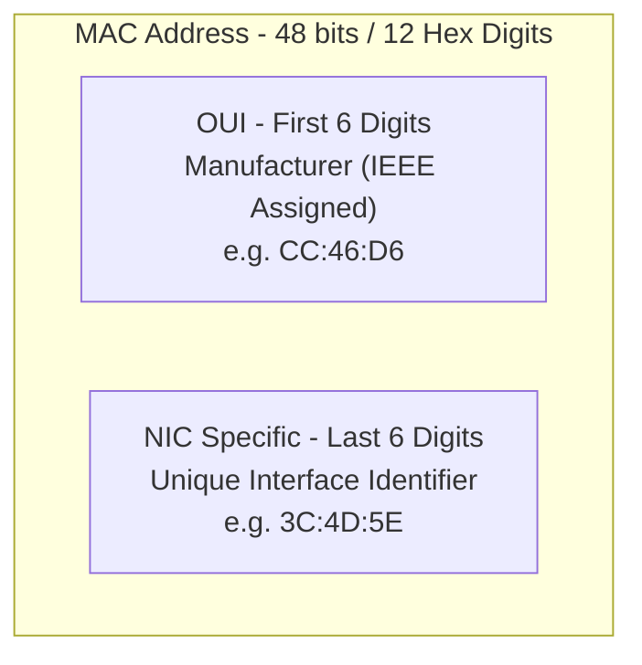
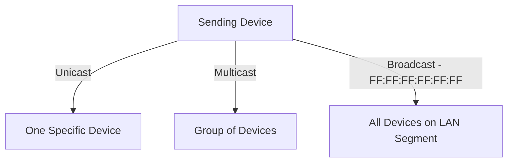
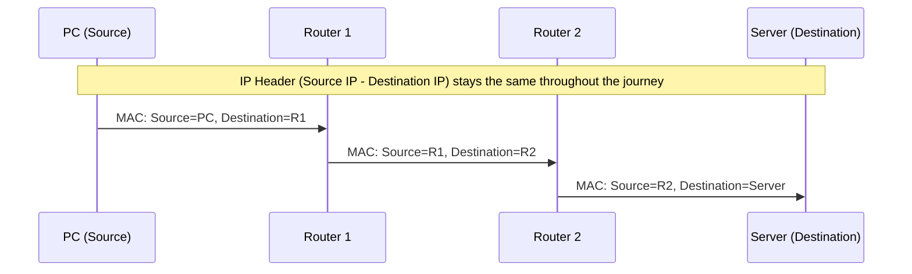

> **Goal of this section:**
>  You'll understand what a MAC Address is and how it differs from an IP Address, how data travels from Router to Router with the MAC Header changing at every Hop, and how a SOC Analyst uses the MAC Address in investigations and in detecting unknown devices on the network.


## Table of Contents

- [Overview](#overview)
- [MAC Address Format](#mac-address-format)
- [Examples of OUI](#examples-of-oui)
- [Types of MAC Addresses](#types-of-mac-addresses)
- [MAC vs IP Addresses](#mac-vs-ip-addresses)
- [Importance of Unique MAC Addresses](#importance-of-unique-mac-addresses)
- [Finding Your MAC Address](#finding-your-mac-address)
- [SOC Analyst Perspective](#soc-analyst-perspective)
- [Summary](#summary)

---

## Overview

A **MAC Address** is a Unique Physical Address assigned to the network card (**Network Interface Card - NIC**) at the time of manufacture. It operates at the **Data Link Layer (Layer 2)** of the OSI Model, and it ensures that every device on the network has a Unique Identification within the same network.

MAC Addresses are essential for delivering data from point to point inside the network (**Hop-to-Hop Data Delivery**), and they work alongside IP Addresses, which are responsible for delivery from start to finish across different networks (**End-to-End Delivery**).

> [!NOTE]
> Think of the MAC Address as the device's "national ID number" - fixed and assigned at the time of manufacture (in principle), unlike the IP Address, which changes depending on the network the device is connected to, much like a "home address" that can change.

---

## MAC Address Format

- **48-bit hardware number** (12 hexadecimal digits)
- Commonly represented in **Colon-Hexadecimal notation**: `00:1A:2B:3C:4D:5E`
- First 6 digits **(OUI)**: Identify the manufacturer (assigned by IEEE)
- Last 6 digits: Identify the specific network interface card (NIC)



> [!NOTE]
> Linux uses **Colon Notation** (such as `00:1A:2B:3C:4D:5E`), while Cisco devices may use **Period-Separated Notation** (such as `001A.2B3C.4D5E`).

---

## Examples of OUI

| OUI | Manufacturer |
|---|---|
| CC:46:D6 | Cisco |
| 3C:5A:B4 | Google |
| 3C:D9:2B | Hewlett Packard |
| 00:9A:CD | Huawei Technologies |

> [!TIP]
> Knowing the OUI is very useful for quickly identifying the type of device without needing to actually log in to it, and it's used a lot in Asset Discovery and Network Inventory work.

---

## Types of MAC Addresses

### 1. Unicast

- Sent to a single specific device
- Source devices always use unicast

### 2. Multicast

- Sent to a group of devices
- LSB of the first octet = 1

### 3. Broadcast

- Sent to all devices on the LAN segment
- MAC address: `FF:FF:FF:FF:FF:FF`



> [!WARNING]
> If Broadcast Traffic increases abnormally on the network, it may be an indicator of a problem (such as a Broadcast Storm) or even an attack attempt that exploits Broadcast to gather information about the devices on the network (such as some Network Discovery/Reconnaissance techniques).

---

## MAC vs IP Addresses

- **MAC Address (Layer 2)**: Hop-to-hop delivery within the network
- **IP Address (Layer 3)**: End-to-end delivery across networks

### Example

1. Data is wrapped in an **IP header** (source and destination IP)
2. Then wrapped in a **MAC header** (source and destination MAC for the next hop)
3. As data moves through routers, **MAC headers are updated for each hop**, **IP header remains until final destination**



> [!IMPORTANT]
> This is one of the most important concepts in understanding networks: the **IP Header stays the same throughout the journey** (until it reaches the final Destination), but the **MAC Header changes at every Hop** because it only describes the "next neighbor" (Next Hop) on the journey, not the final destination.

---

## Importance of Unique MAC Addresses

- Ensures no confusion between devices in the same LAN
- Guarantees accurate delivery of data to the intended device
- Acts as a unique identifier similar to a personal name in a network

---

## Finding Your MAC Address

### Windows

1. Open Command Prompt
2. Type:

```shell
ipconfig /all
```

3. Look for **Physical Address** under your network adapter

---

## SOC Analyst Perspective

> [!IMPORTANT]
> The MAC Address is used primarily in security investigations to identify devices on the network, but you need to keep in mind that it isn't always a 100% reliable source, because it can be spoofed.

### MAC Address Spoofing

An attacker can change their device's MAC Address (at the Software level) in order to:

- Bypass Access Control mechanisms that rely on the MAC (such as MAC Filtering on Wi-Fi)
- Impersonate a trusted device on the network (such as spoofing the Gateway's MAC in an ARP Spoofing attack)
- Hide their real identity during any unauthorized activity

> [!WARNING]
> **MAC Filtering alone isn't enough as a layer of protection**, because any attacker with basic knowledge can easily change their MAC Address (Spoofing), so other layers of protection such as 802.1X Authentication must be added.

### Uses of the MAC Address in Investigations

| Use Case | Description |
|---|---|
| Asset Identification | Using the OUI to quickly identify the type/vendor of a device while building a Network Inventory |
| Rogue Device Detection | Detecting new or unknown devices connected to the network by comparing MAC Addresses against a Known Assets List |
| DHCP Logs Correlation | Linking the MAC Address to the IP Address assigned to it by the DHCP Server at a specific time, which is very useful for tracking a specific device's activity over time |
| Detecting MAC Spoofing | Monitoring any sudden change in the MAC Address associated with the same device or the same Switch Port |

From the MITRE ATT&CK perspective:
- **T1200 - Hardware Additions**: unauthorized devices may be connected to the network, and monitoring new MAC Addresses is the first step in detecting them
- **T1557 - Adversary-in-the-Middle**: some MITM techniques (such as ARP Spoofing) rely on impersonating or spoofing the MAC Address

> [!TIP]
> When you investigate an Incident, don't rely on the MAC Address alone as conclusive proof of a device's identity - you need to correlate it with other sources such as DHCP Logs, the Switch Port, and IP History to build a complete, reliable picture.

---

## Summary

- The **MAC Address** is a unique physical address assigned to the NIC at the time of manufacture, and it operates at **Layer 2**
- It consists of **48 bits** divided into the **OUI** (the first 6 digits - the manufacturer) and the **NIC Identifier** (the last 6 digits)
- 3 types: **Unicast** (to a single device), **Multicast** (to a group), **Broadcast** (`FF:FF:FF:FF:FF:FF` to all devices on the same LAN)
- The key difference between MAC and IP: the MAC changes at every **Hop** (Hop-to-Hop), while the IP stays the same throughout the journey (End-to-End)
- From the SOC's perspective: the MAC Address is an essential tool in **Asset Identification** and **Rogue Device Detection**, but it's vulnerable to **Spoofing**, so it must always be correlated with other verification sources such as DHCP Logs and Switch Port Mapping (related to MITRE T1200 and T1557)
