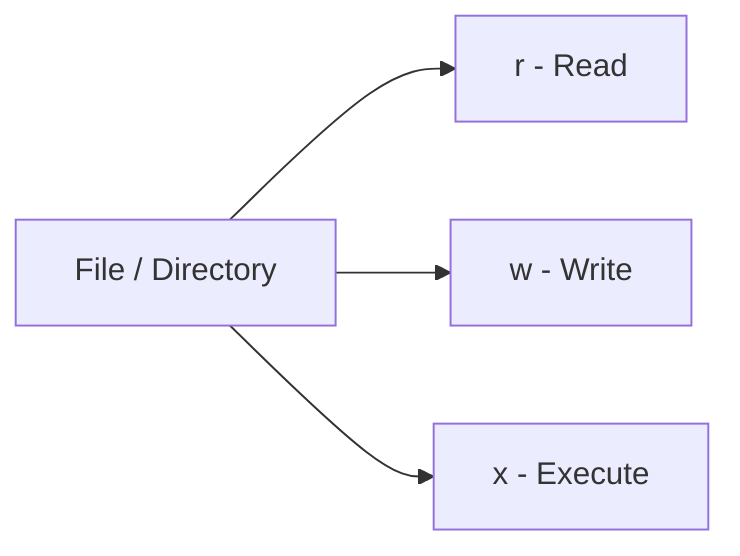
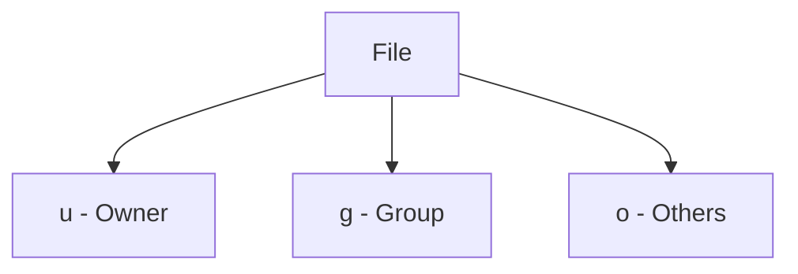
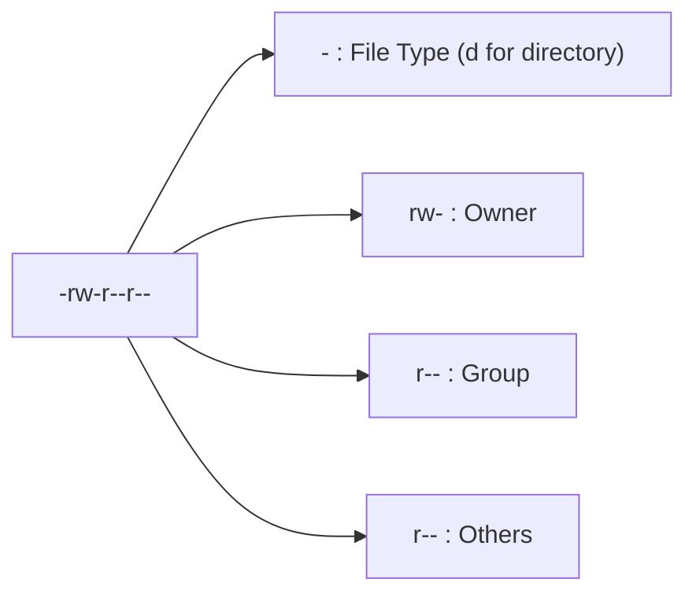
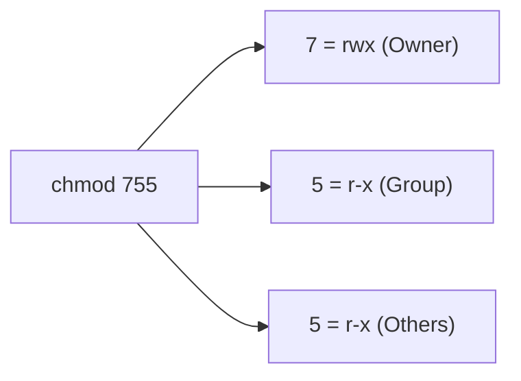
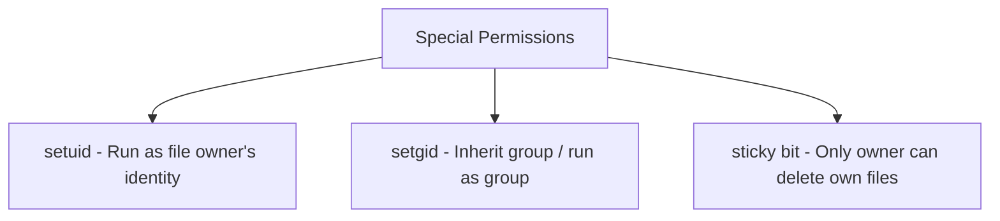

> **Goal of this section:**
>  You'll fully understand the Linux permissions system - Read/Write/Execute, Ownership, and how to use `chmod` with Symbolic and Octal Notation - and you'll get to know its most dangerous part from a security standpoint: Special Permissions such as `setuid`, which can turn into a backdoor if misconfigured.

## Table of Contents

- [Overview](#overview)
- [1. Basic Permissions](#1-basic-permissions)
- [2. Ownership & Permission Groups](#2-ownership--permission-groups)
- [3. Permission Operators](#3-permission-operators)
- [4. Checking File Permissions](#4-checking-file-permissions)
- [5. Changing Permissions with chmod](#5-changing-permissions-with-chmod)
- [6. Special Permissions](#6-special-permissions)
- [7. Changing Ownership](#7-changing-ownership)
- [8. Quick Summary](#8-quick-summary)
- [SOC Analyst Perspective](#soc-analyst-perspective)
- [Summary](#summary)

---

## Overview

**Linux File Permissions** are the foundation of the entire system's security. They determine who can read, write, or execute files and directories, which ensures that only authorized users or processes can access sensitive data. These permissions are modified using the `chmod` command.



---

## 1. Basic Permissions

Every file or directory has 3 types of permissions:

| Permission | Meaning |
|---|---|
| `r` | Read – View file contents or list directory contents |
| `w` | Write – Modify the file or add/delete files in a directory |
| `x` | Execute – Run a file as a program or enter a directory |

> [!NOTE]
> The `x` permission on a **file** means running it as a program, but the same permission on a **directory** means something completely different - that you can enter (`cd`) that directory at all. Without `x` on a directory, you can see its name but you can't enter it.

---

## 2. Ownership & Permission Groups

Permissions are set for 3 categories of users:

| Symbol | Category | Description |
|---|---|---|
| `u` | User | The owner of the file |
| `g` | Group | Users who are members of the file's group |
| `o` | Others | All other users on the system |
| `a` | All | User, Group, and Others |



---

## 3. Permission Operators

| Operator | Function |
|---|---|
| `+` | Add permission |
| `-` | Remove permission |
| `=` | Set permission exactly |

> [!TIP]
> The difference between `+`/`-` and `=`: the first two add or remove a permission **without affecting** the other existing permissions, while `=` sets the permissions **exactly** and removes any other permission that was there before.

---

## 4. Checking File Permissions

### 4.1 Using `ls -l`

```bash
ls -l filename
```

**Example output**:

```
-rw-r--r-- 1 user group 46 Apr 14 16:37 NarX.txt
```

| Segment | Meaning |
|---|---|
| `-` | file type (`d` = directory) |
| `rw-` | owner permissions |
| `r--` | group permissions |
| `r--` | others permissions |



### 4.2 Using `stat`

```bash
stat filename
```

It shows the file size, modification time, access time, and other details.

### 4.3 Using `namei`

```bash
namei -l /path/to/file
```

It shows you the permissions of every directory along the file's path.

> [!TIP]
> `namei -l` is a very valuable tool when you're trying to figure out "why can't the user access this file," because it shows you the permissions of **every directory** along the full path, not just the final file. Sometimes the problem is in an intermediate directory, not in the file itself.

---

## 5. Changing Permissions with chmod

### 5.1 Symbolic Notation

**Add execute permission for others**:

```bash
chmod o+x xyz.txt
```

**Remove all permissions for everyone**:

```bash
chmod ugo-rwx xyz.txt
```

**Add read/write to owner and group, remove execute for others**:

```bash
chmod ug+rw,o-x abc.mp4
```

**Add read/execute to owner/group, read for others**:

```bash
chmod ug=rx,o+r abc.c
```

### 5.2 Octal Notation

Permissions can be represented numerically:

```
r = 4, w = 2, x = 1
```

3 digits: Owner, Group, Others.

**Example**:

```bash
chmod 755 file.txt
```

| Digit | Calculation | Result |
|---|---|---|
| 7 | 4+2+1 | rwx (Owner) |
| 5 | 4+0+1 | r-x (Group) |
| 5 | 4+0+1 | r-x (Others) |



> [!IMPORTANT]
> Memorize this table - you'll use it constantly when analyzing any numeric permission:

| Value | Permission |
|---|---|
| 0 | --- (no permissions) |
| 1 | --x |
| 2 | -w- |
| 3 | -wx |
| 4 | r-- |
| 5 | r-x |
| 6 | rw- |
| 7 | rwx |

---

## 6. Special Permissions

### 1. `setuid` → Run file with owner's privileges

```bash
chmod u+s program
```

### 2. `setgid` → Run file or inherit group of directory

```bash
chmod g+s directoryname
```

### 3. `sticky bit` → Only owner can delete/rename files in directory

```bash
chmod +t directoryname
```



> [!WARNING]
> These **Special Permissions** are among the most powerful and dangerous permission concepts in Linux. `setuid` in particular lets any regular user run a program **with the privileges of the file's original owner** (usually root), and it is the basis of a very large number of well-known **Privilege Escalation** techniques in Linux.

---

## 7. Changing Ownership

**Change owner and group using `chown`**:

```bash
chown user:group file.txt
```

**Modify permissions with `chmod`**:

```bash
chmod 755 file.txt
```

> [!NOTE]
> `chmod` controls **permissions** (who can do what), while `chown` controls **ownership** (who the Owner and the Group are in the first place). The two are completely different and complement each other.

---

## 8. Quick Summary

- `r` → read, `w` → write, `x` → execute
- User groups: `u` = owner, `g` = group, `o` = others, `a` = all
- Permissions can be symbolic or octal
- Special permissions: `setuid`, `setgid`, `sticky bit`
- Change ownership: `chown user:group file.txt`

---

## SOC Analyst Perspective

> [!IMPORTANT]
> Misconfigured Permissions are among the most common causes of breaches in Linux environments, and checking the permissions of sensitive files is an essential part of any **Security Audit** or **Incident Response**.

### Common Threats Related to Permissions

| Threat | Description | MITRE ATT&CK Reference |
|---|---|---|
| SUID/SGID Privilege Escalation | Exploiting files that have the `setuid` bit and are owned by root to run commands with full administrative privileges from a regular account | T1548.001 - Abuse Elevation Control Mechanism: Setuid and Setgid |
| World-Writable Files/Directories | Files or directories with `777` permissions or with `w` for Others let any user modify them, which opens the door to tampering or planting malicious code | T1222.002 - File and Directory Permissions Modification: Linux and Mac |
| Weak Permissions on Sensitive Files | Files such as `/etc/shadow` or SSH keys, if their permissions aren't set correctly, can be read by users who aren't supposed to access them | T1552.004 - Unsecured Credentials: Private Keys |
| Sticky Bit Missing on Shared Directories | Shared directories (such as `/tmp`) without the Sticky Bit let any user delete or modify other users' files in them | T1222 - File and Directory Permissions Modification |

> [!WARNING]
> The best-known Privilege Escalation technique in Linux relies on searching for files that have the `setuid` bit and are owned by root. The classic command that any attacker (or security analyst performing an Assessment) uses:
> ```bash
> find / -perm -4000 -type f 2>/dev/null
> ```
> This command searches the entire system for every file with the `setuid` bit enabled. If you find an unexpected file in this list (especially if it isn't one of the standard system tools), it deserves immediate investigation.

### Detection & Best Practices

- Use `find / -perm -4000` and `find / -perm -2000` regularly to review any unexpected files with `setuid`/`setgid`
- Make sure the **Sticky Bit** is enabled on any directory shared by multiple users (such as `/tmp`)
- Review the permissions of sensitive files regularly: `/etc/shadow` should be `600` or stricter, and private SSH keys should be `600`
- Avoid using `chmod 777` entirely except in very exceptional, documented cases, because it opens the file/directory to everyone without any restrictions
- Monitor any change to the permissions of critical files using tools such as `auditd` with dedicated rules for monitoring `chmod`/`chown`

> [!TIP]
> If you notice an Executable file in a directory such as `/tmp` or `/home` that has the `setuid` bit enabled and is owned by root, that's a highly dangerous indicator of a **Privilege Escalation** attempt that is in progress or has already succeeded, and it must be investigated immediately and removed until its origin is understood.

---

## Summary

- Linux permissions consist of 3 basic types: **r (Read), w (Write), x (Execute)**, set for 3 categories: **u (Owner), g (Group), o (Others)**
- Permissions can be modified with `chmod` in two ways: **Symbolic** (such as `chmod o+x file`) or **Octal** (such as `chmod 755 file`)
- **Special Permissions** (`setuid`, `setgid`, `sticky bit`) are very powerful and require great caution, especially `setuid` because of its danger in Privilege Escalation
- `chown` changes **ownership** (Owner/Group), while `chmod` changes the **permissions** on top of that ownership
- From a SOC standpoint: the most important risks are **SUID/SGID Privilege Escalation (T1548.001)**, **World-Writable Files (T1222.002)**, and weak permissions on sensitive files (T1552.004), and the `find / -perm -4000` command is an essential tool for any security Audit on Linux
