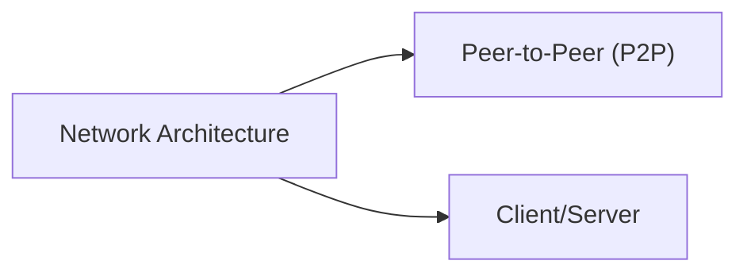
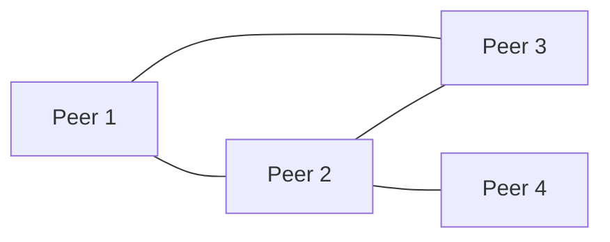
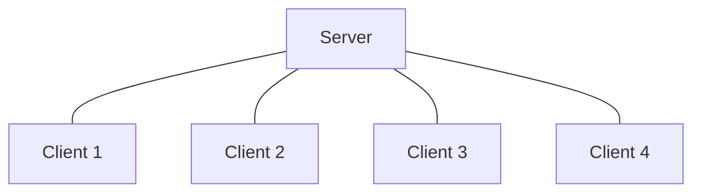
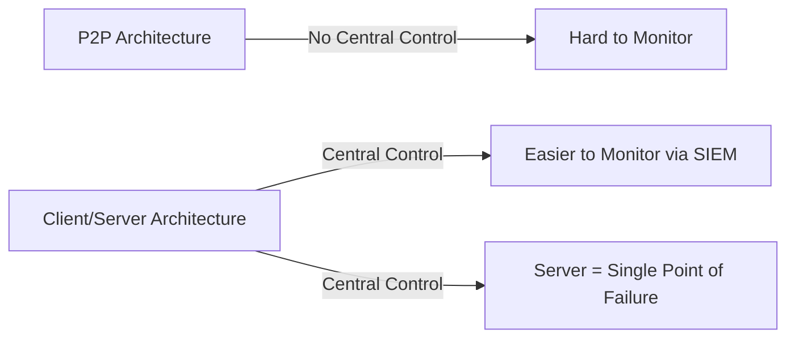

> **Goal of this section:**
> You'll understand how networks are designed in terms of Architecture, the difference between Peer-to-Peer and Client/Server, and why this choice directly affects the level of Security and Control you'll be able to enforce on the network as a SOC Analyst.

# Network Architecture Types (Peer-to-Peer vs Client/Server)

## Table of Contents

- [Introduction](#introduction)
- [Peer-to-Peer (P2P) Architecture](#peer-to-peer-p2p-architecture)
- [Client/Server Architecture](#clientserver-architecture)
- [Architecture Comparison](#architecture-comparison)
- [SOC Analyst Perspective](#soc-analyst-perspective)
- [Summary](#summary)

---

## Introduction

Networks aren't only classified by the geographic area they cover; they're also classified by the Architecture they're built on, meaning how the devices communicate with each other and who is responsible for providing the Resources and services.

There are two main types of Architecture:

> [!NOTE]
> The key difference between the two types is the presence or absence of **Centralized Control**. P2P has no central authority controlling the network, while Client/Server has a central Server that controls everything.

---

## Peer-to-Peer (P2P) Architecture

In a P2P Architecture, all the devices (Peers) are connected to each other directly without any central Server. Each device can act as both a Client and a Server at the same time, meaning it can request a service and provide one too.

Tasks and responsibilities are distributed across all the Peers, which makes this type suitable for small networks (usually up to 10 devices). Communication happens directly between the devices, whether over the internet or a local network.

### Common Use Cases

- File sharing
- Small business networks
- Educational or temporary setups

### Advantages and Disadvantages

| ✅ Advantages | ❌ Disadvantages |
|---|---|
| Low cost, as no dedicated server is required | Difficult to enforce centralized security policies |
| Simple design and easy implementation | Each peer must be managed individually |
| Easy setup and management due to built-in OS support | Performance and efficiency decrease as the network grows |

> [!WARNING]
> The absence of Centralized Control in P2P means there's no single authority that can enforce unified Security Policies on all the devices. If one device inside the network is Compromised, it's very hard to track or control the rest of the devices, because each of them is independent.

From the SOC's perspective, monitoring P2P networks is a real challenge because:
- There's no **Centralized Logging** collecting all the events in one place
- Each device needs to be monitored individually (Local Firewall, Local AV/EDR)
- P2P protocols (such as BitTorrent) can be exploited to transfer data or Malware without passing through any Central Point you can monitor

---

## Client/Server Architecture

In a Client/Server Architecture, there's a powerful central device called a **Server** that provides services, resources, and data to other devices called **Clients**. The Clients request the service, and the Server processes the request and responds to it.

The Server here is the Core of the Network, and it provides Centralized Control, stronger security, and greater Scalability. This type is widely used in medium and large networks.

### Common Use Cases

- Corporate networks
- Web applications
- Databases and enterprise systems

### Advantages and Disadvantages

| ✅ Advantages | ❌ Disadvantages |
|---|---|
| Centralized data management and updates | Server failure can disrupt client access |
| Enhanced security and access control | Higher cost for hardware and software |
| Better scalability and stability | Requires skilled administrators for management |
| Dedicated Network Operating System (NOS) support | |

> [!IMPORTANT]
> Having a central Server means the Server itself becomes a **Single Point of Failure** and also a **High-Value Target** for attackers, because if the Attacker manages to compromise the Server, they'll be able to reach all the Clients that depend on it.

From the SOC's perspective, a Client/Server Architecture is much easier to monitor because:
- All the Logs are collected centrally (Centralized Logging through a SIEM)
- It's easy to apply unified **Access Control Policies** at the Server level
- Authentication and Authorization are controlled from one place (such as an Active Directory Domain Controller)

> [!TIP]
> Always monitor Windows Event IDs **4624 / 4625** (Logon Success/Failure) on Servers, because they're the first place any Brute Force or Unauthorized Access attempt against the central Server shows up.

---

## Architecture Comparison

| Aspect | Peer-to-Peer (P2P) | Client/Server |
|---|---|---|
| Central Control | None | Centralized on the Server |
| Scalability | Poor (best for small networks) | High (suitable for large networks) |
| Security Management | Decentralized, hard to enforce | Centralized, easier to enforce |
| Cost | Low | Higher (dedicated hardware/software) |
| Single Point of Failure | No single point, but harder to secure | Yes, the Server |
| Logging & Monitoring | Distributed, difficult to aggregate | Centralized, easier for SIEM integration |
| Typical Scale | Up to ~10 devices | Medium to large organizations |

---

## SOC Analyst Perspective

> [!IMPORTANT]
> As a SOC Analyst, the first thing you need to know about any network you're analyzing is its Architecture type, because that determines how you'll collect the Logs and how you'll monitor the Traffic.

- In **P2P**: the focus is on Endpoint Security (Local EDR/AV) for each device individually, because there's no central point to collect Logs from
- In **Client/Server**: the focus is on securing the Server itself (Hardening, Patch Management, Access Control), in addition to monitoring the Client Requests within it, and integrating the Logs into a single SIEM for centralized analysis

> [!NOTE]
> Most real work environments (Enterprise Environments) rely on a Client/Server Architecture, because it provides a much higher level of Control and Visibility, which makes the SOC Team's Detection and Response work easier.

---

## Summary

- In terms of Architecture, networks are classified into two main types: **Peer-to-Peer (P2P)** and **Client/Server**
- **P2P**: all devices are equal, there's no central Server, it's suitable for small networks (up to 10 devices), but it's hard to secure centrally
- **Client/Server**: there's a central Server providing the services, which gives Centralized Control and better Security, but the Server itself becomes a Single Point of Failure and a primary target for attackers
- From the SOC's perspective: P2P requires a focus on Endpoint Security for each device, while Client/Server requires a focus on securing and monitoring the central Server through a SIEM
- Most Enterprise environments use Client/Server because it provides much greater Visibility and Control

