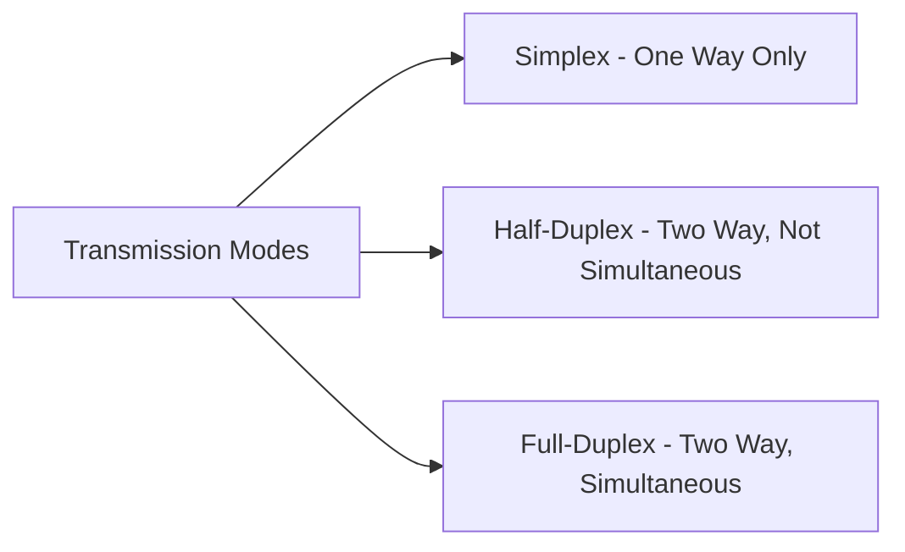
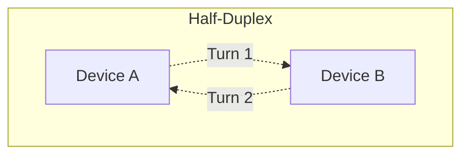
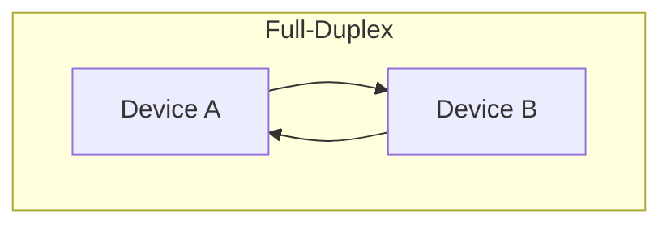
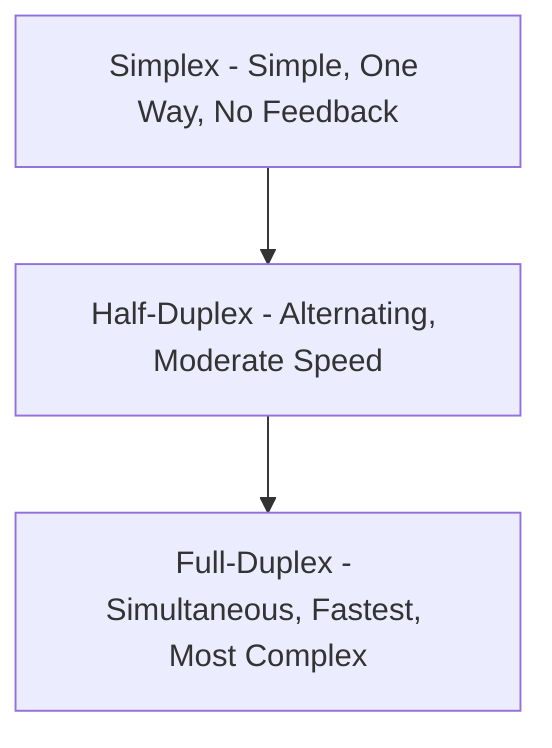

> **Goal of this section:**
>  You will understand in detail the difference between the Simplex, Half-Duplex, and Full-Duplex modes, with practical examples of each and the advantages and disadvantages of each type, and you will be able to connect this to the security context when analyzing any communication medium on the network.

## Table of Contents

- [Overview](#overview)
- [Types of Transmission Modes](#types-of-transmission-modes)
- [1. Simplex Mode](#1-simplex-mode)
- [2. Half-Duplex Mode](#2-half-duplex-mode)
- [3. Full-Duplex Mode](#3-full-duplex-mode)
- [Comparison Summary](#comparison-summary)
- [SOC Analyst Perspective](#soc-analyst-perspective)
- [Summary](#summary)

---

## Overview

**Transmission Modes** (also called **Communication Modes**) describe how data flows between devices in a network or communication system. They define the direction of data transfer and whether devices can send and receive data at the same time or not.

These concepts are fundamental to network and communications design.

---

## Types of Transmission Modes

There are 3 main types of Transmission Modes:

- Simplex Mode
- Half-Duplex Mode
- Full-Duplex Mode

---

## 1. Simplex Mode

In Simplex Mode, communication happens in one direction only. One device acts only as the **Sender**, and the other acts only as the **Receiver**.

### Key Characteristics

- Data flows in a single direction
- Full channel capacity is used for transmission
- No feedback or acknowledgment

### Examples

- Keyboard → Computer
- Television broadcast
- Surveillance cameras

### Advantages

- Simple and cost-effective
- No coordination required between devices

### Disadvantages

- No error detection or confirmation
- Not suitable for interactive communication

> [!NOTE]
> The absence of any feedback in Simplex Mode means the sending device has no way to confirm that the data actually reached the receiver correctly.

---

## 2. Half-Duplex Mode

In Half-Duplex Mode, devices can send and receive data, but not at the same time. Communication happens alternately in each direction.

### Key Characteristics

- Bidirectional communication
- One direction active at a time
- Entire channel capacity is used per transmission

### Example

- Walkie-Talkie communication

### Advantages

- Better utilization than simplex
- Suitable where simultaneous communication is not required

### Disadvantages

- Delay due to turn-taking
- Slower than full-duplex systems

> [!TIP]
> Think of a walkie-talkie: you have to say "Over" and release the button so the other side can reply. If both talk at the same time, the message is lost or garbled. That is exactly the logic of Half-Duplex.

---

## 3. Full-Duplex Mode

In Full-Duplex Mode, devices can send and receive data at exactly the same time. This type is used when continuous two-way communication is required.

### Key Characteristics

- Simultaneous bidirectional communication
- Channel capacity is shared or duplicated

### Examples

- Telephone calls
- Video conferencing
- Modern network communications

### Advantages

- High efficiency and speed
- Ideal for real-time applications

### Disadvantages

- Higher cost
- More complex implementation
- Requires higher bandwidth

> [!IMPORTANT]
> Most modern Ethernet networks (such as Modern Switches) operate in **Full-Duplex**, which allows data to be sent and received at the same time without any collisions, unlike older networks that relied on hubs and were often Half-Duplex.

---

## Comparison Summary

| Aspect | Simplex | Half-Duplex | Full-Duplex |
|---|---|---|---|
| Direction | One-way only | Two-way, one at a time | Two-way, simultaneous |
| Feedback/Acknowledgment | None | Possible (alternating) | Continuous |
| Speed | N/A (one direction) | Slower due to turn-taking | Fastest |
| Complexity | Simple | Moderate | Complex |
| Cost | Low | Moderate | Higher |
| Real-World Example | TV Broadcast | Walkie-Talkie | Phone Call |

---

## SOC Analyst Perspective

> [!NOTE]
> The Transmission Mode isn't a concept that is attacked directly like a specific protocol, but understanding it is very important when analyzing network architecture and Traffic Patterns, and it has indirect security implications.

### Security Implications

| Aspect | Security Relevance |
|---|---|
| Simplex Devices (Sensors, Cameras) | IoT devices and surveillance systems that operate in Simplex usually have no channel to verify data integrity, which makes them an easy target for manipulation (Data Injection/Spoofing) if they aren't properly secured at another level |
| Legacy Half-Duplex Networks (Hub-based) | Older networks that rely on hubs (Half-Duplex by nature) let any connected device see all the traffic, which makes Sniffing easier compared to modern switches (Full-Duplex) |
| Full-Duplex Modern Networks | They reduce the chance of opportunistic Sniffing, but require techniques such as Port Mirroring or TAPs so the SOC can legitimately monitor the traffic for analysis |

> [!WARNING]
> If you find a device or segment on the network still running in **Half-Duplex** or relying on an **old hub**, it deserves a review, because it represents a real weakness in terms of Sniffing potential and the ease of intercepting traffic compared to modern infrastructure.

> [!TIP]
> When you deploy a monitoring tool (such as an IDS Sensor) on the network, you must make sure it is connected through **Port Mirroring (SPAN Port)** or a **Network TAP**, because in a modern Full-Duplex environment the switch won't send all the traffic to every port like the old hub did, so without them you won't be able to see all the traffic you need to analyze.

---

## Summary

- **Transmission Modes** define the direction of data flow between devices, and there are 3 types: **Simplex, Half-Duplex, Full-Duplex**
- **Simplex**: One direction only, simple and cheap, but without feedback (such as Keyboard, TV Broadcast)
- **Half-Duplex**: Two directions, but alternating rather than at the same time (such as Walkie-Talkie)
- **Full-Duplex**: Two directions at the same time, the fastest and most efficient but the most complex and expensive (such as phone calls, Video Conferencing, and today's networks)
- From the SOC's perspective: older devices and networks that operate in Half-Duplex or rely on hubs pose a higher security risk because Sniffing is easy, while monitoring modern Full-Duplex networks requires tools such as Port Mirroring or Network TAPs

