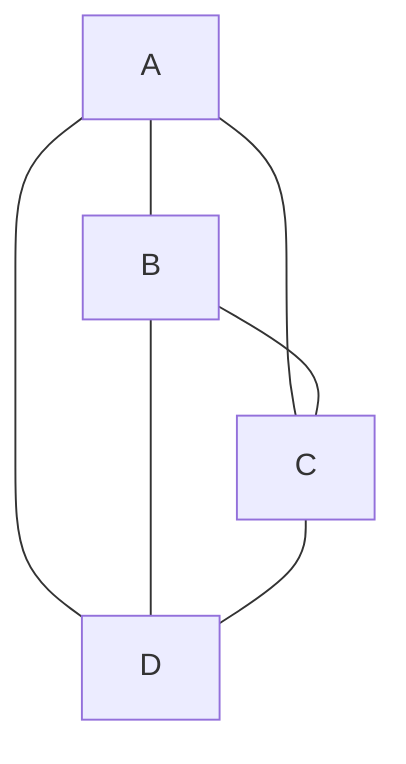
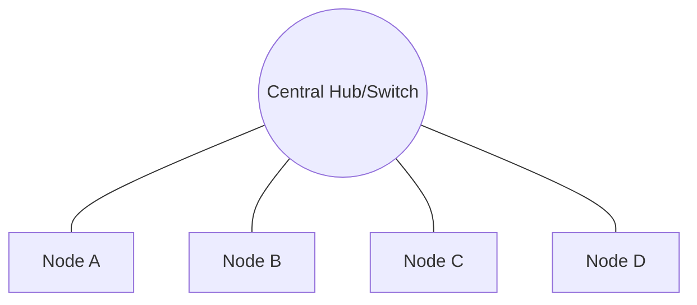
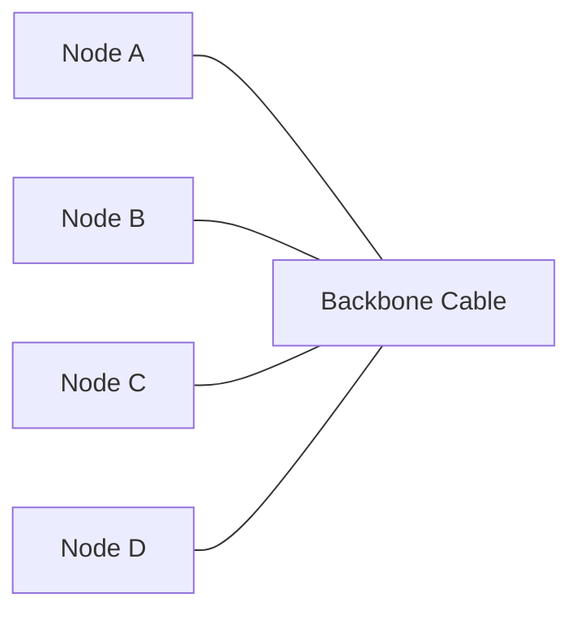
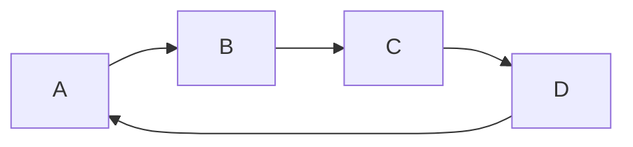
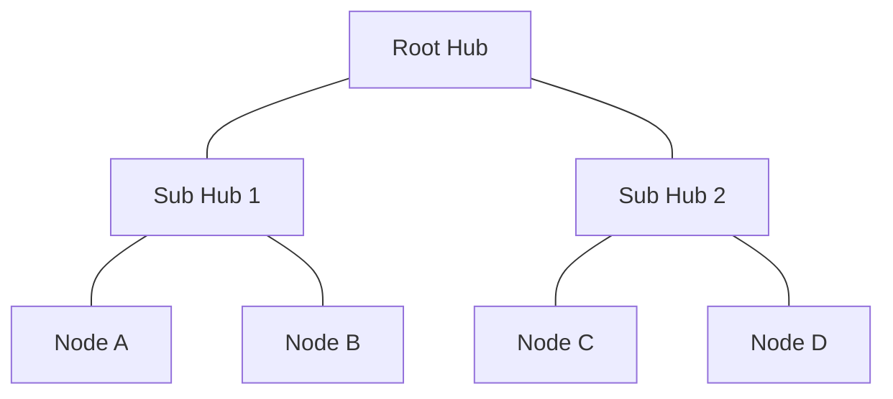
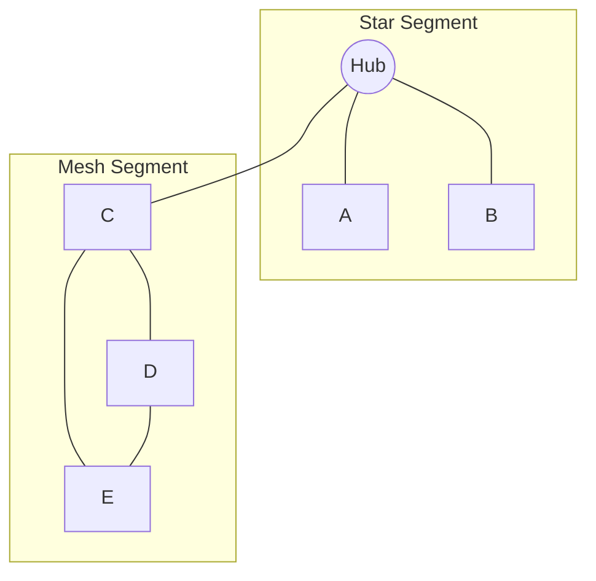

> **The goal of this section:**  
> You'll understand how Devices connect to each other inside any Network, which different Topologies you might see in any environment, and the advantages and disadvantages of each one — and that's very important for a SOC Analyst, so that when you see a Network Diagram you can understand how the Traffic flows and where a weakness or Single Point of Failure might exist that an Attacker could exploit.

## Table of Contents

- [Introduction](#introduction)
- [Physical vs Logical Topology](#physical-vs-logical-topology)
- [Key Terms](#key-terms)
- [Common Network Topologies](#common-network-topologies)
  - [Mesh Topology](#1-mesh-topology)
  - [Star Topology](#2-star-topology)
  - [Bus Topology](#3-bus-topology)
  - [Ring Topology](#4-ring-topology)
  - [Tree Topology](#5-tree-topology)
  - [Hybrid Topology](#6-hybrid-topology)
- [Comparison Table](#comparison-table)
- [Memory Tip](#memory-tip)
- [SOC Analyst Perspective](#soc-analyst-perspective)
- [Summary](#summary)

---

## Introduction

**Network Topology** is simply the way the Devices (Nodes) are arranged inside a network, and how Data moves between them. Think of it like a city map: the streets can be laid out in a certain way (a grid, a circle, a straight line...), and that determines how the cars (Data) will move from one place to another.

Understanding Topology isn't just a theoretical topic — if you're a SOC Analyst looking at a Network Diagram, you need to be able to identify:
- Where could a **Bottleneck** occur?
- If a single device goes down, will the whole network stop or not?
- Where is the best place to put an **IDS/IPS** or a **Network Sensor** to monitor the Traffic?

> [!NOTE]
> Understanding Topology helps you identify the **Attack Surface** and put Monitoring Tools in the right places.

---

## Physical vs Logical Topology

Network Topology is divided into two main types:

| Type | Definition |
|---|---|
| **Physical Topology** | The actual, real-world layout of the devices and cables |
| **Logical Topology** | The way Data actually moves, regardless of the physical layout |

> [!IMPORTANT]
> The Physical Topology can be a **Star** (all devices connected to a single Switch), while the Logical Topology is a **Bus** or **Ring**, depending on how Data actually moves inside the network. This difference is very important to understand so you don't get confused when you're analyzing any environment.

---

## Key Terms

| Term | Definition |
|---|---|
| **Node** | Any device inside the network (Computer, Server, Router, Switch...) |
| **Link** | The connection between one Node and another, whether Wired or Wireless |
| **Topology** | The arrangement of the Nodes and Links together inside the network |

---

## Common Network Topologies

### 1. Mesh Topology

In a **Mesh Topology**, every Node is connected directly to every other Node in the network.

There are two types:
- **Full Mesh**: all devices are connected directly to each other.
- **Partial Mesh**: only some of the devices are connected to each other.

**Advantages:**
- Excellent Fault Isolation — if one Link goes down, the rest won't be affected
- High Security, because Data is sent directly between the endpoints
- Reliable Data Transmission

**Disadvantages:**
- Very Expensive, because you need a large number of cables and Ports
- Maintenance becomes complex as the number of devices grows

> [!TIP]
> Mesh Topology is mostly used in **Backbone Networks** or **Critical Infrastructure** that needs the highest degree of Redundancy.

---

### 2. Star Topology

All devices connect to a single central device, the **Hub** or the **Switch**.

**Advantages:**
- Easy Setup
- If one device goes down, the rest keep working normally
- Easy Troubleshooting

**Disadvantages:**
- Complete dependence on the Central Hub — if it goes down, the whole network stops
- More Cabling Required

> [!WARNING]
> The Central Hub/Switch here is the **Single Point of Failure**. From a SOC perspective, it's the most important device to monitor and secure, because if it's hit, the whole network is affected.

---

### 3. Bus Topology

All devices share **a single Cable** called the Backbone.

**Advantages:**
- Low Cost
- Simple Cabling

**Disadvantages:**
- If the main Cable is cut, the whole network stops
- Limited Security — any device on the same Bus can see the Traffic

> [!WARNING]
> Because of the nature of the Shared Medium, Bus Topology is highly vulnerable to **Sniffing** attacks, since any device on the same line can capture Packets that aren't addressed to it.

---

### 4. Ring Topology

Devices are connected in a **Closed Loop**, and Data travels sequentially from one device to the next, usually using a technique called **Token Passing**.

**Advantages:**
- High-Speed Transmission
- Minimal Collisions in the Data

**Disadvantages:**
- If one device goes down, the whole network may be affected (depending on the type of Ring)
- Troubleshooting is hard because you have to trace the whole loop

---

### 5. Tree Topology

A Hierarchical structure that combines the advantages of **Star** and **Bus**.

**Advantages:**
- High Security
- Scalable
- Easy Error Detection

**Disadvantages:**
- If the Central/Root Hub goes down, all the branches beneath it are affected
- High cabling cost

---

### 6. Hybrid Topology

A mix of two or more of the previous Topologies to achieve the best possible performance for the network's needs.

**Advantages:**
- Flexible
- Robust
- Performance optimized to the needs of each part of the network

**Disadvantages:**
- Complex Design
- High infrastructure cost

> [!NOTE]
> Most large networks and Enterprise Networks in practice are **Hybrid**, because they combine more than one type depending on each department's needs (for example, the Data Center is a Mesh, while the offices are a Star).

---

## Comparison Table

| Topology | Cost | Fault Tolerance | Security | Scalability | Common Use |
|---|---|---|---|---|---|
| **Mesh** | High | Very High | High | Low | Critical/Backbone Networks |
| **Star** | Medium | Medium (depends on Hub) | Medium | High | Most LANs today |
| **Bus** | Low | Low | Low | Low | Legacy/Small Networks |
| **Ring** | Medium | Low-Medium | Medium | Medium | Legacy Token Ring Networks |
| **Tree** | High | Medium | High | High | Large Enterprise Networks |
| **Hybrid** | Very High | High | High | High | Enterprise/Complex Environments |

---

## Memory Tip

- **Mesh** → Full connections (everything connected to everything)
- **Star** → Central hub (everything passes through a central point)
- **Bus** → Single backbone cable (one line for everyone)
- **Ring** → Circular loop (a closed loop)
- **Tree** → Hierarchy (hierarchical)
- **Hybrid** → Combination of types (a mix of types)

---

## SOC Analyst Perspective

From a SOC Analyst's point of view, understanding Topology isn't just theory — it's essential for:

| Activity | Why It Matters |
|---|---|
| **Placement of Sensors** | Determining the best place for an IDS/IPS or Network TAP so you can monitor all the Traffic |
| **Identifying Single Points of Failure** | Knowing which device, if it goes down, could affect the whole network or become an attractive target for the Attacker |
| **Traffic Flow Analysis** | Understanding how Data is supposed to move, so you can detect any **Anomaly** or abnormal movement |
| **Incident Containment** | When an Incident happens, knowing how to isolate the affected part of the network quickly without shutting everything down |

> [!IMPORTANT]
> Any good SOC Analyst must be able to read their work environment's Network Diagram and immediately identify: where the weak points are, where Monitoring needs to be, and how Traffic is supposed to move under normal conditions.

---

## Summary

- **Network Topology** describes how the devices (Nodes) are connected to each other and how Data (Traffic) moves within it.
- It's divided into **Physical Topology** (the actual layout) and **Logical Topology** (how Data travels).
- The main types: **Mesh, Star, Bus, Ring, Tree, Hybrid** — each one has different Advantages and Disadvantages.
- **Star Topology** is the most widespread in modern networks, while **Mesh** is used for Critical/Backbone Networks.
- **Hybrid Topology** is the closest to reality in most Enterprise Environments.
- From a SOC perspective: understanding Topology helps you identify Monitoring locations, detect Single Points of Failure, and understand normal Traffic so you can spot any Anomaly quickly.

