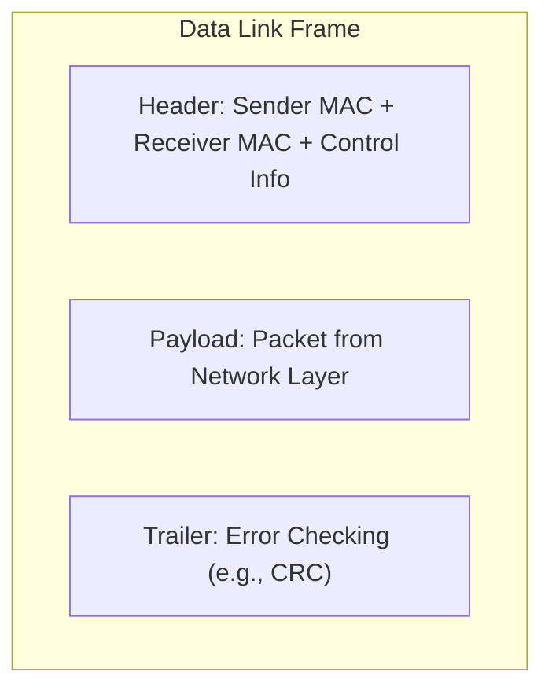
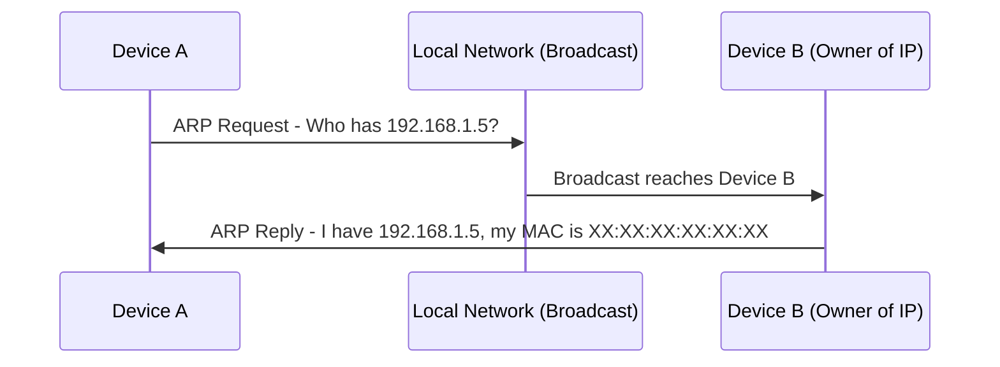
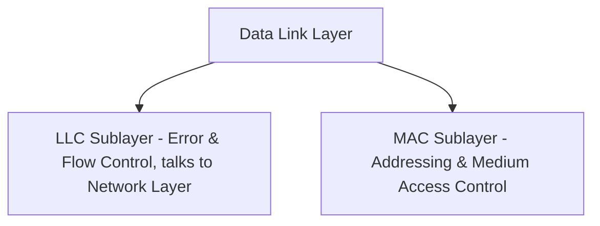
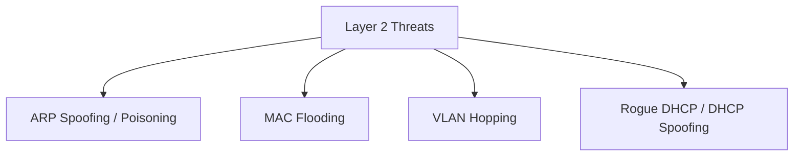

> **Goal of this section:**
> You'll understand how the Data Link Layer turns raw bits into organized frames and how MAC addresses and the ARP protocol work, and you'll be able to connect this layer to the most common local network attacks, such as ARP Spoofing and MAC Flooding, which you'll run into often as a SOC Analyst.

## Table of Contents

- [Overview](#overview)
- [Frame Structure](#frame-structure)
- [MAC Address and ARP](#mac-address-and-arp)
- [Sublayers](#sublayers)
- [Key Functions](#key-functions)
- [Common Data Link Layer Devices](#common-data-link-layer-devices)
- [SOC Analyst Perspective](#soc-analyst-perspective)
- [Summary](#summary)

---

## Overview

The **Data Link Layer** is the second layer of the OSI Model. Its main responsibility is to ensure error-free node-to-node delivery of data over the Physical Layer. It takes the raw bits from the Physical Layer, organizes them into structured **Frames**, and manages addressing, flow, and access control.

This layer is the link between the Physical Layer and the Network Layer, and it ensures reliable transmission within the same network.

---

## Frame Structure

The data coming from the Network Layer (which is in the form of a **Packet**) is encapsulated inside a **Frame**.

Each frame contains:

- Sender MAC Address
- Receiver MAC Address
- Control information

> [!NOTE]
> Frames ensure that data is correctly identified and delivered to the intended device, because each frame clearly contains the sender's address and the receiver's address.

---

## MAC Address and ARP

The Data Link Layer uses **MAC Addresses** to identify devices on the same network.

If a device knows another device's IP but not its MAC, it uses the **ARP (Address Resolution Protocol)**:

- The device sends a question: "Who has this IP?"
- The device that owns that IP replies with its MAC address

> [!WARNING]
> The ARP protocol **has no authentication mechanism at all**, meaning any device on the network can send a fake ARP reply and claim to own a particular IP. This weakness is the basis of the **ARP Spoofing / ARP Poisoning** attack.

---

## Sublayers

The Data Link Layer is divided into two sublayers:

### 1. Logical Link Control (LLC)

- Provides error control and flow control
- Interfaces with the Network Layer

### 2. Media Access Control (MAC)

- Handles MAC addresses
- Controls access to the shared medium
- Prevents data collisions

---

## Key Functions

### 1. Framing

- Converts packets into frames with defined start and end points
- Ensures the receiver can recognize complete frames

### 2. Physical Addressing

- Adds sender and receiver MAC addresses to each frame header

### 3. Error Control

- Detects damaged or lost frames
- Retransmits frames if errors are detected

### 4. Flow Control

- Maintains consistent data rate between sender and receiver
- Prevents data overflow and corruption

### 5. Access Control

- Coordinates which device can use the shared medium at any time
- Managed by the MAC sublayer

> [!TIP]
> Think of access control like a traffic light at an intersection: it controls who goes when, to prevent a "collision" between data trying to use the same medium at the same time.

---

## Common Data Link Layer Devices

- **Switch** – forwards frames only to the destination device
- **Bridge** – connects two LAN segments, filtering traffic based on MAC addresses

> [!NOTE]
> These devices were explained in detail earlier in the Network Devices lesson; here we're reviewing them again as part of our complete understanding of the Data Link Layer.

---

## SOC Analyst Perspective

| Threat | Description | Detection Approach |
|---|---|---|
| ARP Spoofing / Poisoning | An attacker sends fake ARP replies to trick devices into believing their MAC belongs to the gateway or another device (MITM Attack) | Monitor ARP tables for any unusual changes, and use tools such as Dynamic ARP Inspection (DAI) |
| MAC Flooding | Flooding the switch with a huge number of fake MAC addresses so it fails and falls back to behaving like a hub (fail-open), which allows sniffing | Monitor the number of MAC addresses on each port, and enable Port Security on switches |
| VLAN Hopping | Trying to reach another, unauthorized VLAN by exploiting trunking settings | Review trunk port settings, and disable auto-trunking negotiation |
| Rogue DHCP / DHCP Spoofing | An unauthorized device hands out fake IP settings on the network (often tied to combined Layer 2/3 attacks) | Use DHCP Snooping on switches |

> [!IMPORTANT]
> **ARP Spoofing** is one of the most common attacks at the Data Link Layer, and it is often used as the first step in carrying out a **Man-in-the-Middle (MITM) Attack**, where the attacker can intercept the traffic between two devices before it reaches its real destination.

From a MITRE ATT&CK standpoint:
- **T1557 - Adversary-in-the-Middle**: covers techniques such as ARP spoofing and DNS spoofing that the attacker uses to place themselves between the two parties of a connection

> [!TIP]
> As a core detection tool at Layer 2, use **Wireshark** or **Arpwatch** to monitor any sudden change in the MAC-to-IP mapping, because that is the strongest indicator of an ARP spoofing attack in progress on the network.

---

## Summary

- The **Data Link Layer** is responsible for delivering data between devices on the same network without errors, by organizing bits into **Frames**
- Each frame contains the sender MAC, the receiver MAC, and control information
- The **ARP** protocol maps IP addresses to MAC addresses, but it has no authentication, which makes it open to exploitation
- The layer is divided into **LLC** (Error & Flow Control) and **MAC** (Addressing & Medium Access)
- The core functions: **Framing, Physical Addressing, Error Control, Flow Control, Access Control**
- The related devices: **Switch** and **Bridge**
- From a SOC standpoint: the most common attacks on this layer are **ARP Spoofing, MAC Flooding, VLAN Hopping**, most of which map to MITRE **T1557 - Adversary-in-the-Middle**, and tools such as Wireshark and Dynamic ARP Inspection help detect them
