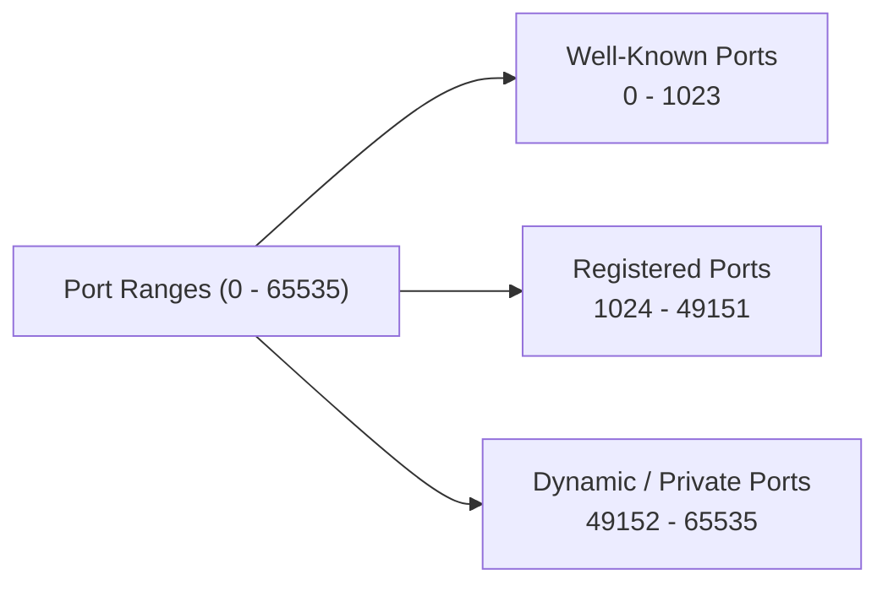

> **The goal of this section:**  
> You'll understand exactly what a Port is and why it's needed alongside the IP Address, get to know the three types of Ports (Well-Known, Registered, Dynamic), and memorize the most important Common Ports that every SOC Analyst must know by heart.

# Ports in Networking

## Table of Contents

- [Overview](#overview)
- [What is a Port?](#what-is-a-port)
- [Types of Ports](#types-of-ports)
- [Importance of Ports](#importance-of-ports)
- [Common Port Numbers](#common-port-numbers)
- [SOC Analyst Perspective](#soc-analyst-perspective)
- [Summary](#summary)

---

## Overview

**Ports** are Logical Addresses used to identify a specific application or service on a computer. When data is sent across the network, the **IP** and the **MAC Address** get it to the right device, but the **Port** is what ensures the data reaches the right Application inside that device.

Think of it this way:

- **IP/MAC Address** → like a national ID number or a building's address (identifies the device itself)
- **Port Number** → like the apartment number inside the building (delivers the data to the right application)

In the OSI Model, Ports are used at the **Transport Layer**, and they're specified inside the Headers of protocols such as **TCP** and **UDP**.

---

## What is a Port?

- A port is a **16-bit unsigned integer** ranging from **0 to 65535**
- Every application that uses the internet has a unique port number
- Ports help computers differentiate between incoming and outgoing traffic

> [!NOTE]
> Since a Port is a 16-bit number, the maximum possible number of Ports is 2^16 = 65536 values, from 0 to 65535.

---

## Types of Ports

Ports are divided into 3 main ranges according to the **Internet Assigned Numbers Authority (IANA)**:

| Range | Name | Description |
|---|---|---|
| 0 – 1023 | Well-Known Ports | Reserved for well-known services and protocols officially assigned by IANA (such as HTTP, FTP, SSH) |
| 1024 – 49151 | Registered Ports | Registered to specific companies or applications, but not as strictly as the Well-Known Ports |
| 49152 – 65535 | Dynamic / Private Ports | Used temporarily (Ephemeral) by the operating system when your device starts a new connection, and released again once the connection ends |

> [!TIP]
> When your device opens a connection to a website, it usually uses **a Port from the Dynamic Range** as the Source Port, while it communicates with a **Well-Known Port** on the Server (such as Port 443 for HTTPS).

---

## Importance of Ports

- **Service Identification**: Different applications on the same device use different ports
- **Efficient Data Routing**: Ensures data is delivered to the correct application
- **Traffic Control**: Firewalls can block traffic to specific ports
- **Scalability**: Multiple services can run simultaneously on the same device using different ports

---

## Common Port Numbers

| Port | Protocol | Service |
|---|---|---|
| 20 / 21 | TCP | FTP (Data / Control) |
| 22 | TCP | SSH |
| 23 | TCP | Telnet |
| 25 | TCP | SMTP |
| 53 | TCP/UDP | DNS |
| 67 / 68 | UDP | DHCP |
| 80 | TCP | HTTP |
| 110 | TCP | POP3 |
| 123 | UDP | NTP |
| 143 | TCP | IMAP |
| 443 | TCP | HTTPS |
| 445 | TCP | SMB |
| 3306 | TCP | MySQL |
| 3389 | TCP | RDP |
| 8080 | TCP | HTTP Alternate / Proxy |

> [!IMPORTANT]
> Memorizing these Common Ports isn't a luxury for a SOC Analyst - it's an essential tool for reading any Log or Traffic Capture quickly and knowing immediately what type of service is being accessed, without having to go back and look it up in a reference every time.

---

## SOC Analyst Perspective

> [!IMPORTANT]
> Ports are one of the most important monitoring points in any SOC environment, because any intrusion attempt usually starts with trying to find out which Ports are open on the target.

### Port States (as seen in scanning)

| State | Meaning |
|---|---|
| Open | A Service is running and responding to requests on this Port |
| Closed | The device exists and responded, but no Service is running on this Port |
| Filtered | No response at all, usually because a Firewall is blocking access to this Port |

> [!WARNING]
> **Port Scanning** is usually the first step in any Reconnaissance process before an actual attack. The attacker tries to find out which services are running on the target in order to identify potential vulnerabilities (such as an old or unpatched service running on a well-known Port).

From the MITRE ATT&CK perspective:
- **T1046 - Network Service Discovery**: covers scanning for Ports and the services available on the network
- **T1571 - Non-Standard Port**: some attackers run services (such as C2 Communication) on unusual Ports to avoid detection by monitoring tools that focus only on the Common Ports

### Best Practices for SOC Monitoring

- Monitor any **unknown or unexpected Port** that suddenly starts receiving Traffic
- Use **Firewall Rules** to close any Port that isn't necessary for the business (applying the **Least Privilege** principle at the network level)
- Correlate any activity on a sensitive Port (such as 3389 RDP or 22 SSH) with the source IP and the User, so you can quickly detect any unauthorized access attempt
- Watch for well-known services running on non-standard Ports (such as HTTP Traffic appearing on a Port other than 80/8080), because this could be an Evasion attempt

> [!TIP]
> If you find in the Logs an Outbound connection on a strange or rarely used Port (especially if it isn't one of the Well-Known Ports) that happens periodically and regularly, it's worth investigating - it could be **C2 Beaconing** using a non-standard Port to avoid detection.

---

## Summary

- **Ports** are Logical Addresses (16-bit, from 0 to 65535) that identify the Application or service on a device, and they operate at the **Transport Layer**
- 3 main types: **Well-Known (0-1023)**, **Registered (1024-49151)**, **Dynamic/Private (49152-65535)**
- Ports are essential for: identifying the service, routing data correctly, controlling Traffic through Firewalls, and allowing multiple services to run at the same time
- Memorizing the **Common Ports** (such as 22 SSH, 80/443 HTTP/HTTPS, 3389 RDP) is essential for any SOC Analyst to read Logs quickly
- From the SOC side: **Port Scanning (T1046)** is usually the first step in any attack, and some attackers use **Non-Standard Ports (T1571)** to hide their activity, so monitoring for abnormal patterns in Port usage is an essential part of any SOC's work
