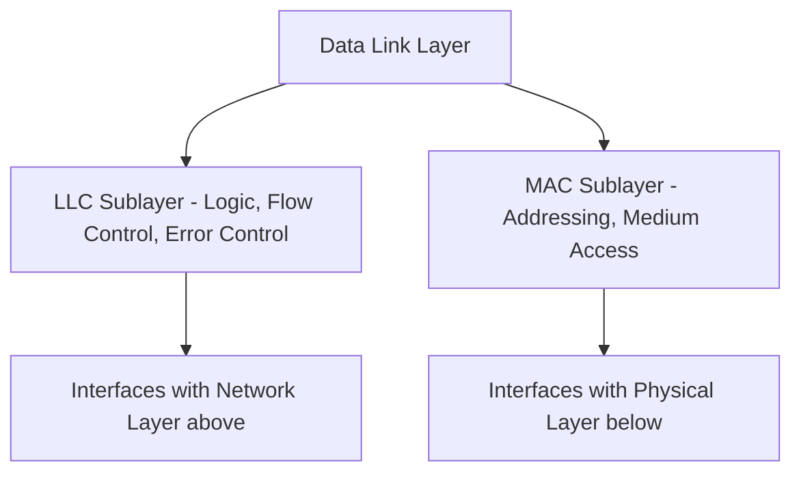
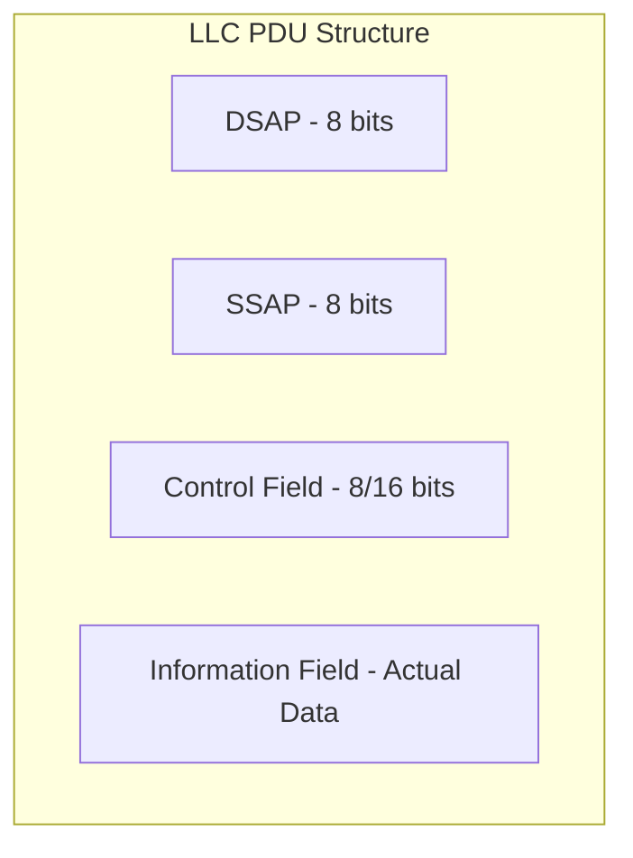
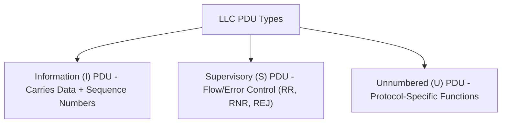

> **Goal of this section:**  
>  You'll understand how Logical Link Control (LLC) is the "smart" part of the Data Link Layer, how it organizes data and controls errors and flow, and you'll get to know the structure of the LLC PDU in detail so you can understand it when you see it in any packet capture.

## Table of Contents

- [Overview](#overview)
- [Relationship with MAC Sublayer](#relationship-with-mac-sublayer)
- [LLC Protocols](#llc-protocols)
- [Protocol Data Unit (PDU) Structure](#protocol-data-unit-pdu-structure)
- [Types of LLC PDU](#types-of-llc-pdu)
- [Functions of the LLC Sublayer](#functions-of-the-llc-sublayer)
- [SOC Analyst Perspective](#soc-analyst-perspective)
- [Summary](#summary)

---

## Overview

**Logical Link Control (LLC)** is the upper sublayer of the **Data Link Layer (DLL)**. It provides the logic and control mechanisms needed for reliable node-to-node communication between devices.

LLC manages:

- Synchronization
- Multiplexing
- Flow Control
- Error Checking/Correction

It ensures that the data transmitted across the network is organized, error-free, and delivered correctly.

> [!NOTE]
> If the MAC sublayer is the "body" that controls access to the physical medium, then the LLC is the "brain" that controls organizing the data itself and verifying its integrity.

---

## Relationship with MAC Sublayer

The Data Link Layer is divided into two sublayers:

1. **LLC Sublayer** – logic and control
2. **MAC Sublayer** – access to physical media

The LLC works with the MAC to ensure correct addressing and the delivery of frames within the network.

> [!IMPORTANT]
> The LLC is what provides a uniform interface to the Network Layer, regardless of the type of MAC technology used underneath it (whether Ethernet, Wi-Fi, or anything else). This means the upper layers don't need to know the details of the hardware they're running on.

---

## LLC Protocols

LLC protocols are modeled after the **HDLC (High-Level Data Link Control)** protocol, and they provide three types of service:

1. **Unacknowledged Connectionless Service** – data is sent without any acknowledgment of receipt
2. **Connection-Oriented Service** – a connection is established before the data is transmitted
3. **Acknowledged Connectionless Service** – data is sent with an acknowledgment of receipt

| Service Type | Connection Established? | Acknowledgment? | Use Case |
|---|---|---|---|
| Unacknowledged Connectionless | No | No | High speed, suitable for applications not sensitive to minor data loss |
| Connection-Oriented | Yes | Yes (implicit via connection) | Reliable data transfer that needs ordering and acknowledgment |
| Acknowledged Connectionless | No | Yes | A balance between speed and reliability |

---

## Protocol Data Unit (PDU) Structure

LLC uses a **PDU** to encapsulate data. Each PDU consists of four main fields:

### 1. DSAP (Destination Service Access Point)

- 8-bit field
- Identifies the logical address of the receiving device
- Indicates individual or group address

### 2. SSAP (Source Service Access Point)

- 8-bit field
- Identifies the logical address of the sending device
- Specifies command or response PDU

### 3. Information Field

- Contains the actual data being transmitted

### 4. Control Field

- 8 or 16-bit field depending on PDU type
- Specifies flow control and error control functions

> [!NOTE]
> The DSAP and SSAP act like "logical addresses" that determine who is talking to whom at the protocol level, which is different from the MAC address that identifies the device's physical identity.

---

## Types of LLC PDU

### Information (I) PDU

- Carries data
- Includes 7-bit sequence number **N(S)** and acknowledgment number **N(R)**

### Supervisory (S) PDU

- Used for flow and error control
- Includes acknowledgment number **N(R)** and 2-bit S field for **RR, RNR, and REJ** formats

### Unnumbered (U) PDU

- Includes 5-bit **M field**
- Used for various protocol-specific functions

| PDU Type | Purpose | Key Fields |
|---|---|---|
| Information (I) | Transferring the actual data | N(S) Sequence Number, N(R) Acknowledgment Number |
| Supervisory (S) | Controlling flow and errors | N(R), 2-bit S Field (RR = Receive Ready, RNR = Receive Not Ready, REJ = Reject) |
| Unnumbered (U) | Protocol-specific functions (such as establishing or terminating the connection) | 5-bit M Field |

---

## Functions of the LLC Sublayer

- Ensures data integrity and reliability
- Provides logic for the Data Link Layer
- Controls synchronization, multiplexing, flow, and error checking
- Supports multipoint communication across networks

---

## SOC Analyst Perspective

> [!NOTE]
> In modern Ethernet networks (like most of today's work environments), **Ethernet II Framing** is usually used directly instead of relying fully on LLC/802.2 Framing, but understanding the LLC structure is still important because it appears in other protocols and environments such as **Token Ring** and some industrial network protocols (like some older SCADA/ICS systems).

From the threat hunting and forensics side:

- When you analyze a **packet capture** using a tool like **Wireshark** and find a frame with an **802.2 LLC Header** instead of the usual Ethernet II, that can be a sign that there's an unusual protocol or device (a legacy device or industrial equipment) on the network, which needs further investigation to find out why it's there
- Understanding the Control Field values (such as RR, RNR, REJ) is useful when you analyze performance problems or repeated errors at the Data Link level, which can be an indicator of a hardware problem or even an attempt to disrupt communication (a layer-level denial of service)

> [!TIP]
> If you see a large number of **Supervisory (S) PDUs** of type **REJ (Reject)** appearing repeatedly and abnormally in the traffic, that can be an indicator of a connection quality problem or a deliberate attempt to jam the network, and it warrants further investigation.

---

## Summary

- The **LLC Sublayer** is the upper part of the Data Link Layer, and it provides the logic and control for reliable communication between devices
- It manages **Synchronization, Multiplexing, Flow Control, Error Checking/Correction**
- It works with the **MAC Sublayer** to ensure correct addressing and delivery of frames
- Its protocols are modeled after **HDLC** and provide 3 types of service: Unacknowledged Connectionless, Connection-Oriented, Acknowledged Connectionless
- The **PDU Structure** consists of: **DSAP, SSAP, Control Field, Information Field**
- There are 3 types of LLC PDU: **Information (I), Supervisory (S), Unnumbered (U)**
- From the SOC side: understanding the LLC structure is useful for analyzing packet captures, especially when 802.2 framing shows up in legacy or industrial network environments, and it can help detect problems or jamming attempts at the Data Link level
