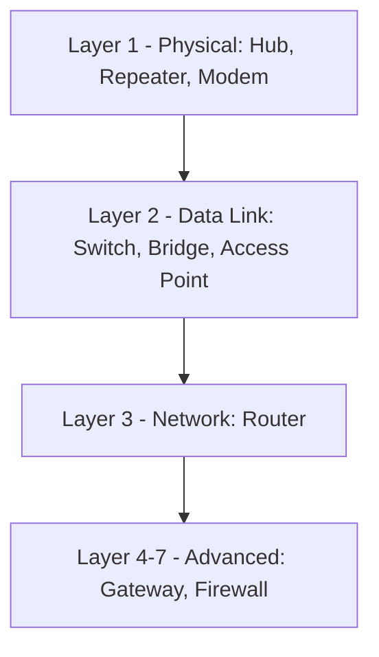
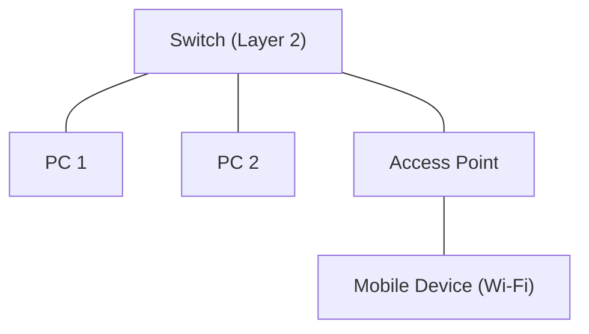
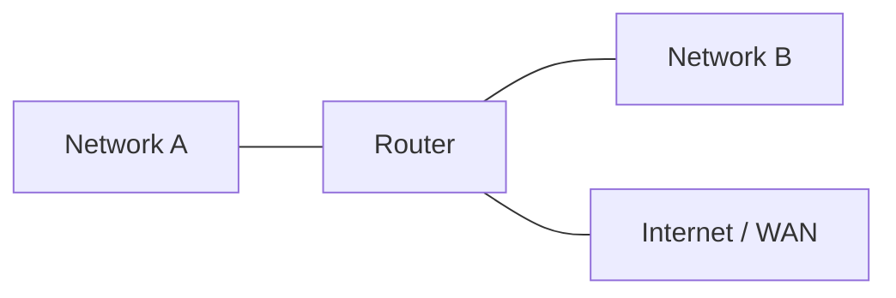
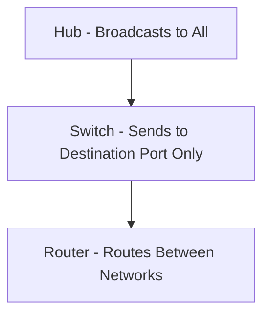
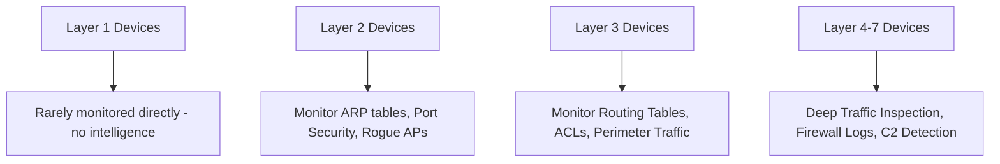

> **Goal of this section:**
>  You'll get to know the most important Network Devices that make up a network, understand which Layer of the OSI Model each device operates on, and see why understanding this is so important when you analyze any Incident or determine where an Attacker might exploit a weakness in the Hardware itself.

## Table of Contents

- [Introduction](#introduction)
- [Functions of Network Devices](#functions-of-network-devices)
- [Layer 1 Devices – Physical Layer](#layer-1-devices--physical-layer)
- [Layer 2 Devices – Data Link Layer](#layer-2-devices--data-link-layer)
- [Layer 3 Devices – Network Layer](#layer-3-devices--network-layer)
- [Layer 4–7 Devices – Advanced Processing](#layer-47-devices--advanced-processing)
- [Hub vs Switch vs Router](#hub-vs-switch-vs-router)
- [SOC Analyst Perspective](#soc-analyst-perspective)
- [Summary](#summary)

---

## Introduction

Network Devices are the Physical Hardware components that allow devices on a network to communicate with each other and exchange data. They are the Backbone of any network, because they are responsible for Directing Traffic, Amplifying Signals, and Securing Connections.

The main way we classify these devices is by the **Layer** they operate on in the **OSI Model**.

> [!NOTE]
> The higher we move up the OSI Layers, the "smarter" the device becomes and the more information it can base its decisions on (such as the MAC Address, the IP Address, or even the content of the Packet itself), which makes it better able to provide Security.

---

## Functions of Network Devices

- Enable communication between networked devices
- Provide secure and efficient connectivity
- Improve network performance and traffic management
- Control access and enhance network security
- Extend network coverage and overcome signal attenuation

> [!TIP]
> "Signal Attenuation" is the weakening of a signal as distance increases, and it's what makes devices like the Repeater essential in large networks.

---

## Layer 1 Devices – Physical Layer

Layer 1 devices deal with Raw Signals / Bits without any understanding of MAC Addresses or IP Addresses. In other words, they are just a "carrier" for the signal, with no intelligence at all.

### Hub

A central device that receives data and Broadcasts it to every Port connected to it, without any distinction.

> [!WARNING]
> The Hub has become **Obsolete** because of frequent Collisions and high security risks: it sends data to every device, even those it isn't meant to reach, which makes **Sniffing** easy on any device connected to it.

### Repeater

It Regenerates and Amplifies weak signals to extend the network's range over a longer distance.

### Modem

It connects the local network to the service provider (ISP) by converting the signal from Digital to Analog and vice versa.

> [!NOTE]
> From a Security standpoint, Layer 1 devices have no logic of their own that can understand or filter Traffic, so you can't rely on them as a protection layer; any Monitoring or Filtering has to happen at a higher layer.

---

## Layer 2 Devices – Data Link Layer

Layer 2 devices operate using **MAC Addresses**.

### Switch

It connects devices within the same LAN and sends data only to the Port of the intended device (Destination Port), which improves speed and security compared to the Hub.

There are two main types:
- **Unmanaged Switch**: Simple, with no settings or control
- **Managed Switch**: Supports advanced settings such as VLANs, Port Security, and SNMP Monitoring

### Bridge

It connects two LAN Segments and filters Traffic using MAC Addresses. This type has almost entirely been replaced by Switches.

### Access Point (AP)

It provides Wireless Connectivity by Bridging the wired Ethernet network and Wi-Fi devices.

> [!IMPORTANT]
> **Managed Switches** are very important from a Security standpoint because they support **Port Security** (specifying which MAC Address is allowed to connect to which Port), which prevents attacks such as **MAC Flooding** and **Rogue Device Connection**.

From a Detection standpoint:
- **ARP Spoofing / MITM Attacks** usually happen at Layer 2, so monitoring the ARP tables on Switches is very important
- **Rogue Access Points**: If an AP that isn't officially registered appears inside the network, it's a serious Indicator that an unauthorized device has tried to set up an insecure wireless connection

---

## Layer 3 Devices – Network Layer

Layer 3 devices operate using **IP Addresses** to connect different networks (not just devices within the same network).

### Router

It routes data between different networks using **Routing Tables**, and it isolates Broadcast Traffic between networks (meaning it prevents one network's Broadcast from reaching another network).

> [!IMPORTANT]
> The Router is often the first point of contact between the internal network and the outside world, so it becomes a key monitoring point (Perimeter Point) for all incoming and outgoing Traffic, and Access Control Lists (ACLs) can be configured on it to block unwanted Traffic in the first place.

---

## Layer 4–7 Devices – Advanced Processing

These devices operate at higher layers and can understand and handle the content of the Traffic itself, not just the addresses.

### Gateway

It acts as a "translator" between networks, protocols, or Architectures that are completely different from one another.

### Firewall

It controls incoming and outgoing Traffic based on predefined Security Rules. It can be Hardware-based or Software-based.

> [!IMPORTANT]
> The Firewall is the First Line of Defense in most SOC Environments, and Firewall Logs are analyzed continuously to detect any suspicious connection attempts, whether Inbound (such as Scanning attempts) or Outbound (such as a connection to a C2 Server).

From a MITRE ATT&CK standpoint:
- **T1071 - Application Layer Protocol**: The Firewall and the Gateway can detect abnormal use of protocols such as HTTP/HTTPS/DNS to communicate with C2
- **T1090 - Proxy**: Some Gateways act as a Proxy, and they can be used by the Attacker to hide the source of the Traffic if they aren't monitored properly

---

## Hub vs Switch vs Router

| Aspect | Hub | Switch | Router |
|---|---|---|---|
| OSI Layer | Layer 1 (Physical) | Layer 2 (Data Link) | Layer 3 (Network) |
| Addressing Used | None | MAC Address | IP Address |
| Traffic Handling | Broadcasts to all ports | Sends only to destination port | Routes between different networks |
| Security Level | Very Low | Medium (with Managed types) | High (supports ACLs, Routing Rules) |
| Collision Domain | Single (shared) | Separate per port | Separate per network |
| Use Case | Legacy / Obsolete | Connecting devices in a LAN | Connecting different networks |

> [!WARNING]
> A common beginner mistake is using the words "Switch" and "Router" as if they were the same thing. A Switch connects devices within the same network, while a Router connects different networks together. This difference is fundamental to understanding any Network Diagram.

---

## SOC Analyst Perspective

> [!NOTE]
> The higher we move up the Layers, the greater our ability to perform **Deep Inspection** of Traffic, which makes devices like the Firewall and the Gateway the most important Log sources for the SIEM and the SOC Team.

> [!TIP]
> When you analyze any Incident, the first question to ask yourself is: "Which Layer does this device operate on?" Because that determines the type of Logs available, the likely type of attack, and which tool you can use to investigate (such as Wireshark for Layer 2/3, or Firewall/Proxy Logs for Layer 4-7).

---

## Summary

- Network Devices are classified by the Layer they operate on in the OSI Model
- **Layer 1 (Hub, Repeater, Modem)**: They deal with raw signals without any intelligence, and the Hub has become Obsolete for security reasons
- **Layer 2 (Switch, Bridge, Access Point)**: They operate on MAC Addresses, and Managed Switches support Port Security against MAC Flooding and Rogue Devices
- **Layer 3 (Router)**: It operates on IP Addresses and connects different networks, and it's considered a key monitoring point (Perimeter Point)
- **Layer 4-7 (Gateway, Firewall)**: They can understand the content of the Traffic, and the Firewall is the first line of defense and a primary source of Logs in any SOC
- The core difference between **Hub vs Switch vs Router**: a Hub Broadcasts to everyone, a Switch sends only to the Destination Port, and a Router connects different networks together
- The smarter the device (the higher we move up the Layers), the more Security and Visibility it can provide to the SOC Team
