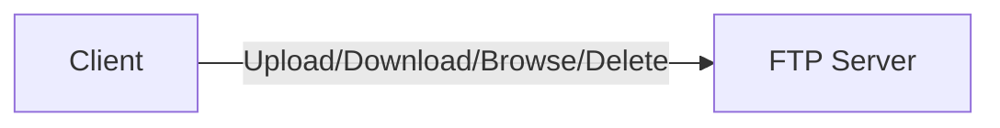
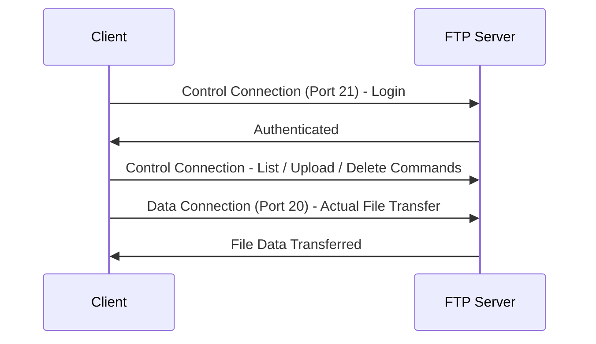
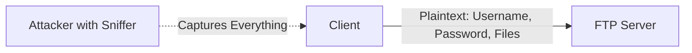
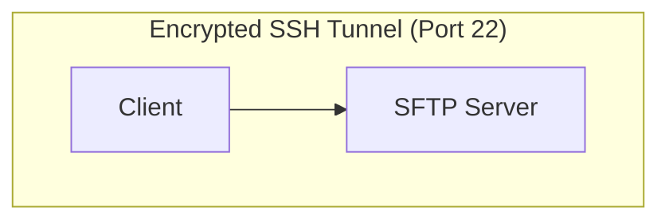

> **Goal of this section:**
> You'll understand how FTP transfers files using two separate connections (Control and Data), why using it has become a real security risk because of its complete lack of encryption, and how SFTP solves this problem through a fully encrypted SSH tunnel.

## Table of Contents

- [Overview](#overview)
- [Basic Information](#basic-information)
- [How FTP Works](#how-ftp-works)
- [Security Risk](#security-risk)
- [Secure Alternative – SFTP](#secure-alternative--sftp)
- [How SFTP Works](#how-sftp-works)
- [FTP vs SFTP](#ftp-vs-sftp)
- [Security Note (SOC / Blue Team)](#security-note-soc--blue-team)
- [Best Practices](#best-practices)
- [SOC Analyst Perspective](#soc-analyst-perspective)
- [Summary](#summary)

---

## Overview

**FTP (File Transfer Protocol)** is a network protocol used to transfer files between two systems:

- **Client** (the user's device)
- **FTP Server**

Using FTP, you can:

- Upload files
- Download files
- Browse server directories
- Delete or modify files

Simply put: **FTP is a way to transfer files between your device and a remote server**.

---

## Basic Information

| Property | Value |
|---|---|
| Layer | Application Layer (Layer 7) |
| Protocol | TCP |
| Ports | Port 21 – Control connection (commands) / Port 20 – Data connection (file transfer) |

---

## How FTP Works

FTP uses **two separate connections**:

### Control Connection (Port 21)

Used for commands such as:

- Login
- List files
- Upload/Delete

### Data Connection (Port 20)

Used for the actual file transfer.

> [!NOTE]
> The idea of separating commands from data transfer into two separate connections is a relatively old design, and it's part of the reason FTP is complicated to set up behind firewalls (especially in Active Mode) compared to modern protocols.

---

## Security Risk

The core problem with FTP:

- **No encryption**
- All data is sent as **plaintext**, including:
  - Username
  - Password
  - File contents

Anyone on the same network using packet sniffing tools (such as network analyzers) can:

- Capture login credentials
- Read transferred files

> [!WARNING]
> **FTP over the internet = High security risk**. Any use of FTP over a public network or directly over the internet puts the login credentials and the file contents completely at risk.

---

## Secure Alternative – SFTP

**SFTP (SSH File Transfer Protocol)** is the secure alternative to FTP.

| Property | Value |
|---|---|
| Port | 22 |
| Protocol | SSH |
| Encryption | Yes |

---

## How SFTP Works

An **Encrypted SSH Tunnel** is created between the client and the server.

Inside this tunnel:

- Commands are protected
- Files are encrypted
- Credentials are secure

Even if the traffic is intercepted, the data can't be read.

> [!IMPORTANT]
> Unlike FTP, which uses two separate connections (Control and Data), SFTP uses **just one fully encrypted connection** on Port 22, which makes it simpler and more secure at the same time.

---

## FTP vs SFTP

| Aspect | FTP | SFTP |
|---|---|---|
| Encryption | None (Plaintext) | Full Encryption (via SSH) |
| Port(s) | 21 (Control) + 20 (Data) | 22 (Single Connection) |
| Underlying Protocol | TCP (direct) | SSH |
| Credential Security | Exposed | Protected |
| File Content Security | Readable if intercepted | Unreadable if intercepted |
| Firewall Configuration | Complex (multiple ports/modes) | Simple (single port) |
| Recommended for Internet Use | ❌ No | ✅ Yes |

---

## Security Note (SOC / Blue Team)

The presence of FTP on any system may indicate:

- Exposed credentials
- Risk of data leakage
- Weak security configuration

---

## Best Practices

- Disable FTP if not required
- Use SFTP or FTPS instead
- Monitor for plaintext credential transmission

---

## SOC Analyst Perspective

> [!IMPORTANT]
> Discovering **Port 21 open** on any device during Asset Discovery or Vulnerability Scanning must be raised as a key **Finding**, because it represents a clear and direct weakness even if the server itself is up to date.

| Threat | Description | MITRE ATT&CK Reference |
|---|---|---|
| Credential Sniffing over FTP | Capturing login credentials directly from unencrypted traffic | T1040 - Network Sniffing |
| Anonymous FTP Access | Some FTP servers are configured with Anonymous Login, which allows anyone to access them without authentication | T1078 - Valid Accounts |
| FTP Brute Force | Repeated credential-guessing attempts, because FTP doesn't always support strong rate limiting | T1110 - Brute Force |
| Data Exfiltration via FTP | Using FTP as a channel to smuggle out stolen data, especially because it's a common protocol that isn't always monitored in depth | T1048.003 - Exfiltration Over Unencrypted/Obfuscated Non-C2 Protocol |

### Detection & Best Practices

- Run periodic **Port Scanning** on the network to discover any active, undocumented FTP servers
- Monitor any **traffic on Port 21** and make sure no credentials or sensitive files are being transferred without encryption
- Disable **Anonymous FTP Login** completely if FTP must stay running for a specific reason
- Replace any actual use of FTP with **SFTP** or **FTPS (FTP over SSL/TLS)** immediately
- Monitor any large volume of data being transferred over FTP to an external party, because it may be an indicator of **Data Exfiltration**

> [!TIP]
> If you notice in the logs an FTP connection (Port 21) from an internal device to an unknown external server, accompanied by an unusually large volume of data, it deserves immediate investigation — it could be a **Data Exfiltration** attempt deliberately using an old, neglected protocol to evade modern monitoring tools.

---

## Summary

- **FTP** is an old file transfer protocol that uses two separate connections: **Control (Port 21)** and **Data (Port 20)**
- The core problem: **no encryption at all** - everything (Username, Password, File Contents) is sent in plaintext
- **SFTP** is the secure alternative; it uses **SSH on Port 22** and a single, fully encrypted connection
- **The key difference**: FTP puts credentials and files at risk, while SFTP fully protects them even if the traffic is intercepted
- From the SOC perspective: the presence of FTP on any system is a security risk indicator, linked to **Credential Sniffing (T1040)**, **Anonymous Access (T1078)**, **Brute Force (T1110)**, and **Data Exfiltration (T1048.003)**
- **The golden rule**: never use FTP over the internet - always use SFTP
