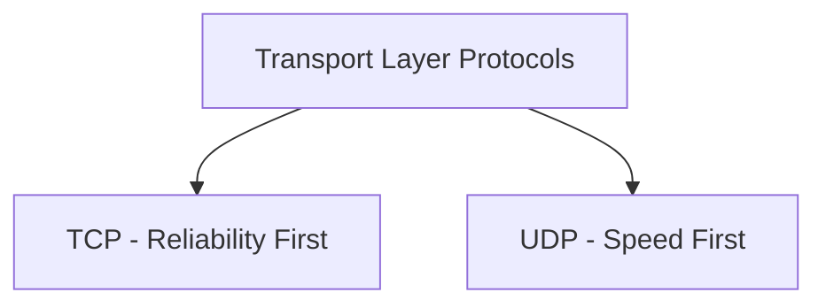
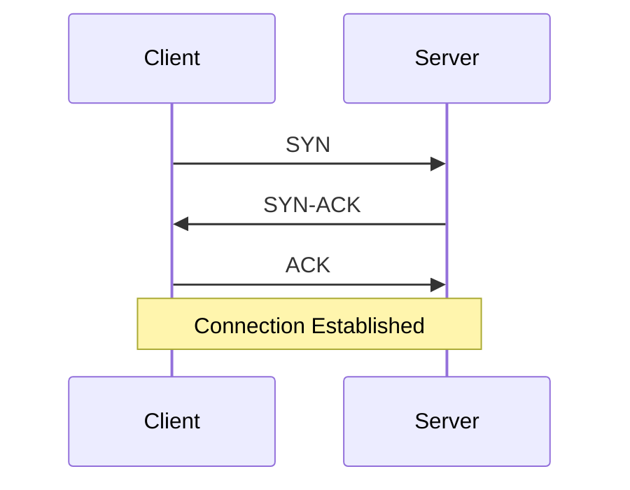
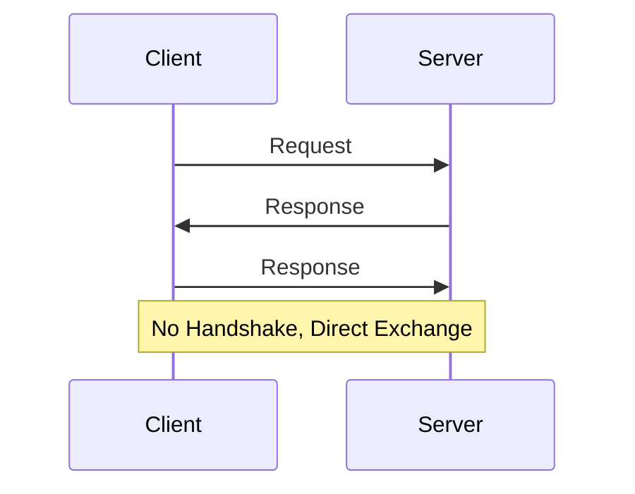
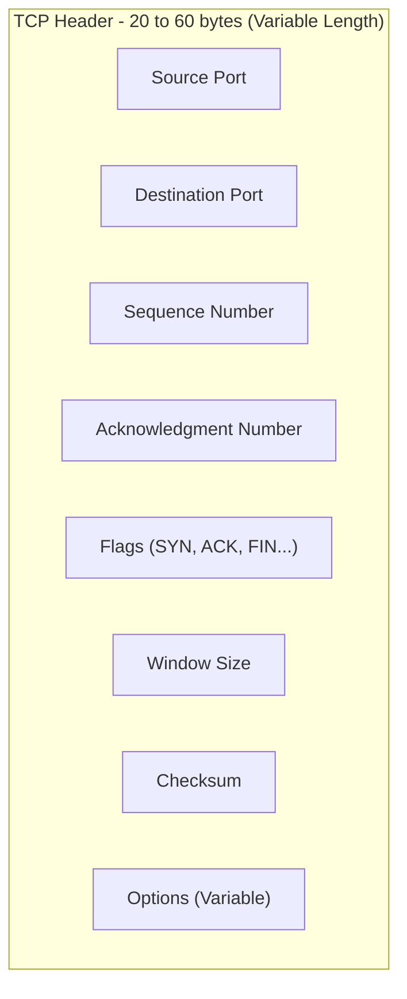
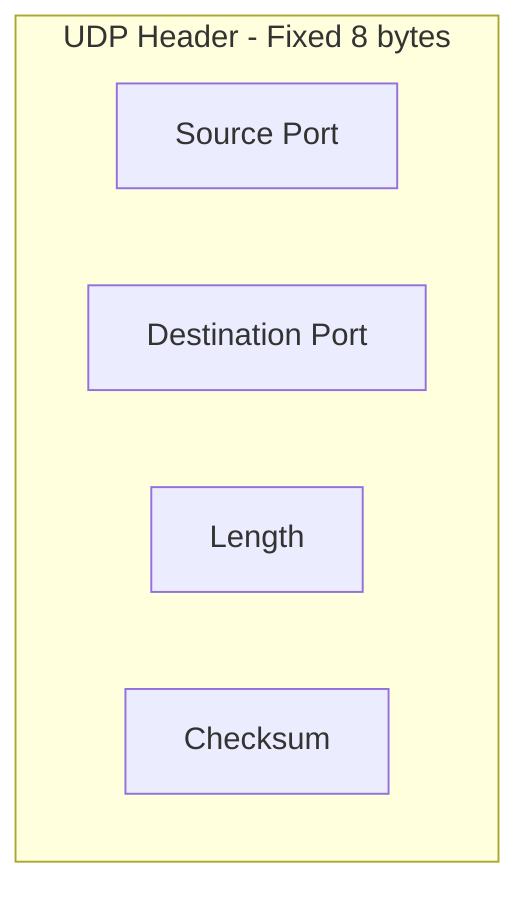

> **Goal of this section:**
>  You'll understand the detailed difference between TCP and UDP at the Transport Layer, when to use each of them, and how these differences (such as the absence of a Handshake in UDP) open the door to certain types of attacks you need to be aware of as a SOC Analyst.

## Table of Contents

- [Overview](#overview)
- [How Each Protocol Establishes Communication](#how-each-protocol-establishes-communication)
- [Detailed Comparison Table](#detailed-comparison-table)
- [Header Structure Comparison](#header-structure-comparison)
- [When to Use TCP vs UDP](#when-to-use-tcp-vs-udp)
- [SOC Analyst Perspective](#soc-analyst-perspective)
- [Summary](#summary)

---

## Overview

Choosing the right protocol between **TCP** and **UDP** depends mainly on what the Application needs: does it need **Reliability**, or does it need **Speed and Efficiency**?

Both operate at the **Transport Layer (Layer 4)**, but the philosophy each one is built on is completely different.

---

## How Each Protocol Establishes Communication

### TCP - Connection-Oriented

### UDP - Connectionless

> [!NOTE]
> In TCP, the two devices first agree to open a reliable communication channel (like a phone call where you make sure the other person has answered before you start talking). In UDP, the data is sent right away without any prior agreement (like sending an SMS without checking whether the person's phone is even on).

---

## Detailed Comparison Table

| TCP | UDP |
|---|---|
| TCP is a connection-oriented protocol | UDP is the connection-less protocol |
| TCP supports error-checking mechanisms | UDP has only the basic error-checking mechanism using checksums |
| An acknowledgment segment is present | No acknowledgment segment |
| TCP is slower than UDP | UDP is faster, simpler, and more efficient than TCP |
| Retransmission of lost packets is possible in TCP, but not in UDP | There is no retransmission of lost packets in the User Datagram Protocol (UDP) |
| TCP has a 20-60 bytes variable length header | The header length is fixed at 8 bytes |

> [!IMPORTANT]
> The most important point in this table is **"No retransmission in UDP"**. This means that if any Packet is lost while using UDP, there's no mechanism within the protocol itself to resend it. If the Application needs that reliability, it has to build it on top of UDP itself (as happens in some Streaming or Gaming applications).

---

## Header Structure Comparison

> [!NOTE]
> The big difference in Header size (20-60 bytes in TCP versus a fixed 8 bytes in UDP) is one of the reasons UDP is much faster and lighter - there's no extra Overhead such as Sequence numbers or complex Flags fields.

---

## When to Use TCP vs UDP

| Scenario | Recommended Protocol | Why |
|---|---|---|
| Web Browsing | TCP | All the data needs to arrive complete and in the correct order |
| File Transfer - FTP | TCP | Losing part of the file is unacceptable |
| Email - SMTP | TCP | The message must arrive complete |
| Video Streaming | UDP | Losing a frame or two is acceptable in exchange for speed and continuity |
| Voice calls (VoIP) | UDP | Latency matters more than retransmitting lost data |
| Online Gaming | UDP | Speed and instant responsiveness matter more than guaranteeing every packet arrives |
| DNS Queries | UDP (usually) | A simple, fast request and response, with the option to switch to TCP if the reply is large |

---

## SOC Analyst Perspective

> [!IMPORTANT]
> The absence of a Handshake and Acknowledgment in UDP isn't just a technical difference; it opens up real security gaps you need to be aware of.

### Security Implications

| Aspect | Security Impact |
|---|---|
| No Handshake in UDP | It's very easy to forge the Source IP (**IP Spoofing**) because there's no verification of the sender's identity before data is exchanged |
| No Acknowledgment in UDP | It's hard to track whether a connection succeeded or failed, which makes some types of Data Exfiltration over UDP harder to detect |
| TCP Handshake Exploitation | The **SYN Flood** attack exploits the fact that the Server reserves resources as soon as it receives a SYN, even before the Handshake is complete |
| Fixed Small UDP Header | It makes it easy for attackers to use UDP in **Amplification/Reflection** attacks (such as DNS/NTP Amplification) because the Overhead is low and the response can be much larger than the request |

> [!WARNING]
> Protocols such as **DNS** and **NTP** that run over UDP are among the most exploited protocols in **Amplification DDoS** attacks, because the attacker can send a small request with a forged Source IP (the victim's) and make the Server send a large reply to the victim instead of to the attacker.

From a MITRE ATT&CK standpoint:
- **T1498 - Network Denial of Service**: Covers attacks such as UDP Flood and Amplification Attacks
- **T1499 - Endpoint Denial of Service**: Covers attacks such as SYN Flood that aim to exhaust a specific machine's resources

> [!TIP]
> When analyzing unusual Traffic, if you find a large volume of data being sent over UDP on unusual Ports (especially with no clear Response), it deserves investigation - it could be a **Data Exfiltration** attempt that takes advantage of UDP being harder to monitor and track than TCP.

---

## Summary

- The choice between **TCP** and **UDP** depends on what the Application needs: **Reliability** (TCP) versus **Speed and Efficiency** (UDP)
- **TCP**: Connection-Oriented, supports strong Error-Checking, has Acknowledgment, and retransmits lost packets, but it's slower and its Header is variable (20-60 bytes)
- **UDP**: Connectionless, simple Error-Checking with the Checksum only, no Acknowledgment or Retransmission, but it's faster and simpler, and its Header is fixed (8 bytes)
- The practical choice: TCP for data that must arrive complete (Web, Email, File Transfer), and UDP for latency-sensitive applications (Streaming, VoIP, Gaming, DNS)
- From a SOC standpoint: the absence of a Handshake in UDP makes **IP Spoofing** and **Amplification DDoS** attacks easier (associated with MITRE T1498), while the TCP Handshake mechanism itself is exploited in **SYN Flood** (T1499)
