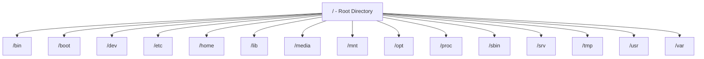

> **Goal of this section:**
> You will understand how Linux organizes all of its files under one main directory (`/`), memorize the function of each main directory, and be able to connect this to knowing where important Forensic Artifacts such as logs and configuration files are located during any investigation on a Linux machine.

## Table of Contents

- [Overview](#overview)
- [/ — Root Directory](#--root-directory)
- [/bin — Essential User Binaries](#bin--essential-user-binaries)
- [/boot — Boot Loader Files](#boot--boot-loader-files)
- [/dev — Device Files](#dev--device-files)
- [/etc — Configuration Files](#etc--configuration-files)
- [/home — User Home Directories](#home--user-home-directories)
- [/lib — System Libraries](#lib--system-libraries)
- [/media — Removable Media](#media--removable-media)
- [/mnt — Temporary Mount Point](#mnt--temporary-mount-point)
- [/opt — Optional Software](#opt--optional-software)
- [/sbin — System Binaries](#sbin--system-binaries)
- [/srv — Service Data](#srv--service-data)
- [/tmp — Temporary Files](#tmp--temporary-files)
- [/usr — User Utilities and Applications](#usr--user-utilities-and-applications)
- [/var — Variable Data](#var--variable-data)
- [/proc — Process Information](#proc--process-information)
- [Full Directory Tree Overview](#full-directory-tree-overview)
- [SOC Analyst Perspective](#soc-analyst-perspective)
- [Summary](#summary)

---

## Overview

The **Linux File Hierarchy Structure (FHS)** defines the Standard Directory Layout used by Linux and Unix-like systems. It provides an organized, consistent way to store system files, user data, configuration files, and applications.

In Linux, everything starts from the **Root** directory `/`, and all files and directories are organized under it, whether they live on physical or virtual devices.

> [!NOTE]
> Think of `/` as the root of a tree: every branch (directory) grows out of it directly or indirectly, and there is never any directory "above" this root.

---

## / — Root Directory

The Top-Level Directory in Linux.

- All files and directories originate from `/`
- No directory exists above it
- Only the **root user** can modify its contents
- `/root` is the home directory of the root user and is different from `/`

> [!WARNING]
> Don't confuse `/` (the Root Directory, the root of the entire system) with `/root` (the Home Directory of the root user only). The two are completely different despite their similar names.

---

## /bin — Essential User Binaries

Contains the Essential Command Binaries required by all users.

- Available in single-user and recovery modes
- Includes commonly used commands

**Examples**: `ls`, `cp`, `ping`, `grep`, `ps`

---

## /boot — Boot Loader Files

Stores the files required to boot the system.

- Kernel files
- Bootloader configuration (**GRUB**)

**Examples**: `vmlinuz`, `initrd.img`

---

## /dev — Device Files

Represents hardware devices as files.

- Block devices (disks)
- Character devices (keyboard, mouse, terminals)

**Examples**: `/dev/sda1`, `/dev/tty1`

> [!NOTE]
> The famous Linux philosophy "**Everything is a file**" shows up clearly here: even physical devices such as the hard disk or the keyboard are treated as regular files inside `/dev`.

---

## /etc — Configuration Files

Contains system-wide configuration files.

- Application and service configurations
- Startup and shutdown scripts

**Examples**: `/etc/passwd`, `/etc/resolv.conf`

---

## /home — User Home Directories

Stores the personal directories of non-root users.

- Each user has a private workspace
- Users can manage files only in their own directory

**Examples**: `/home/ahmed`, `/home/ali`

---

## /lib — System Libraries

Contains the Shared Libraries required by the essential binaries.

- Needed by programs in `/bin` and `/sbin`

**Examples**: `lib*.so`, `ld*.so`

---

## /media — Removable Media

A Mount Point for removable devices.

- USB drives
- CDs and DVDs

**Examples**: `/media/usb`, `/media/cdrom`

---

## /mnt — Temporary Mount Point

Used to mount temporary filesystems manually.

- Commonly used by system administrators

---

## /opt — Optional Software

Stores third-party or additional applications.

- Software not included in the default system installation

**Examples**: `/opt/google`, `/opt/oracle`

---

## /sbin — System Binaries

Contains Administrative Commands.

- Primarily used by the root user
- Used for system maintenance and repair

**Examples**: `iptables`, `fdisk`, `reboot`, `ifconfig`

---

## /srv — Service Data

Stores the data served by system services.

- Web servers
- FTP servers
- Version control systems

**Examples**: `/srv/www`, `/srv/ftp`

---

## /tmp — Temporary Files

Holds temporary files created by applications.

- Files are deleted automatically on reboot

> [!WARNING]
> `/tmp` is one of the locations most commonly used by malware to store its files temporarily during execution, because it is usually writable by all users and its contents are deleted automatically, which can sometimes make it hard to trace evidence if the machine was rebooted before the investigation.

---

## /usr — User Utilities and Applications

Contains most of the user-level applications and tools.

### Important subdirectories

- `/usr/bin` — User commands
- `/usr/sbin` — Administrative commands
- `/usr/lib` — Libraries
- `/usr/local` — Locally installed software
- `/usr/src` — Linux kernel source files

---

## /var — Variable Data

> [!NOTE]
> This directory is one of the most important in the system, but it was missing from the original source material, so I completed it with standard reference information to make the picture complete.

Stores data that changes constantly while the system is running (Variable Data).

- System logs
- Mail spools
- Print queues
- Cache files

**Examples**: `/var/log`, `/var/mail`, `/var/spool`

> [!IMPORTANT]
> `/var/log` is **the most important directory for any SOC Analyst** in the entire Linux system, because it is where most of the System Logs are stored (such as `/var/log/auth.log` or `/var/log/syslog`) that you will rely on in any investigation.

---

## /proc — Process Information

A Virtual Filesystem that provides real-time system information.

- Process details
- Memory usage
- System uptime

**Examples**: `/proc/meminfo`, `/proc/uptime`, `/proc/[pid]`

> [!TIP]
> `/proc` doesn't actually exist on the hard disk. It is Dynamically Generated by the Kernel in RAM and gives a "Live Snapshot" of the system's state at any moment, which makes it a very powerful tool in Live Forensics.

---

## Full Directory Tree Overview

| Directory | Purpose |
|---|---|
| `/` | Root of the entire filesystem |
| `/bin` | Essential user command binaries |
| `/boot` | Kernel and bootloader files |
| `/dev` | Device files |
| `/etc` | System-wide configuration files |
| `/home` | User home directories |
| `/lib` | Shared libraries |
| `/media` | Removable media mount points |
| `/mnt` | Temporary manual mount points |
| `/opt` | Optional/third-party software |
| `/proc` | Virtual filesystem - live process/system info |
| `/sbin` | Administrative/system binaries |
| `/srv` | Service-related data |
| `/tmp` | Temporary files (cleared on reboot) |
| `/usr` | User-level applications and utilities |
| `/var` | Variable data (logs, mail, cache) |

---

## SOC Analyst Perspective

> [!IMPORTANT]
> Understanding the FHS isn't just theoretical knowledge. It is a **fundamental map** for any investigation on a Linux machine, because every type of evidence has an expected location where you can find it quickly.

### Key Directories for Forensics & Incident Response

| Directory | Investigative Value |
|---|---|
| `/var/log` | The primary source of all System Logs (Authentication, Kernel, Application Logs) |
| `/etc/passwd` & `/etc/shadow` | User information and encrypted passwords, a common target for credential theft attempts |
| `/tmp` | A common location for storing temporary malware files during execution |
| `/proc/[pid]` | Live inspection of currently running processes, very useful for discovering hidden malicious processes |
| `/home/[user]` | The user's personal files, command history (`.bash_history`), and SSH keys |
| `/etc/cron*` and `/etc/init.d` | Common locations attackers use to achieve **Persistence** |

> [!WARNING]
> The `.bash_history` file inside the user's directory in `/home` records every command that was executed, which makes it a very strong source of evidence in any investigation. But be aware that experienced attackers often delete or modify this file to hide their tracks (**Anti-Forensics Technique**).

From a MITRE ATT&CK standpoint:

| Technique | Relevant Directory |
|---|---|
| T1074.001 - Local Data Staging | `/tmp` or any writable directory used to gather stolen data before Exfiltration |
| T1053.003 - Scheduled Task/Job: Cron | `/etc/cron.d`, `/etc/crontab` for achieving Persistence |
| T1552.001 - Unsecured Credentials: Credentials In Files | `/etc/passwd`, `/home/*/.bash_history`, configuration files containing exposed credentials |
| T1070.003 - Indicator Removal: Clear Command History | Modifying or deleting `.bash_history` to hide traces of activity |

> [!TIP]
> When investigating a suspicious Linux machine, always start in this order: `/var/log` for the logs, then `/tmp` for any suspicious leftover files, then `/etc/cron*` to make sure there's no Persistence, and finally `/proc` if the machine is still running so you can see the live processes.

---

## Summary

- The **Linux File Hierarchy Structure (FHS)** organizes all system files under a single **Root** directory `/`
- Each main directory has a specific function: `/bin` and `/sbin` for commands, `/etc` for configuration, `/home` for user data, `/var` for variable data such as logs, and `/proc` for live system information
- `/tmp` is a temporary location that is cleared on reboot and is commonly used by malware
- From the SOC's perspective: the most important directories in any investigation are **`/var/log`** (for logs), **`/etc/passwd`** (for user data), **`/tmp`** (for malware traces), and **`/proc`** (for live process inspection)
- Understanding this map greatly speeds up any Incident Response on a Linux machine, because you know exactly where to look for each type of evidence

