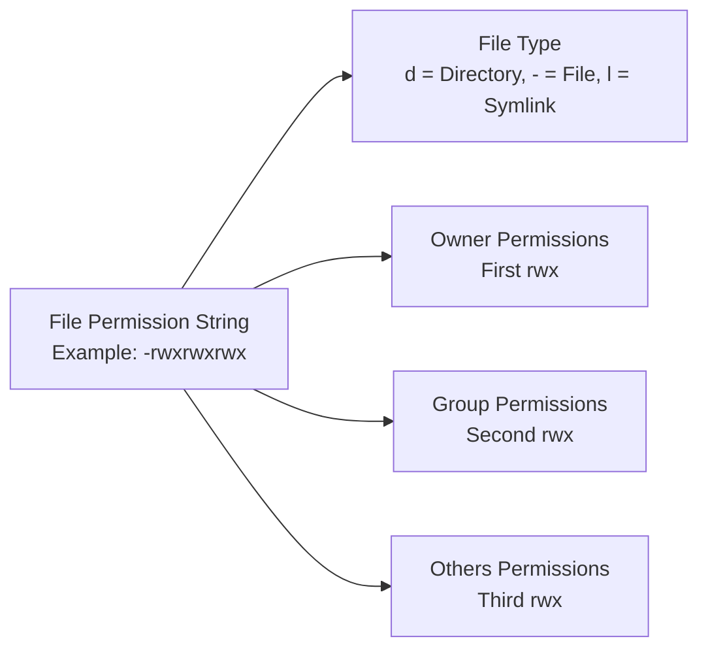
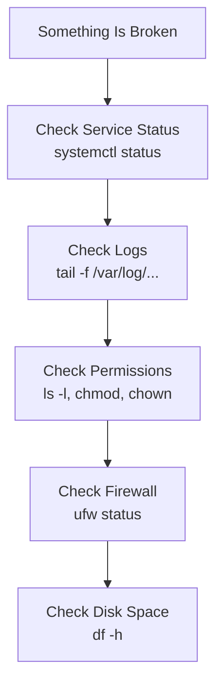

| Topic | Level | Reading Time | Prerequisites |
|---|---|---|---|
| Linux Fundamentals | Beginner | ~40 min | None (no prior Linux or command-line experience needed) |

> **Goal of this section:**
>  You'll take your first real step into the world of Linux, with no prior background needed. You'll understand how Linux is built on the inside, learn the most important commands for working with files and directories, understand the users and permissions system, and get a practical look at managing packages, services, and the network. If this is the first time you've ever opened a Terminal, you're in the right place.


## Learning Objectives

By the end of this section, you will be able to:

- Explain what **Linux** is and why it's the backbone of servers, cloud platforms, and cybersecurity tools.
- Trace how a command travels through the system: `User → Shell → Kernel → Hardware`.
- Navigate the Linux file system and explain the purpose of key directories like `/etc`, `/home`, and `/var`.
- Use essential commands for navigation, file management, and viewing file content.
- Explain how **Users**, **Groups**, and **File Permissions** work together to control access.
- Manage packages with **APT** and services with **systemd**.
- Monitor running processes, disk space, and memory usage.
- Perform basic networking checks and understand how the **UFW firewall** and **log files** help you troubleshoot problems.

## Table of Contents

- [What Is Linux](#what-is-linux)
- [Why Linux](#why-linux)
- [Common Distributions](#common-distributions)
- [Linux Architecture: How a Command Travels](#linux-architecture-how-a-command-travels)
  - [The User Layer](#the-user-layer)
  - [The Shell Layer](#the-shell-layer)
  - [The Kernel Layer](#the-kernel-layer)
  - [The Hardware Layer](#the-hardware-layer)
- [Important Concept: Everything Is a File](#important-concept-everything-is-a-file)
- [The Linux File System Structure](#the-linux-file-system-structure)
- [Basic Navigation Commands](#basic-navigation-commands)
- [Getting Help](#getting-help)
- [File Management: Creating and Organizing Files](#file-management-creating-and-organizing-files)
- [Viewing File Content](#viewing-file-content)
- [Linux Users and Groups](#linux-users-and-groups)
  - [Three Types of Users](#three-types-of-users)
  - [Creating and Managing Users](#creating-and-managing-users)
  - [Understanding Groups](#understanding-groups)
  - [Important System Files](#important-system-files)
  - [Real Admin Scenario](#real-admin-scenario)
  - [The Sudo Group](#the-sudo-group)
- [File Permissions](#file-permissions)
- [Package Management with APT](#package-management-with-apt)
- [Service Management with Systemd](#service-management-with-systemd)
- [Process Management](#process-management)
- [Disk and Memory Monitoring](#disk-and-memory-monitoring)
- [Networking Basics](#networking-basics)
- [The Firewall: UFW](#the-firewall-ufw)
- [Logs in Linux](#logs-in-linux)
- [Putting It All Together: A Practice Scenario](#putting-it-all-together-a-practice-scenario)
- [Troubleshooting Checklist](#troubleshooting-checklist)
- [Career Connection](#career-connection)
- [Key Terms Glossary](#key-terms-glossary)
- [Summary](#summary)

## What Is Linux

**Linux** is not just an ordinary operating system. It is the **backbone** that runs servers, cloud platforms, DevOps pipelines, cybersecurity tools, and the entire infrastructure of large companies around the world.

> [!NOTE]
> If you work in any technical field, it's almost impossible to avoid Linux. Even if your personal computer runs Windows or macOS, the servers that run most websites, mobile apps, and security tools most likely run on Linux.

## Why Linux

There are clear reasons why Linux is so widespread:

- **Open Source**: The source code is open, so anyone can view it, modify it, and improve it.
- **Stable & Secure**: It is very stable and secure, and it can run for months without needing a reboot.
- **Lightweight**: It is light enough to run even on machines with limited resources.
- **Used in Servers, Cloud, Containers, Networking**: It is used in servers, the cloud, containers, and networking devices.

## Common Distributions

Linux is not a single system; it is a whole "family" of systems called **distributions** (or Distros). Some of the best known are:

| Distribution | Notes |
|---|---|
| **Ubuntu** | The easiest for beginners; we'll use it as the main reference in this guide |
| **CentOS / Rocky Linux** | Very common in corporate server environments |
| **Debian** | Known for its exceptional stability; Ubuntu itself is built on it |
| **RedHat Enterprise Linux (RHEL)** | A paid, officially supported edition, common in large companies |

> [!TIP]
> All of these distributions share the same core concepts we'll explain here (the Kernel, the file system, users and permissions). When you learn Ubuntu, you're really learning the foundation of all of Linux.

## Linux Architecture: How a Command Travels

When we talk about **Linux architecture**, we're describing how the operating system is put together on the inside, and how a user's command travels through the system until it actually gets executed.

The simplified path is:

```
User → Shell → Kernel → Hardware
```

Let's break this journey down layer by layer.

### The User Layer

This is the top layer. The **User** can be:

- A **system administrator**.
- A **developer**.
- A regular user.
- Even a **service** like `nginx` that runs commands on its own.

The user interacts with Linux through:

- The **Terminal / CLI**.
- A graphical interface (**GUI / Desktop Environment**).
- A **Remote SSH session**.

When the user types:

```bash
ls
```

This command **does not talk to the hardware directly**. It passes through layers.

### The Shell Layer

The **Shell** is a **command interpreter**.

The most popular shell in Ubuntu is **bash (Bourne Again Shell)**.

You can check which shell you're using with the command:

```bash
echo $SHELL
```

**What exactly does the Shell do?**

- It reads the command you typed.
- It interprets it.
- It converts it into **system calls**.
- It sends them to the kernel.

> [!TIP]
> Think of the Shell as a **translator** between humans and the system.

**Example**: When you type:

```bash
mkdir test
```

The Shell understands that:

- You want to create a directory.
- It translates that into a system call.
- It sends it to the kernel.

There are other shells such as `sh`, `zsh`, and `fish`, but they all do the same core job: interpreting commands.

### The Kernel Layer

**The Kernel is the most important part**. It is the "brain" of the operating system.

It is responsible for managing:

- The processor (**CPU**).
- Memory (**Memory / RAM**).
- Disk operations (**Disk I/O**).
- **Processes**.
- **Device Drivers**.
- **Networking**.

The Kernel is always running in memory. You can check its version with the command:

```bash
uname -r
```

**What does the Kernel do, in detail?**

**Process Management**

When you run a program, such as:

```bash
top
```

The Kernel:

- Creates a process.
- Allocates memory to it.
- Distributes CPU time to it.
- Manages its **scheduling**.

**Memory Management**

If you have 10 applications running:

- The Kernel decides how much RAM each one gets.
- It prevents any process from accessing another process's memory.

> [!IMPORTANT]
> This is critical for system stability. Without this protection, any program could "interfere" with another program's memory and crash the entire system.

**File System Management**

When you open a file such as:

```bash
cat file.txt
```

The Kernel:

- Locates the file on the disk.
- Reads the data.
- Returns it to the Shell.

**Device Management**

When you plug in a USB device:

- The Kernel detects the device.
- It loads the correct driver.
- It makes it available under `/dev`.

> [!IMPORTANT]
> Everything connected to the system goes through the Kernel.

### The Hardware Layer

This is the physical layer:

- The processor (**CPU**).
- Memory (**RAM**).
- The **Hard Disk**.
- The **Network Card**.
- USB devices.

> [!WARNING]
> The hardware **never talks to the user directly**. It communicates only through the Kernel.

## Important Concept: Everything Is a File

One of the most important Linux concepts: **Everything is a File**.

| Item | Represented as |
|---|---|
| Hard disks | `/dev/sda` |
| Partitions | `/dev/sda1` |
| USB | `/dev/sdb` |
| Processes | `/proc` |
| System information | `/sys` |

Even **hardware devices** are represented as files.

Example:

```bash
ls /dev
```

This design makes Linux:

- **Flexible**.
- **Scriptable**.
- **Easy to automate**.

## The Linux File System Structure

Let's explore the file system. You can try the following command on any Linux machine or VM you have:

```bash
ls /
```

The following table summarizes the most important directories and why they exist:

| Directory | Description |
|---|---|
| `/bin` | Essential executables (such as `ls`, `cp`, `grep`) available to all users, even in emergency mode |
| `/sbin` | Maintenance executables intended for the system administrator (root) (such as `iptables`, `fdisk`) |
| `/boot` | Everything needed to boot the system: the kernel, the Initial RAM Disk, and the GRUB configuration |
| `/dev` | Representations of physical devices (such as `/dev/sda` for the hard disk) |
| `/etc` | The central location for all system configuration, such as `/etc/passwd` for user information |
| `/home` | Users' personal directories; for example, your files live in `/home/amr` |
| `/root` | The home directory of the root user, kept separate from `/home` for security reasons |
| `/var` | Files that grow over time, such as system logs in `/var/log` |
| `/lib` and `/lib64` | Shared libraries required to run the commands in `/bin` and `/sbin` |
| `/usr` | The largest part of the system, containing user-installed programs and libraries |
| `/usr/local` | Where programs built from source code are installed, so they don't conflict with system files |
| `/opt` | Add-on or third-party software, such as Google Chrome or Zoom |
| `/proc` | A **pseudo-filesystem** containing information about running processes; it doesn't actually exist on the disk |
| `/tmp` | Temporary files, usually deleted when the system reboots |
| `/media` | Automatic mount points for removable media (USB, CD-ROM) |
| `/mnt` | Manual mount points for file systems or network drives |

> [!TIP]
> Quick note: `/proc` doesn't actually exist on the hard disk; it is generated directly in memory and reflects the state of the system at that exact moment.

## Basic Navigation Commands

These commands are the first thing you need to get comfortable with as a beginner:

| Command | Description | Used for |
|---|---|---|
| `pwd` | Prints the path of the current directory | Knowing exactly where you are before creating or deleting files |
| `ls` | Lists files and directories | Browsing the contents of a directory |
| `ls -l` | Lists files in a detailed format (permissions, owner, size) | Checking permissions and ownership |
| `ls -a` | Shows hidden files (those starting with `.`) | Viewing configuration files such as `.bashrc` |
| `cd` | Changes the current directory | Moving between directories |
| `cd ..` | Moves up one level | Going back to the parent directory |
| `clear` | Clears the terminal screen | Tidying up the workspace for a clearer view |
| `history` | Shows previously used commands | Reusing or reviewing earlier commands |

## Getting Help

If you need help with any command, you're not on your own; Linux has built-in tools for that:

```bash
man ls
ls --help
```

| Command | Description | Used for |
|---|---|---|
| `whoami` | Shows the currently logged-in user | Checking your privileges |
| `uname -a` | Shows system and kernel information | Finding the system version and kernel details |
| `man command` | Opens the manual page for the command | Learning detailed usage and options |

> [!TIP]
> `man` is short for **manual**. For any command you're unsure about, type `man` before it and you'll find a full explanation. To exit a man page, press the `q` key.

## File Management: Creating and Organizing Files

Now we'll learn how to create, copy, move, and delete files and directories.

### Creating Files and Directories

```bash
touch file.txt
```

**Description**: Creates an empty file. **Used for**: Making test files or placeholders.

```bash
mkdir myfolder
```

**Description**: Creates a directory. **Used for**: Organizing files.

### Copying Files

```bash
cp file1.txt myfolder/
```

General syntax: `cp source destination`

**Description**: Copies files or directories. **Used for**: Making a backup or duplicating a file.

### Moving and Renaming Files

```bash
mv file1.txt file2.txt
```

General syntax: `mv source destination`

**Description**: Moves or renames files. **Used for**: Renaming a file or moving it to another location.

> [!TIP]
> Important note: `mv` is used for both moving and renaming. If the destination is in the same directory but with a different name, that's a "rename." If the destination is a different directory, that's a "move."

### Deleting Files and Directories

```bash
rm file2.txt
```

**Description**: Deletes a file. **Used for**: Removing unwanted files.

```bash
rm -r myfolder
```

**Description**: Deletes a directory and all of its contents (**recursively**). **Used for**: Removing directories that contain files.

> [!WARNING]
> Be very careful with `rm`, especially with `-r`. There is no "recycle bin" in the terminal by default; the file is deleted immediately and permanently. Always double-check the path before you press Enter.

## Viewing File Content

There are different tools for viewing file content, and each one has its own best use:

| Command | Description | Used for |
|---|---|---|
| `cat file` | Displays the entire file content at once | Viewing small text files |
| `less file` | Displays the file page by page, letting you scroll forward and backward | Safely reading large files without flooding the screen |
| `more file` | Displays the content page by page (a simpler version of `less`) | Viewing text files |
| `head file` | Displays the first 10 lines | Quickly previewing a large file |
| `tail file` | Displays the last 10 lines | Checking recent logs |
| `tail -f /var/log/syslog` | Follows the file live and shows any new additions immediately | Monitoring logs in real time as events happen |

> [!TIP]
> A very real use case on the job: **monitoring logs** in real time and **debugging services** rely heavily on `tail -f`.

## Linux Users and Groups

In Linux, **access control** is based on:

- **Users**.
- **Groups**.
- **File Ownership**.
- **Permissions**.

Every file and every process belongs to:

- One user.
- One group.

### Three Types of Users

There are three types of users in Linux:

**Root User**

- The **super administrator**.
- Its User ID (UID) = `0`.
- Full access to the entire system.

**System Users**

- Used by services (such as `nginx`, `mysql`).
- Usually have no permission to log in directly.
- Their UID is below 1000 (in Ubuntu).

**Regular Users**

- Ordinary human users.
- UIDs start at 1000.
- Used for normal day-to-day work.

### Creating and Managing Users

**Creating a new user**

```bash
sudo adduser user1
```

**Description**: Creates a new user account and its home directory. **Used for**: Adding a new real user to the system.

This command:

- Creates `/home/user1`.
- Sets the default shell.
- Creates a **private group** for the user.

**Alternative command**

```bash
sudo useradd user1
```

**Description**: A more basic, **low-level** command for creating users. **Used for**: Advanced scripting or manual user setup.

> [!TIP]
> **The difference between them**: `adduser` is interactive (it asks you questions) and is the recommended option in Ubuntu, while `useradd` is more manual and better suited to scripting.

**Setting or changing a password**

```bash
sudo passwd user1
```

**Description**: Sets or changes a user's password. **Used for**: Managing **authentication credentials**.

**Deleting users**

```bash
sudo deluser user1
```

**Description**: Deletes the user account. **Used for**: Removing inactive users.

```bash
sudo deluser --remove-home user1
```

**Description**: Deletes the user **along with** their home directory. **Used for**: Completely removing the user and their data.

### Understanding Groups

A **Group** is a collection of users.

Its purpose:

- Easier permission management.
- Shared access to files.
- **Role-based access control**.

**Example**: Instead of granting access to 10 users one by one, you create a single group and add all the users to it.

**Viewing groups**

```bash
cat /etc/group
```

**Checking a specific user's groups**

```bash
groups user1
```

Or:

```bash
id user1
```

**Description**: Shows the user ID and group memberships. **Used for**: Checking access privileges.

**Creating a group**

```bash
sudo groupadd developers
```

**Description**: Creates a new group. **Used for**: Organizing users by job role.

**Deleting a group**

```bash
sudo groupdel developers
```

**Description**: Deletes a group. **Used for**: Cleaning up unused roles.

**Adding a user to a group**

```bash
sudo usermod -aG developers user1
```

**Description**: Adds the user to an existing group. **Used for**: Granting additional permissions.

> [!WARNING]
> Very important: `-a` means **append**, and `-G` means **group**. Without `-a`, the user may be **removed** from other groups they were a member of.

**Changing the primary group**

```bash
sudo usermod -g developers user1
```

**Description**: Changes the user's **primary group**. **Used for**: Restructuring roles.

### Important System Files

**`/etc/passwd`**

```bash
cat /etc/passwd
```

It contains:

- The username.
- The UID.
- The GID.
- The home directory.
- The default shell.

Example of the format:

```
user1:x:1001:1001::/home/user1:/bin/bash
```

**`/etc/group`**

```bash
cat /etc/group
```

It contains:

- The group name.
- The GID.
- The group members.

**`/etc/shadow` (advanced)**

```bash
sudo cat /etc/shadow
```

It contains:

- Hashed passwords.

> [!WARNING]
> This file is restricted to **root only**, because it contains highly sensitive data.

### Real Admin Scenario

**Scenario**: You have 3 developers and 2 testers, and you want to organize access permissions between them.

**Solution**:

```bash
sudo groupadd developers
sudo groupadd testers
sudo usermod -aG developers dev1
sudo usermod -aG developers dev2
sudo usermod -aG developers dev3
sudo usermod -aG testers test1
sudo usermod -aG testers test2
```

Next, set the directory's permissions for the group:

```bash
sudo chown :developers /project
sudo chmod 770 /project
```

**Now**: Only the `developers` group can access this directory.

### The Sudo Group

In Ubuntu, users in the **sudo** group can run administrative commands.

**Check**:

```bash
groups user1
```

**Adding a user to the sudo group**:

```bash
sudo usermod -aG sudo user1
```

This gives the user **administrative privileges**.

> [!IMPORTANT]
> Grant `sudo` privileges very carefully. Any user in the `sudo` group can effectively control the entire system, almost like root.

## File Permissions

**Permissions** are one of the most important concepts in Linux. Let me show you how to read them:

```
- rwx rwx rwx
```

This string breaks down into four main parts:

| Part | Represents |
|---|---|
| First character (`-`, `d`, `l`) | File type |
| First three characters (`rwx`) | **User/Owner** permissions |
| Second three characters (`rwx`) | **Group** permissions |
| Third three characters (`rwx`) | **Others** permissions |

**File type**:

- `d` = **Directory**
- `-` = **Regular File**
- `l` = **Symbolic Link**

**Permission symbols**:

- `r` = **Readable**
- `w` = **Writeable**
- `x` = **Executable**
- `-` = **Denied**

Each permission also has a numeric value:

| Symbol | Meaning | Numeric value |
|---|---|---|
| `r` | read | 4 |
| `w` | write | 2 |
| `x` | execute | 1 |

These values are added together for each set (owner, group, others). For example, `rwx` = `4+2+1 = 7`, `rw-` = `4+2 = 6`, and `r--` = `4`.

The following diagram shows how any permission string is read:



**Viewing permissions**:

```bash
ls -l
```

**Description**: Shows permissions and ownership. **Used for**: Checking access control.

**Changing permissions**:

```bash
chmod 755 script.sh
```

**Description**: Changes the file's permissions. **Used for**: Controlling access levels.

> [!TIP]
> `755` means: the owner has `7` (rwx, read+write+execute), the group has `5` (r-x, read+execute only), and others also have `5` (r-x).

```bash
chmod 644 file.txt
```

**Description**: Changes the file's permissions so the owner can read and write (`6` = rw-), while the group and others can only read (`4` = r-- for each). **Used for**: Ordinary text files that shouldn't be executed or modified without permission.

**Changing ownership**:

```bash
chown user1 file.txt
```

**Description**: Changes the file's owner. **Used for**: Fixing permission problems.

> [!TIP]
> **A real-world scenario**: "Why can't Apache read the website files?" The answer is usually a **permission issue**. The service (such as Apache) runs as a specific user, and if the files don't grant read permission to that user or group, the service will fail to access them.

## Package Management with APT

Ubuntu uses a package management system called **APT (Advanced Package Tool)**.

```bash
sudo apt update
```

**Description**: Updates the list of available packages. **Used for**: Refreshing repository data.

```bash
sudo apt upgrade
```

**Description**: Updates the packages that are already installed. **Used for**: Applying updates.

```bash
sudo apt install nginx
```

**Description**: Installs a specific package. **Used for**: Installing applications such as `nginx`.

```bash
sudo apt remove nginx
```

**Description**: Removes an installed package. **Used for**: Uninstalling software.

Important concepts you need to understand:

- **Repository**: A central store containing thousands of packages ready to install.
- **Dependency**: A package may need other packages in order to work; these are called dependencies.
- **Why run `update` before `install`**: To make sure your package list is up to date, so you can install the latest version that's actually available.

## Service Management with Systemd

**Systemd** is the system responsible for managing **services** in modern Ubuntu.

```bash
sudo systemctl status nginx
```

**Description**: Shows the status of a service. **Used for**: Checking whether the service is running or not.

```bash
sudo systemctl start nginx
```

**Description**: Starts the service. **Used for**: Starting a stopped service.

```bash
sudo systemctl stop nginx
```

**Description**: Stops the service. **Used for**: Stopping a running service.

```bash
sudo systemctl restart nginx
```

**Description**: Restarts the service. **Used for**: Applying configuration changes.

```bash
sudo systemctl enable nginx
```

**Description**: Enables the service so it starts automatically when the system boots. **Used for**: Automatic startup when the system reboots.

Important concepts:

- **Active**: The service is actually running right now.
- **Enabled**: The service is configured to start automatically at boot (but isn't necessarily running right now).
- **Disabled**: The service is not configured to start automatically at boot.

## Process Management

```bash
ps aux
```

**Description**: Shows a list of running processes. **Used for**: Identifying active programs.

```bash
top
```

**Description**: Live, real-time monitoring of the system. **Used for**: Checking CPU and memory usage.

```bash
htop
```

**Description**: An advanced, interactive system monitor (if installed). **Used for**: Better process management that is visually easier than `top`.

```bash
kill PID
```

**Description**: Terminates a specific process by its number (**PID**). **Used for**: Stopping unwanted programs.

```bash
kill -9 PID
```

**Description**: Forcefully terminates the process. **Used for**: Killing **stuck processes** that won't respond to a normal `kill`.

> [!TIP]
> **A real-world example**: Is the CPU running at a very high load? Open `top`, see which process is consuming the resources, and then kill it with `kill`.

## Disk and Memory Monitoring

```bash
df -h
```

**Description**: Shows used disk space in a **human-readable** format. **Used for**: Monitoring disk space.

```bash
du -sh *
```

**Description**: Shows the size of each directory. **Used for**: Finding large directories that take up space.

```bash
free -m
```

**Description**: Shows memory usage. **Used for**: Checking how much RAM is available.

```bash
uptime
```

**Description**: Shows how long the system has been running and the **load average**. **Used for**: Monitoring overall system performance.

Important concepts you need to understand:

- **Load Average**: The average number of processes waiting to be processed; the higher the number, the busier the system.
- **Disk Usage**: The amount of space used on the disk.
- **Memory Usage**: The amount of memory currently in use.

## Networking Basics

**Checking the IP address**:

```bash
ip a
```

**Description**: Shows network interfaces and IP addresses. **Used for**: Checking the server's IP.

```bash
hostname -I
```

**Description**: Quickly shows the system's IP address. **Used for**: A fast IP lookup.

**Checking connectivity**:

```bash
ping google.com
```

**Description**: Tests connectivity to a specific host or website. **Used for**: Checking network reachability.

**Checking open ports**:

```bash
ss -tulnp
```

**Description**: Shows the ports and services currently **listening**. **Used for**: Checking which ports are open on the server.

## The Firewall: UFW

Ubuntu uses a firewall called **UFW (Uncomplicated Firewall)**.

```bash
sudo ufw status
```

**Description**: Shows the firewall status. **Used for**: Checking the current firewall rules.

```bash
sudo ufw enable
```

**Description**: Enables the firewall. **Used for**: Turning on protection.

```bash
sudo ufw allow 22
sudo ufw allow 80
```

**Description**: Opens a specific port. **Used for**: Allowing specific traffic (such as port 80 for the web, or port 22 for SSH).

> [!TIP]
> This is a very practical example of the **Default Deny** concept we studied in the network security topics: UFW blocks everything by default, and you open only the ports you actually need.

## Logs in Linux

System **logs** are located in:

```
/var/log
```

Some of the most important logs:

- `syslog`: A general log of system events.
- `auth.log`: A log dedicated to authentication and login attempts.
- `nginx logs`: Logs specific to the nginx service (if installed).

**Practical example**:

```bash
tail -f /var/log/syslog
```

**Description**: Live monitoring of the system log. **Used for**: Diagnosing errors as they happen.

> [!IMPORTANT]
> **Logs** are any **sysadmin**'s best friend. Whatever the problem, the first thing to look at is the logs.

## Putting It All Together: A Practice Scenario

Let's apply everything we've learned in one simple, complete scenario:

1. Install `nginx`.
2. Start the service.
3. Check its status.
4. Open the appropriate firewall port.
5. Check your IP address.
6. Test access through the browser.

```bash
sudo apt install nginx
sudo systemctl start nginx
sudo systemctl status nginx
sudo ufw allow 80
ip a
```

Then open the browser and type the server's IP address. If everything is working correctly, you'll see the default nginx page.

## Troubleshooting Checklist

If something is broken or not working as expected, follow this order when trying to diagnose the problem:



## Career Connection

Understanding Linux fundamentals is very important no matter what your career path in tech is:

- In **SOC**, most security tools and log analysis systems run on Linux servers.
- In **Cloud Security**, most cloud environments (AWS, Azure, GCP) rely heavily on Linux systems.
- In **DevOps**, Linux is the foundation on which CI/CD pipelines and containers (such as Docker) are built.
- In **Pentesting**, most penetration testing tools (such as Nmap and Wireshark, which we studied earlier) run primarily on Linux distributions such as Kali Linux.

## Key Terms Glossary

| Term | Definition |
|---|---|
| **Kernel** | The core of the operating system, responsible for managing the CPU, memory, and devices. |
| **Shell** | A command interpreter that reads user commands and converts them into system calls. |
| **Distribution (Distro)** | A specific version of Linux, such as Ubuntu or CentOS. |
| **Root User** | The highest-privileged user on the system; its UID is zero. |
| **UID / GID** | A unique identification number for a user or group. |
| **Permissions** | The read, write, and execute rights applied to a file or directory. |
| **chmod** | A command for changing file permissions. |
| **chown** | A command for changing a file's owner. |
| **APT** | The package management system used in Ubuntu and Debian. |
| **Systemd** | The service and process management system in modern Linux distributions. |
| **Process** | A program currently running on the system. |
| **PID** | A unique identification number for each running process. |
| **UFW** | An easy-to-use firewall in Ubuntu. |
| **Log File** | A file that records events and errors occurring in the system or in a specific service. |

## Summary

- **Linux** is the backbone of most servers, cloud platforms, and cybersecurity tools; it is open source, stable, and lightweight.
- Linux architecture follows the path `User → Shell → Kernel → Hardware`, and each layer has a clear, well-defined role.
- One of the most important Linux concepts is **"Everything is a file"**; even hardware is represented as files inside `/dev`.
- The Linux file system is organized into directories with clear purposes, such as `/etc` for configuration, `/home` for users, and `/var` for logs.
- Access control is based on **Users**, **Groups**, and **File Ownership**, with three types of users: root, system, and regular.
- **Permissions** are defined in `rwx` format for the owner, the group, and others, and they translate into numbers (4, 2, 1) used with the `chmod` command.
- Packages are managed with **APT**, and services are managed with **systemd**.
- Monitoring processes, disk, and memory are essential everyday tools for any system administrator.
- **UFW** is a simple firewall that follows the principle of "open only what you need," and the logs in `/var/log` are the best starting point for diagnosing any problem.

