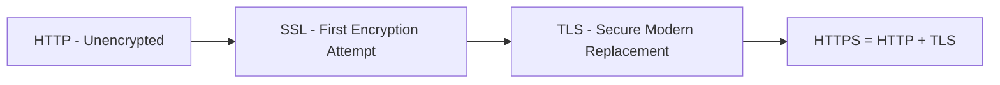
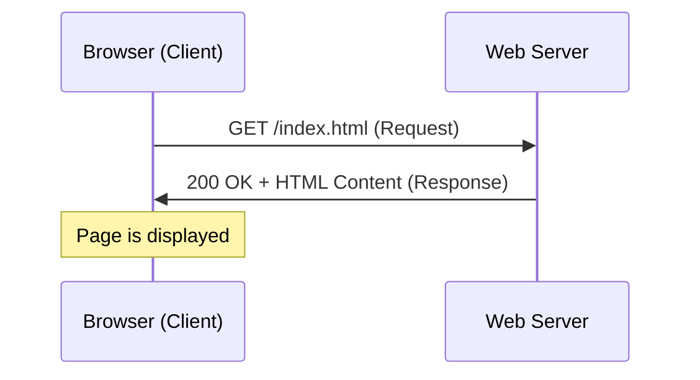
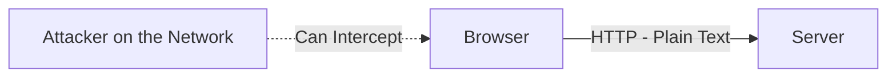
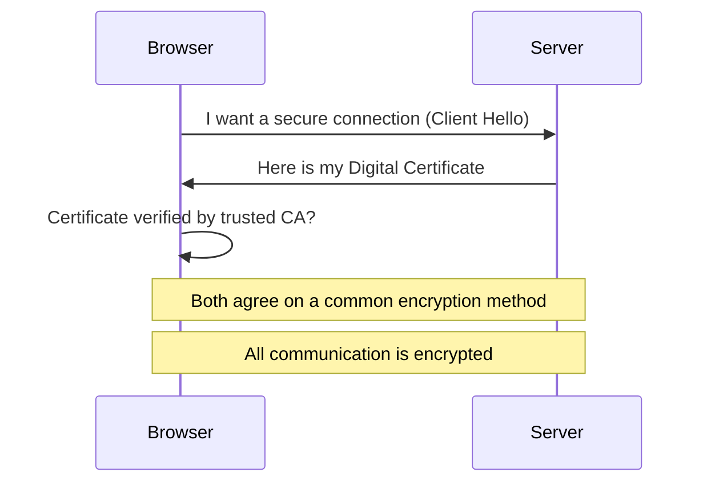
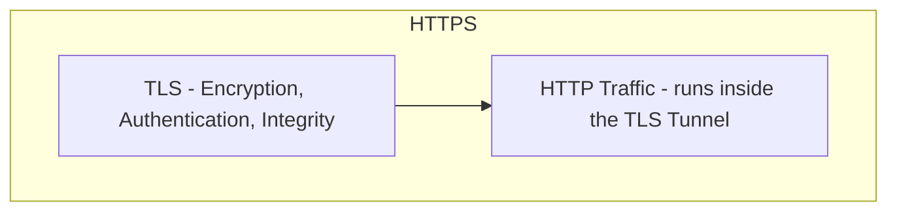
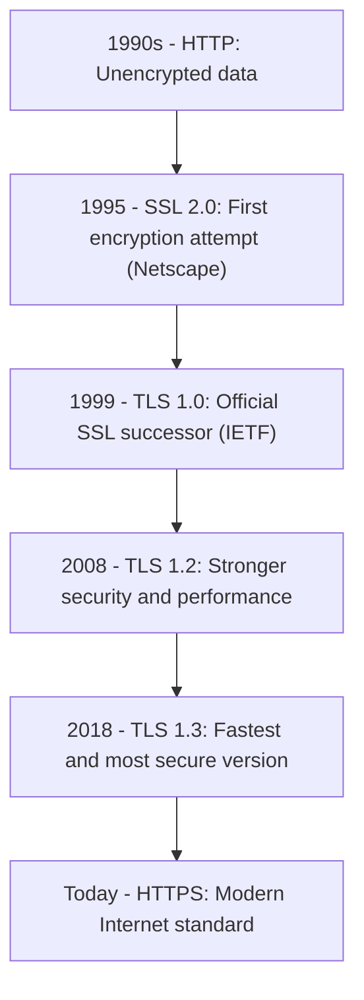

> **Goal of this section:**
> You'll understand how HTTP works without any protection, how SSL and then TLS came along to solve this problem through encryption, leading to the HTTPS we use today, and you'll be able to explain to anyone why HTTP is a real danger to any sensitive data.


## Table of Contents

- [Overview](#overview)
- [1. HTTP – HyperText Transfer Protocol](#1-http--hypertext-transfer-protocol)
- [2. SSL – Secure Sockets Layer](#2-ssl--secure-sockets-layer)
- [3. TLS – Transport Layer Security](#3-tls--transport-layer-security)
- [4. HTTPS – HTTP Secure](#4-https--http-secure)
- [Protocol Evolution Timeline](#protocol-evolution-timeline)
- [HTTP vs HTTPS](#http-vs-https)
- [Key Takeaways](#key-takeaways)
- [SOC Analyst Perspective](#soc-analyst-perspective)
- [Summary](#summary)

---

## Overview

Every time you open a website, there's a protocol running in the background to transfer the page from the server to your browser. This part explains the evolution from plain HTTP to secure HTTPS using SSL/TLS.



---

## 1. HTTP – HyperText Transfer Protocol

| Property | Value |
|---|---|
| Layer | Application Layer (Layer 7) |
| Port | 80 |
| Function | Transfers web pages between client and server |

### How it works



### Key Characteristics

- **Client-Server Model**: The client initiates the request; the server responds
- **Stateless**: HTTP does not remember previous requests. Each request is independent
  - Websites use **Cookies and Sessions** to maintain user sessions
- **Plain Text**: All data is sent unencrypted - usernames, passwords, credit card data. Anyone on the network can see it

### Major Problem



Any attacker on the network can intercept sensitive data.

**Example**:

```
Browser ─── username=admin ───► Server
        ─── password=12345
```

The attacker can see everything.

> [!WARNING]
> "Stateless" means every request is completely separate from the one before it — the server doesn't even remember that you logged in before, which is why cookies exist in the first place. If that cookie is stolen on an unencrypted HTTP network, the attacker can fully impersonate you without ever knowing the password.

---

## 2. SSL – Secure Sockets Layer

Introduced in the 1990s by **Netscape**.

**Purpose**: Solve the problem of unencrypted HTTP data.

### What SSL does

- Encrypts data between client and server
- Makes intercepted data unreadable
- Supports secure communication between client-server and server-server

### Limitation

- Vulnerabilities were discovered over time
- Replaced by TLS for better security

> [!NOTE]
> SSL in all its versions (1.0, 2.0, 3.0) is now **fully deprecated** because of known vulnerabilities (such as the POODLE Attack), and no modern browser supports it today.

---

## 3. TLS – Transport Layer Security

- TLS is the improved successor of SSL
- Same idea but more secure and modern
- Provides three main functions: **Authentication, Encryption, Integrity**

### How TLS works



### Digital Certificate

- Confirms the server's identity
- Contains the **Public Key** used for encryption

> [!IMPORTANT]
> The "Certificate verified by trusted CA?" step is the most important step in the whole process. If the browser accepts a certificate that isn't signed by a trusted Certificate Authority without verification, that opens the door wide to MITM attacks using fake certificates.

---

## 4. HTTPS – HTTP Secure

- HTTPS = HTTP + TLS
- HTTP runs inside a secure encrypted tunnel



---

## Protocol Evolution Timeline



| Year | Milestone | Description |
|---|---|---|
| 1990s | HTTP | Unencrypted data |
| 1995 | SSL 2.0 | First encryption attempt (Netscape) |
| 1999 | TLS 1.0 | Official SSL successor (IETF) |
| 2008 | TLS 1.2 | Stronger security and performance |
| 2018 | TLS 1.3 | Fastest and most secure version |
| Today | HTTPS | Modern Internet standard |

---

## HTTP vs HTTPS

| Aspect | HTTP | HTTPS |
|---|---|---|
| Port | 80 | 443 |
| Encryption | None (Plain Text) | Encrypted via TLS |
| Data Integrity | Not guaranteed | Guaranteed |
| Server Authentication | None | Verified via Digital Certificate |
| Vulnerability | Easily intercepted (Sniffing) | Protected against interception |
| Browser Indicator | No lock icon / "Not Secure" warning | Lock icon shown |

---

## Key Takeaways

- **HTTP**: Transfers web pages, Port 80, unencrypted
- **SSL**: First encryption layer, outdated
- **TLS**: Secure and modern replacement for SSL
- **HTTPS**: HTTP + TLS, Port 443, encrypted

> [!IMPORTANT]
> **Golden Rule**: any site that asks for sensitive data without HTTPS is considered insecure. Always make sure `https://` is in the browser before entering any personal data.

---

## SOC Analyst Perspective

> [!IMPORTANT]
> The move from HTTP to HTTPS isn't just a technical improvement; it's a fundamental security shift that changed how attackers attack and how the SOC monitors traffic.

### Threats Related to HTTP/HTTPS

| Threat | Description | MITRE ATT&CK Reference |
|---|---|---|
| Network Sniffing on HTTP | Capturing sensitive data (Usernames, Passwords) directly from unencrypted traffic | T1040 - Network Sniffing |
| SSL/TLS Downgrade Attack | Forcing the connection to use SSL or an old, weak TLS version instead of TLS 1.3 | T1600 - Weaken Encryption |
| Certificate Spoofing / Fake CA | Using a fake certificate, or one signed by an untrusted authority, to impersonate a server and perform MITM | T1553.002 - Subvert Trust Controls: Code Signing |
| HTTPS-based C2 Communication | Using ordinary HTTPS to hide Command and Control communication among legitimate encrypted traffic | T1071.001 - Application Layer Protocol: Web Protocols |

> [!WARNING]
> Encryption in HTTPS **protects the content of the data**, but it **doesn't prevent** HTTPS itself from being used as a channel for attacks such as C2 Communication. The attacker can use normal HTTPS to hide their activity, which makes analyzing the metadata (such as traffic volume, frequency, and the domain being contacted) more important than trying to "decrypt" the traffic itself.

### Detection & Best Practices

- Enable **HSTS (HTTP Strict Transport Security)** on web servers to prevent the browser from accidentally accepting any unencrypted HTTP connection
- Monitor any connection attempt on **Port 80** to services that are supposed to run only on HTTPS, because it may indicate a misconfiguration or a downgrade attempt
- Use **SSL/TLS Inspection** tools (if the security policy allows it) to inspect the content of HTTPS traffic at specific points in the network
- Analyze **JA3/JA3S Fingerprints** and the **SNI (Server Name Indication)** in the TLS Handshake to identify malware tools trying to hide among normal HTTPS
- Verify the validity of digital certificates and detect any unusual **Self-Signed Certificates** inside the network

> [!TIP]
> If an employee connects to an internal or external site and gets a "Certificate Not Trusted" or "Connection Not Private" warning, that's not just a technical annoyance — it could be the first indicator of an **MITM Attack** actually underway on the network, and it must be taken seriously right away.

---

## Summary

- **HTTP** is a simple protocol for transferring web pages on **Port 80**, but it's **completely unencrypted**, and any sensitive data in it can easily be stolen
- **SSL** was the first attempt to solve this problem, but it became **outdated and weak** and has been fully replaced
- **TLS** is the secure, modern replacement; it provides **Authentication, Encryption, Integrity** through a handshake process that includes verifying the Digital Certificate
- **HTTPS = HTTP + TLS**, runs on **Port 443**, and is the current standard for any secure website
- From the SOC perspective: the most important related threats are **Network Sniffing on HTTP (T1040)**, **SSL/TLS Downgrade (T1600)**, **Certificate Spoofing (T1553.002)**, and **Using HTTPS to hide C2 Communication (T1071.001)**
- The core protection tools: **HSTS, SSL/TLS Inspection, JA3/SNI Fingerprint analysis,** and continuous monitoring of digital certificate validity
