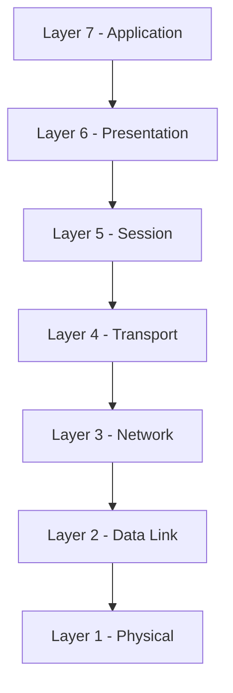
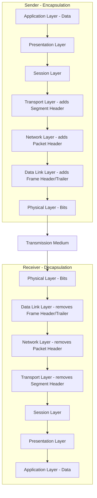
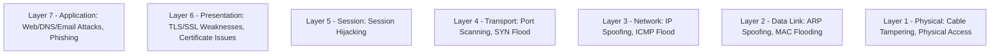

> **Goal of this section:**
>  You'll understand the OSI Model in detail, its seven layers and how data moves from one layer to the next, and you'll be able to link each layer to its related detection tools and attacks, so that when you analyze any incident you can pinpoint exactly which layer the problem is in.

## Table of Contents

- [What is the OSI Model?](#what-is-the-osi-model)
- [Why the OSI Model is Important](#why-the-osi-model-is-important)
- [The Seven Layers of the OSI Model](#the-seven-layers-of-the-osi-model)
  - [7 - Application Layer](#7-application-layer)
  - [6 - Presentation Layer](#6-presentation-layer)
  - [5 - Session Layer](#5-session-layer)
  - [4 - Transport Layer](#4-transport-layer)
  - [3 - Network Layer](#3-network-layer)
  - [2 - Data Link Layer](#2-data-link-layer)
  - [1 - Physical Layer](#1-physical-layer)
- [How Data Flows Through the OSI Model](#how-data-flows-through-the-osi-model)
- [Protocols Used in the OSI Layers](#protocols-used-in-the-osi-layers)
- [Key Takeaways](#key-takeaways)
- [SOC Analyst Perspective](#soc-analyst-perspective)
- [Summary](#summary)

---

## What is the OSI Model?

The **OSI (Open Systems Interconnection) Model** is a conceptual framework that explains how different computer systems communicate with each other over a network. It was developed by the **International Organization for Standardization (ISO)** to standardize how network communication works and to ensure interoperability between devices and technologies from different vendors.

The OSI Model divides the communication process into seven distinct layers, and each layer has a specific function and responsibility. Dividing things up this way makes it easier to design and implement a network, and even to troubleshoot any problem in it.

> [!NOTE]
> The OSI Model is a **Reference Model**, not a protocol that is actually implemented. In other words, real networks use protocols (such as TCP/IP) inspired by this layered idea, not the OSI Model itself to the letter.

---

## Why the OSI Model is Important

- Provides a clear structure for how data moves across a network
- Ensures compatibility and interoperability between different systems
- Simplifies network design and development
- Helps in troubleshooting by isolating problems to a specific layer
- Serves as a standard reference model in networking education and certifications

> [!TIP]
> The advantage of dividing the network into layers is that it lets you isolate the problem. For example, if the internet is down, you can ask yourself: "Is the problem in the cable (Layer 1)? In the IP configuration (Layer 3)? Or in the application itself (Layer 7)?" This speeds up the fix considerably.

---

## The Seven Layers of the OSI Model

Each layer in the OSI Model performs a specific function and deals only with the layer directly above it and the layer directly below it.

> [!TIP]
> There's a well-known mnemonic for memorizing the layers from top to bottom: **"All People Seem To Need Data Processing"** (Application, Presentation, Session, Transport, Network, Data Link, Physical).

---

### 7 - Application Layer

- Provides network services directly to end-user applications
- Enables communication between software applications and the network
- Examples: **HTTP, FTP, SMTP, DNS**

> [!NOTE]
> This is the only layer the user interacts with directly (such as opening a browser or sending an email), but it isn't the application itself (such as Chrome); it's the layer that provides the service the application uses to communicate with the network.

---

### 6 - Presentation Layer

- Translates data into a format that the application layer can understand
- Handles **encryption, decryption, compression, and formatting**

> [!IMPORTANT]
> **SSL/TLS Encryption** conceptually happens in this area, which makes it very important from a security standpoint, because any weakness in the encryption here can expose the data to the risk of interception.

---

### 5 - Session Layer

- Establishes, manages, and terminates communication sessions
- Controls dialog between devices and synchronizes data exchange

> [!NOTE]
> This layer is responsible for opening and closing the session in an orderly way, such as managing the communication session between the browser and the server for as long as you're browsing a particular website.

---

### 4 - Transport Layer

- Ensures reliable or unreliable data delivery between devices
- Manages **segmentation, flow control, and error control**
- Uses **port numbers** to identify applications
- Examples: **TCP, UDP**

> [!IMPORTANT]
> The difference between **TCP** and **UDP** is fundamental: TCP guarantees data delivery (Reliable - Connection-Oriented) through the three-way handshake, while UDP sends data without confirming delivery (Unreliable - Connectionless), which makes it faster but less dependable in terms of guaranteeing delivery.

---

### 3 - Network Layer

- Determines the best path for data transmission
- Handles logical addressing and routing
- Examples: **IP, ICMP**

> [!NOTE]
> This is where **Logical Addressing** happens using IP addresses, and it's also where the best path for the data is determined through routing.

---

### 2 - Data Link Layer

- Provides node-to-node data transfer
- Uses **MAC addresses** for device identification
- Handles error detection and frame synchronization
- Examples: **Ethernet, ARP**

> [!WARNING]
> Attacks such as **ARP Spoofing / MAC Flooding** target this layer specifically, because it relies on implicit trust between devices when resolving MAC addresses, without strong verification.

---

### 1 - Physical Layer

- Transmits raw binary data (bits) over physical media
- Defines cables, connectors, voltages, and signaling

> [!NOTE]
> This is the raw physical layer that deals with the electrical or optical signals that carry the bits (0s and 1s) across cables or through the air.

---

## How Data Flows Through the OSI Model

When data is sent from one device to another:

1. The data moves downward through the OSI layers on the sending device (Sender)
2. It travels across the physical medium
3. The data moves upward through the OSI layers on the receiving device (Receiver)

Each layer adds or removes its own header during this process, which is called **Encapsulation** (when sending) and **Decapsulation** (when receiving).

> [!TIP]
> The name of the data changes depending on the layer, and this is known as the **Protocol Data Unit (PDU)**:

| Layer | PDU Name |
|---|---|
| Application / Presentation / Session | Data |
| Transport | Segment (TCP) / Datagram (UDP) |
| Network | Packet |
| Data Link | Frame |
| Physical | Bits |

---

## Protocols Used in the OSI Layers

| Layer | Layer Name | Protocols / Examples |
|---|---|---|
| 7 | Application | HTTP, FTP, SMTP, DNS |
| 6 | Presentation | SSL/TLS, JPEG, ASCII |
| 5 | Session | NetBIOS, RPC, PPTP |
| 4 | Transport | TCP, UDP |
| 3 | Network | IP, ICMP |
| 2 | Data Link | Ethernet, ARP |
| 1 | Physical | Cables, Hubs, NICs (Physical Signaling) |

---

## Key Takeaways

- The OSI Model consists of 7 layers, each with a specific role
- It is a reference framework, not a protocol
- It simplifies learning, designing, and troubleshooting networks
- Widely used in networking education and documentation

---

## SOC Analyst Perspective

> [!IMPORTANT]
> A deep understanding of the OSI Model is the foundation of any successful **Threat Hunting** or **Incident Response**, because most SOC tools specialize in a particular layer:

| Layer | Common Detection Tools / Focus |
|---|---|
| Layer 7 | Web Application Firewall (WAF), Proxy Logs, DNS Logs |
| Layer 6 | SSL/TLS Inspection Tools, Certificate Monitoring |
| Layer 5 | Application Logs, Session Monitoring |
| Layer 4 | IDS/IPS, NetFlow (Port/Protocol Analysis) |
| Layer 3 | Firewall, Router ACLs, IP Reputation Lists |
| Layer 2 | Switch Port Security, ARP Monitoring Tools |
| Layer 1 | Physical Security, Cable Management, NAC (Network Access Control) |

> [!TIP]
> When you use a tool like **Wireshark**, you're actually reading traffic at different levels of the OSI Model at the same time - from the frame (Layer 2) up to the application data (Layer 7) - which is why understanding the layers is essential for interpreting any packet capture correctly.

---

## Summary

- The **OSI Model** is a 7-layer conceptual framework that explains how devices communicate over a network; it's a reference model, not an actual protocol
- The layers from top to bottom: **Application → Presentation → Session → Transport → Network → Data Link → Physical**
- Each layer has its own PDU (Data, Segment, Packet, Frame, Bits) and adds/removes a header during **Encapsulation/Decapsulation**
- From a SOC standpoint: each layer is associated with a different type of attack and detection tools (such as ARP spoofing at Layer 2, port scanning at Layer 4, and phishing at Layer 7)
- A deep understanding of the OSI Model helps you isolate any problem or attack in the correct layer, which is the foundation of any successful troubleshooting or incident response
