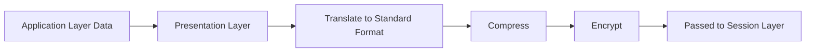
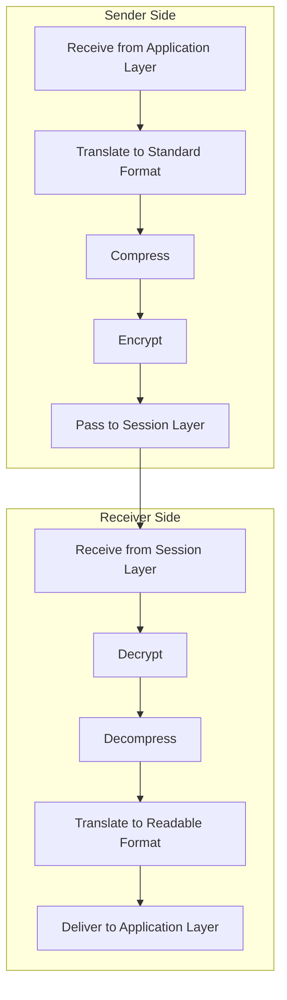
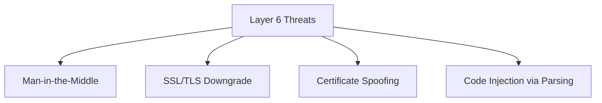

> **Goal of this section:**
>  You will understand how the Presentation Layer translates, encrypts, and compresses data so that different systems can understand each other, and you will get to know the most common TLS/SSL attacks that specifically target this layer, such as Downgrade Attacks and Certificate Spoofing.

## Table of Contents

- [Overview](#overview)
- [Key Responsibilities](#key-responsibilities)
- [How the Presentation Layer Works](#how-the-presentation-layer-works)
- [Services Provided](#services-provided)
- [Common Protocols](#common-protocols)
- [Security Considerations and Attacks](#security-considerations-and-attacks)
- [SOC Analyst Perspective](#soc-analyst-perspective)
- [Summary](#summary)

---

## Overview

The **Presentation Layer** is the sixth layer of the OSI Model. It is responsible for translating, encrypting, compressing, and formatting data so that the communicating systems can understand each other correctly.

| Property | Value |
|---|---|
| OSI Layer | 6 |
| Also Known As | Translation Layer / Syntax Layer |
| Primary Role | Data representation, security, and efficiency |

The Presentation Layer ensures that data sent from the Application Layer is converted into a Standard Format before transmission, and that received data is translated back into a usable format.

> [!NOTE]
> Think of this layer as the "simultaneous interpreter" at an international meeting: it takes speech in one language (format) and translates it into another language the other party understands, while making sure the meaning (Semantics) doesn't change during translation.

---

## Key Responsibilities

### 1. Data Translation

It converts data between application-specific formats and standard network formats. This allows different systems, architectures, and encodings to communicate effectively.

**Example**: ASCII ↔ Unicode

### 2. Data Compression

It reduces the size of data before transmission to improve bandwidth usage and boost performance.

### 3. Data Encryption & Decryption

It protects data in transit by encrypting it at the sender and decrypting it at the receiver.

### 4. Syntax and Semantics Management

It ensures that the structure of the data (Syntax) and its meaning (Semantics) remain consistent between the sender and the receiver.

### 5. Transfer Syntax Negotiation

The rules for representing the data (format, encoding, compression) are agreed upon before communication begins.

> [!IMPORTANT]
> This **Transfer Syntax Negotiation** process is essentially what happens in practice in the **TLS Handshake**, when the two devices agree on the type of encryption (Cipher Suite) they will use before exchanging any actual data.

---

## How the Presentation Layer Works

### Sender Side

1. Receives data from the Application Layer
2. Translates data into a standard format
3. Applies compression (if needed)
4. Encrypts data for security
5. Passes data to the Session Layer

### Receiver Side

1. Receives data from the Session Layer
2. Decrypts the data
3. Decompresses the data
4. Translates it into a readable format
5. Delivers data to the Application Layer

---

## Services Provided

- Format Translation
- Data Compression
- Data Encryption and Decryption
- Cross-platform Compatibility

---

## Common Protocols

| Protocol | Purpose |
|---|---|
| SSL (Secure Socket Layer) | Legacy encryption protocol |
| TLS (Transport Layer Security) | Secure successor to SSL |
| XDR (External Data Representation) | Standard data encoding |
| NDR (Network Data Representation) | Data representation for network communication |
| AFP (Apple Filing Protocol) | File services for macOS |
| NCP (NetWare Core Protocol) | File and print services in Novell NetWare |

> [!WARNING]
> The **SSL** protocol in all its versions (including SSLv3) is now officially **Deprecated** because of known security vulnerabilities (such as the POODLE Attack), and you should now rely entirely on **TLS** (specifically versions 1.2 and 1.3).

---

## Security Considerations and Attacks

Since the Presentation Layer handles encryption and data formatting, it is a frequent target of attacks:

- **Man-in-the-Middle (MITM)** – Intercepting communications
- **SSL/TLS Downgrade Attacks** – Forcing weaker encryption
- **Certificate Spoofing** – Using fake digital certificates
- **Code Injection** – Exploiting data parsing vulnerabilities

---

## SOC Analyst Perspective

| Threat | Description | MITRE ATT&CK Reference |
|---|---|---|
| Man-in-the-Middle (MITM) | The attacker places themselves between the two parties of a connection to intercept or modify the encrypted data | T1557 - Adversary-in-the-Middle |
| SSL/TLS Downgrade Attack | Forcing the two devices to use a weaker encryption version (such as SSLv3 instead of TLS 1.3) to make decryption or the exploitation of known vulnerabilities easier | T1600 - Weaken Encryption |
| Certificate Spoofing | Using a fake or stolen digital certificate to impersonate a trusted server | T1553.002 - Subvert Trust Controls: Code Signing |
| Code Injection (Parsing Vulnerabilities) | Exploiting vulnerabilities in how data formats (such as XML or JSON) are parsed to execute malicious code | T1190 - Exploit Public-Facing Application |

> [!IMPORTANT]
> **SSL/TLS Downgrade Attacks** are very dangerous because they often happen without the user noticing anything unusual: the browser still shows a "security padlock," but the actual encryption has become much weaker and easy to break.

### Detection & Best Practices

- Monitor **Certificate Validity** and verify certificates against trusted Certificate Authorities (CAs), and flag any unexpected **Self-Signed Certificates**
- Use **Certificate Pinning** in sensitive applications to prevent accepting any certificate other than the expected one, even if it is signed by a trusted CA
- Analyze **JA3/JA3S Fingerprints** to identify abnormal TLS Handshake patterns, which can reveal attack tools or malware trying to mimic legitimate traffic
- Monitor any connection attempt that uses old TLS versions (such as TLS 1.0/1.1) or SSL, because this indicates a downgrade attempt or an old system that needs updating

> [!TIP]
> If you see in the logs a connection that starts with a TLS 1.3 attempt and then suddenly falls back to TLS 1.0 or SSLv3 for no clear reason, that's a strong indicator of a possible **Downgrade Attack** and deserves immediate investigation.

---

## Summary

- The **Presentation Layer** (Layer 6) is responsible for **translation, compression, and encryption** so that different systems can understand each other
- Its most important functions: **Data Translation, Data Compression, Encryption/Decryption, Syntax/Semantics Management, Transfer Syntax Negotiation**
- The most important protocols: **SSL (Legacy/Deprecated)** and **TLS (current and secure)**, in addition to XDR, NDR, AFP, NCP
- The most common attacks on this layer: **MITM, SSL/TLS Downgrade, Certificate Spoofing, Code Injection**
- From the SOC's perspective: monitoring the validity of digital certificates, using Certificate Pinning, and analyzing JA3 Fingerprints are all essential tools for detecting exploitation attempts at the encryption level, and they map to MITRE **T1557, T1600, T1553.002, T1190**
