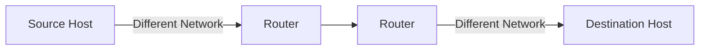
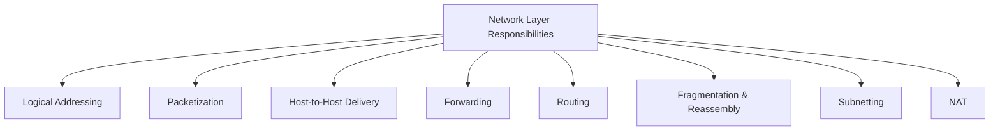
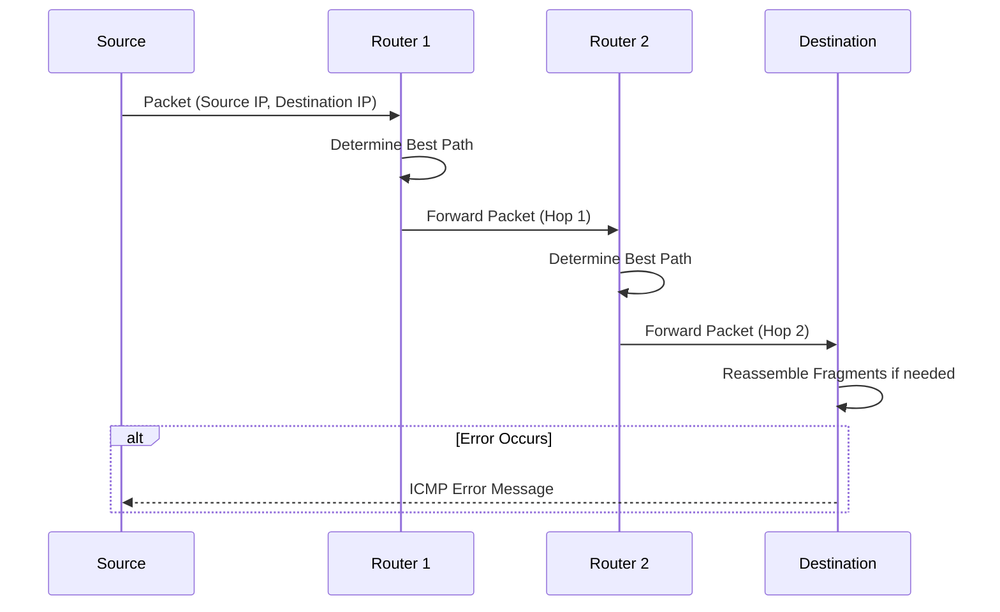
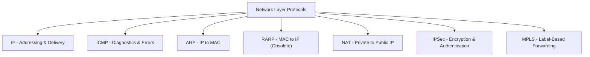
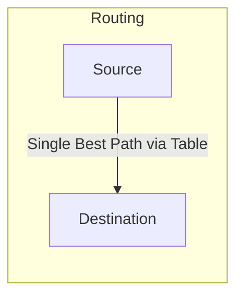
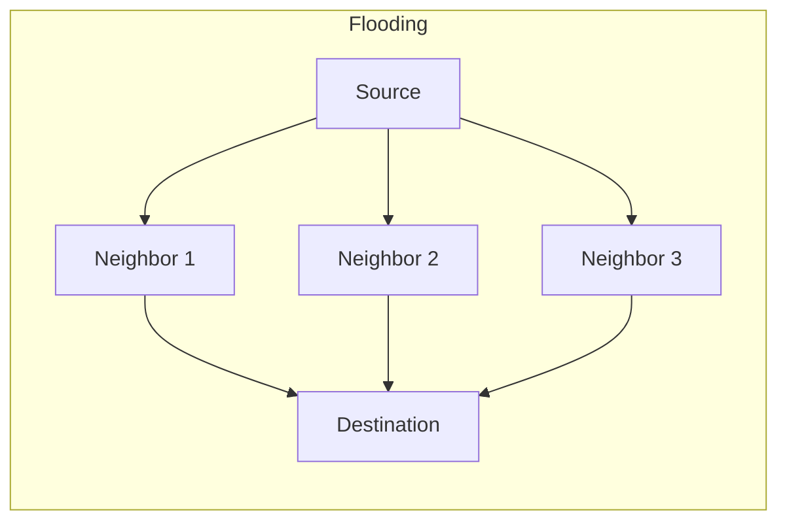

> **The goal of this section:**  
> You'll understand how the Network Layer delivers data between completely different networks through Logical Addressing and Routing, get to know its most important responsibilities and protocols, and be able to tell the difference between Routing and Flooding.

## Table of Contents

- [Overview](#overview)
- [Key Responsibilities of the Network Layer](#key-responsibilities-of-the-network-layer)
- [How the Network Layer Works](#how-the-network-layer-works)
- [Protocols Operating at the Network Layer](#protocols-operating-at-the-network-layer)
- [Routing Protocols](#routing-protocols)
- [Advantages of the Network Layer](#advantages-of-the-network-layer)
- [Limitations of the Network Layer](#limitations-of-the-network-layer)
- [Difference Between Routing and Flooding](#difference-between-routing-and-flooding)
- [SOC Analyst Perspective](#soc-analyst-perspective)
- [Summary](#summary)

---

## Overview

The **Network Layer** is the third layer of the OSI Model, and it's responsible for **Logical Addressing**, **Routing**, and **End-to-End Packet Delivery** across interconnected networks.

- Handles logical (IP) addressing of devices
- Determines optimal routing paths between networks
- Enables host-to-host communication across multiple networks

> [!NOTE]
> Unlike the **Data Link Layer**, which focuses only on delivery within the same Network Segment (Node-to-Node), the **Network Layer** ensures that data gets from the source Host to the final Host even if they're on completely different networks.

---

## Key Responsibilities of the Network Layer

- **Logical Addressing**: Assigns unique IP addresses to devices, ensuring accurate identification and communication across networks
- **Packetization**: Encapsulates transport layer segments into packets for efficient transmission
- **Host-to-Host Delivery**: Ensures reliable delivery of packets from the sender to the intended receiver across diverse networks
- **Forwarding**: Moves packets from the input interface of a router to the appropriate output interface based on the destination IP
- **Routing**: Determines the optimal path for packets to travel across multiple networks using routing algorithms and protocols
- **Fragmentation and Reassembly**: Splits large packets into smaller fragments to match the Maximum Transmission Unit (MTU) of a network, and reassembles them at the destination
- **Subnetting**: Divides larger networks into smaller subnetworks for efficient addressing and traffic management
- **Network Address Translation (NAT)**: Maps private IPs to public IPs for internet communication, conserving address space and adding security

> [!TIP]
> Think of the difference between **Forwarding** and **Routing** this way: Routing is the "planning" - determining the best possible path in advance and storing it in a table (the Routing Table). Forwarding is the "execution" - the actual, fast decision for each arriving Packet about which Interface it should move to, based on that table.

---

## How the Network Layer Works

1. Each device is assigned a unique logical address (IP address)
2. Data from the transport layer is encapsulated into packets, with source and destination IPs attached
3. Routers analyze the destination address and determine the best available path
4. Packets traverse the network hop-by-hop, moving across routers until reaching the destination
5. If the packet size exceeds the MTU, it is fragmented into smaller units
6. At the destination, the fragments are reassembled into the original data
7. If errors occur (e.g., unreachable destination), protocols like ICMP send error messages back to the source

> [!IMPORTANT]
> The **Fragmentation** step happens if the Packet size is larger than the **MTU (Maximum Transmission Unit)** of any network along the path. The problem is that the Fragments only get reassembled at the final destination, which increases the Processing Overhead and is a common source of performance problems.

---

## Protocols Operating at the Network Layer

| Protocol | Purpose |
|---|---|
| IP (Internet Protocol - IPv4/IPv6) | Provides logical addressing and delivers packets across networks; IPv6 offers a larger address space and better efficiency |
| ICMP (Internet Control Message Protocol) | Sends error reports and diagnostic messages (e.g., destination unreachable, ping) |
| ARP (Address Resolution Protocol) | Maps IP addresses to MAC addresses within a local network |
| RARP (Reverse Address Resolution Protocol) | Retrieves a device's IP address using its MAC address (largely obsolete) |
| NAT (Network Address Translation) | Converts private IP addresses to public IPs, conserving addresses and improving security |
| IPSec (Internet Protocol Security) | Secures IP communication through encryption and authentication |
| MPLS (Multiprotocol Label Switching) | Uses labels to forward packets efficiently and manage traffic |

---

## Routing Protocols

| Protocol | Type | Description |
|---|---|---|
| RIP (Routing Information Protocol) | Distance-Vector | Distance-vector protocol using hop count to select routes |
| OSPF (Open Shortest Path First) | Link-State | Link-state protocol that computes the shortest path using network topology |
| BGP (Border Gateway Protocol) | Path-Vector | Path-vector protocol that routes data between autonomous systems on the internet |

> [!IMPORTANT]
> **BGP** is the protocol that actually ties the entire internet together (it directs Traffic between different Autonomous Systems, such as telecom companies and ISPs), and any problem with it or attack on it can affect a very wide portion of the internet.

---

## Advantages of the Network Layer

- Enables end-to-end communication across multiple networks
- Supports scalability by allowing subnetting and hierarchical addressing
- Efficiently routes packets using shortest-path and dynamic routing algorithms
- Provides inter-networking by connecting heterogeneous networks

---

## Limitations of the Network Layer

- No flow control mechanism; congestion may occur if too many datagrams are in transit
- Limited error control; mainly relies on upper layers for reliability
- Routers may drop packets under heavy load, leading to possible data loss
- Fragmentation increases processing overhead and may affect performance

> [!WARNING]
> Since the Network Layer **has no built-in Flow Control**, the responsibility for controlling the transmission rate and preventing Congestion falls entirely on higher layers (such as TCP at the Transport Layer). Understanding this point is important so you can correctly identify the source of any performance problem - is it at the Routing level itself, or in the rate control above it?

---

## Difference Between Routing and Flooding

| Routing | Flooding |
|---|---|
| A routing table is required | No Routing table is required |
| May give the shortest path | Always gives the shortest path |
| Routing is less reliable | Flooding is more reliable |
| Traffic is less in Routing | Traffic is more in Flooding |
| Duplicate packets are not present | Duplicate packets are present |

> [!NOTE]
> **Flooding** sends a copy of the Packet out of every Interface except the one it arrived on, which guarantees the data gets through (even if many paths are cut), but at the cost of a huge load of duplicate Traffic compared to normal Routing, which relies on a specific table.

---

## SOC Analyst Perspective

> [!IMPORTANT]
> The Network Layer is where most of the basic Traffic Filtering decisions happen (Firewalls, Router ACLs), so it's important to understand its responsibilities well so you can correctly analyze any Log or event related to Routing or IP Addressing.

### Common Threats at the Network Layer

| Threat | Description | MITRE ATT&CK Reference |
|---|---|---|
| IP Spoofing | Forging the Source IP Address to impersonate another device or hide the source of the attack | T1090 - Proxy |
| ICMP-based DoS (Ping/Smurf Flood) | Flooding the target with ICMP packets to exhaust its resources | T1498 / T1499 - Network/Endpoint Denial of Service |
| Routing Table Manipulation | Tampering with Routing tables (such as BGP Hijacking) to divert the Traffic's path | T1584.004 - Compromise Infrastructure: Server |
| Fragmentation-based Evasion | Deliberately fragmenting packets to evade IDS/IPS tools | T1027 - Obfuscated Files or Information |

### Detection & Best Practices

- Enable **Ingress/Egress Filtering** on Routers to block packets with a spoofed Source IP
- Monitor for unexpected **Routing Table Changes**, especially in environments that use BGP
- Review **NAT and Firewall Logs** regularly to understand internal and external connection patterns
- Use Fragmentation analysis tools to detect attempts to evade the IDS/IPS

> [!TIP]
> When you analyze any security incident at the network level, ask yourself: "Is this problem in the Addressing (who is talking), or in the Routing (the path the data is taking)?" - that distinction quickly points you to the right Log source (Firewall/ACLs for Addressing, Routing Protocol Logs for Routing).

---

## Summary

- The **Network Layer** (Layer 3) is responsible for **Logical Addressing, Routing, and End-to-End Delivery** across interconnected networks
- Its main responsibilities: Logical Addressing, Packetization, Forwarding, Routing, Fragmentation/Reassembly, Subnetting, NAT
- Its main protocols: **IP (IPv4/IPv6), ICMP, ARP, RARP**, plus NAT, IPSec, MPLS
- **Routing** protocols: RIP (Distance-Vector), OSPF (Link-State), BGP (Path-Vector - the backbone of the internet)
- **The difference between Routing and Flooding**: Routing is more efficient with less Traffic, while Flooding is more reliable but carries a higher load and Duplicate Packets
- From the SOC side: the main threats are **IP Spoofing, ICMP-based DoS, and Routing Table Manipulation**, and tools like Ingress Filtering and monitoring Routing tables are essential for protection
