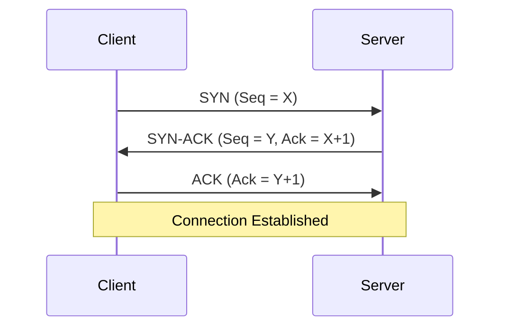
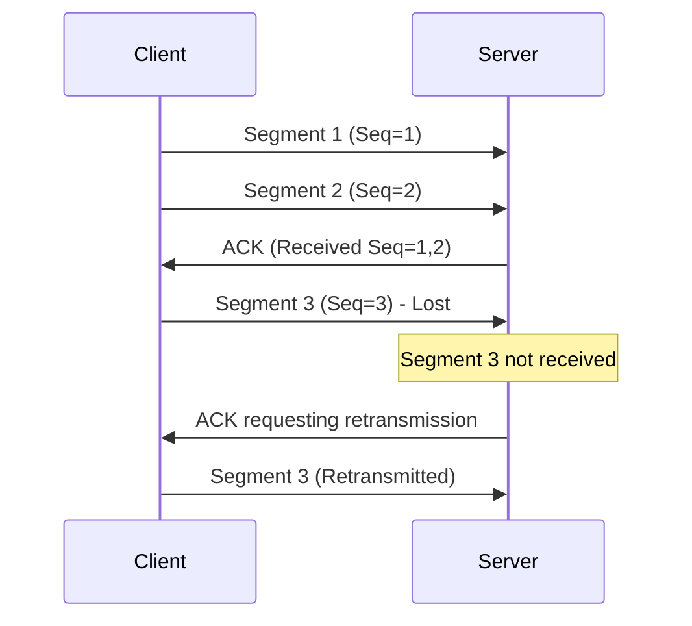
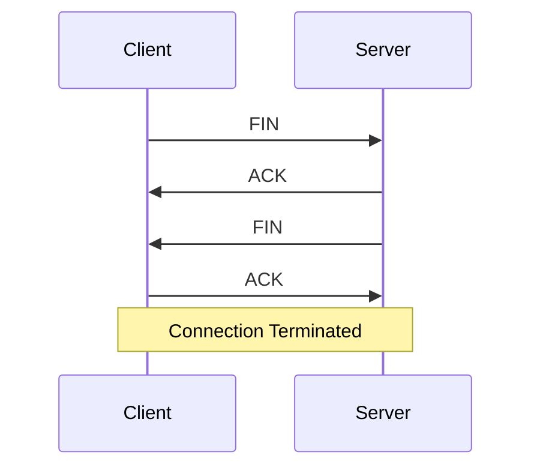
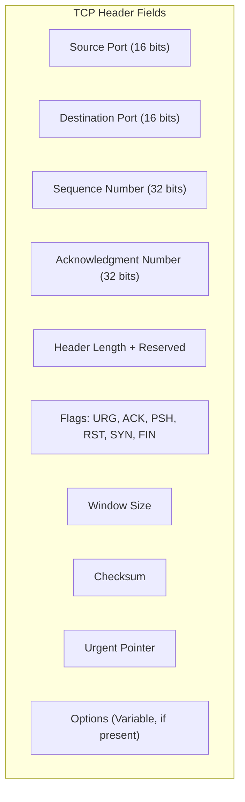

> **Goal of this section:**
>  You'll understand TCP in detail - how it opens a connection, how it closes it safely, and what's inside its Header, and you'll be able to link each step to the types of attacks and Scanning Techniques that exploit the TCP Flags themselves.

# Transmission Control Protocol (TCP)

## Table of Contents

- [Overview](#overview)
- [Key Characteristics of TCP](#key-characteristics-of-tcp)
- [How TCP Works](#how-tcp-works)
  - [1. Connection Establishment (Three-Way Handshake)](#1-connection-establishment-three-way-handshake)
  - [2. Data Transmission](#2-data-transmission)
  - [3. Connection Termination (Four-Way Handshake)](#3-connection-termination-four-way-handshake)
- [TCP Header](#tcp-header)
- [Common Uses of TCP](#common-uses-of-tcp)
- [SOC Analyst Perspective](#soc-analyst-perspective)
- [Summary](#summary)

---

## Overview

**Transmission Control Protocol (TCP)** is a core networking protocol that operates at **Layer 4 (Transport Layer)** of the OSI Model. It was designed to provide Reliable, Ordered, and Error-Checked delivery of data between Applications running on different devices across the network.

TCP is a core part of the **TCP/IP Protocol Suite**, and it's widely used in internet services such as web browsing, email, and file transfer.

---

## Key Characteristics of TCP

- **Connection-Oriented**: A connection must be established before data transmission begins
- **Reliable Data Transfer**: Ensures that all data reaches the destination without loss or corruption
- **Ordered Delivery**: Data is received in the same sequence in which it was sent
- **Error Detection and Recovery**: Lost or damaged segments are detected and retransmitted
- **Flow Control**: Prevents the sender from overwhelming the receiver
- **Congestion Control**: Adjusts transmission speed based on network conditions

> [!NOTE]
> The difference between **Flow Control** and **Congestion Control**: the first protects the **Receiver** from being flooded with data faster than it can process it, and the second protects **the network itself** from congestion by adjusting the sending rate according to network conditions.

---

## How TCP Works

### 1. Connection Establishment (Three-Way Handshake)

Before any data is sent, TCP opens a connection using a 3-step process:

- **SYN (Synchronize)**: The sender requests a connection
- **SYN-ACK (Synchronize-Acknowledge)**: The receiver agrees and acknowledges the request
- **ACK (Acknowledge)**: The sender confirms, and the connection is established

This process ensures that both devices are ready to communicate and are Synchronized with each other.

> [!IMPORTANT]
> The **Sequence Numbers** in the Handshake aren't just a formality - they're what ensure both sides agree on the "starting point" for numbering the data, which is essential for correctly Reassembling the data later.

### 2. Data Transmission

- Data is divided into smaller units called **segments**
- Each segment includes **sequence numbers** and **port information**
- The receiver sends **acknowledgements (ACKs)** for received segments
- If a segment is lost, TCP automatically **retransmits** it

### 3. Connection Termination (Four-Way Handshake)

TCP closes the connection safely using a 4-step process:

1. **FIN**: One side requests to close the connection
2. **ACK**: The other side acknowledges the request
3. **FIN**: The second side signals it is ready to close
4. **ACK**: Final acknowledgement, and the connection is terminated

This ensures that all remaining data has been delivered before the connection is terminated.

> [!NOTE]
> Why does closing need 4 steps instead of 3 like opening? Because each side has to close its own direction separately (TCP is Full-Duplex), so the two sides can't close in a single shared step the way they open.

---

## TCP Header

| Field | Purpose |
|---|---|
| Source / Destination Port | Identifies the Application on each end of the connection |
| Sequence Number | Numbers the data so it can be reassembled in the correct order |
| Acknowledgment Number | Confirms receipt of the data up to a specific number |
| Flags | Control the state of the connection (SYN to open the connection, FIN to close it, RST to terminate it abruptly, ACK to acknowledge, PSH to push data immediately, URG for urgent data) |
| Window Size | The amount of data that can be sent before waiting for an Acknowledgment (part of Flow Control) |
| Checksum | Verifies the integrity of the data and that it wasn't corrupted in transit |

> [!IMPORTANT]
> The **Flags** field is the most important part for a SOC Analyst, because it shows the state of each Segment - and that's exactly what's used when analyzing any suspicious Traffic.

---

## Common Uses of TCP

- Web applications (HTTP / HTTPS)
- Email services (SMTP, POP3, IMAP)
- File transfers (FTP)
- Remote access (SSH)

---

## SOC Analyst Perspective

> [!IMPORTANT]
> Each phase of TCP (the Handshake, data transfer, closing) has its own way of being exploited, so it's important to understand each phase in order to detect Anomalies in it.

### Attacks Exploiting TCP Mechanics

| Attack | Exploits | MITRE ATT&CK Reference |
|---|---|---|
| SYN Flood | Flooding the Server with many SYN Packets without completing the Handshake, so it reserves resources for "Half-Open" connections until its resources run out | T1499 - Endpoint Denial of Service |
| TCP Reset (RST) Attack | Sending a spoofed RST packet to forcibly close an existing connection between two parties (Connection Hijacking/Disruption) | T1498 / T1557 |
| TCP Session Hijacking | Predicting or stealing the Sequence Numbers of an existing connection in order to impersonate one of the parties | T1557 - Adversary-in-the-Middle |
| Port Scanning (SYN/FIN/NULL/XMAS Scan) | Sending Segments with different Flags (such as SYN only, FIN only, or no Flags at all) to probe the state of Ports without completing a full connection | T1046 - Network Service Discovery |

> [!WARNING]
> Scanning techniques such as the **FIN Scan**, **NULL Scan**, and **XMAS Scan** exploit the fact that some systems respond differently to Segments with unusual Flags (such as a Segment containing only FIN without a preceding SYN), which gives the attacker information about the Port's state without making a full connection that would easily show up in traditional logs.

> [!TIP]
> When you analyze Traffic in Wireshark or any IDS, watch for patterns such as:
> - A large number of SYN Packets with no ACK following to complete them (an indicator of a SYN Flood or Scanning)
> - Many unexpected RST Packets in a connection that was working normally
> - Segments with illogical Flags (such as SYN+FIN together at the same time), which is usually an indicator of a Scanning Tool or manually modified Traffic (Crafted Packets)

---

## Summary

- **TCP** is a reliable, Connection-Oriented protocol that guarantees complete, ordered delivery of data, and it operates at **Layer 4**
- It opens the connection with the **Three-Way Handshake** (SYN, SYN-ACK, ACK) and closes it with the **Four-Way Handshake** (FIN, ACK, FIN, ACK)
- It uses **Sequence Numbers** and **Acknowledgments** to make sure the data arrives complete and in the right order, and it retransmits any lost Segment
- The **TCP Header** contains core fields such as Ports and Sequence/Acknowledgment Numbers, and the most important one for the SOC is the **Flags** field
- Used in applications that need accuracy more than speed: **HTTP/HTTPS, SMTP/POP3/IMAP, FTP, SSH**
- From the SOC's perspective: the Handshake mechanism itself is exploited in a **SYN Flood (T1499)**, and the Flags are used in **Port Scanning (T1046)** techniques such as FIN/NULL/XMAS Scans, which makes TCP Flag analysis an essential part of any Traffic Analysis
