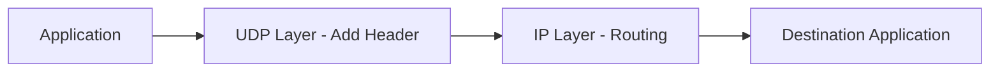
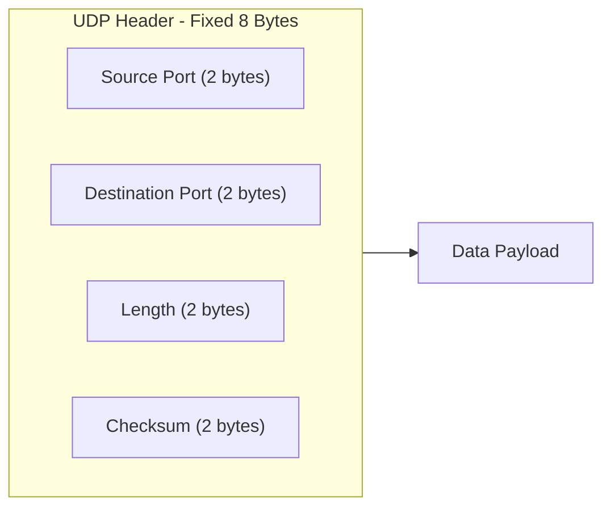
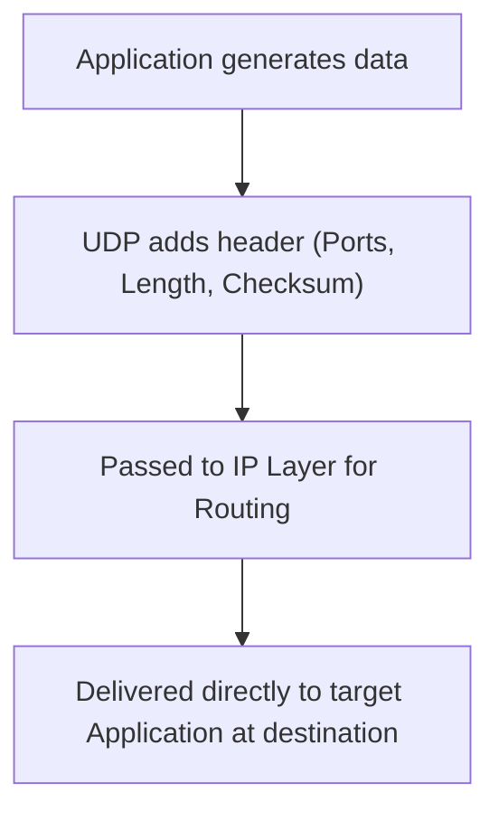

> **Goal of this section:**
> You'll understand UDP in detail - how it works without a Handshake or Acknowledgment, and which applications rely on it - and you'll be able to connect its simplicity to how it's exploited in the very widespread Amplification and DDoS attacks.

# User Datagram Protocol (UDP)

## Table of Contents

- [Overview](#overview)
- [Key Characteristics of UDP](#key-characteristics-of-udp)
- [UDP Header Structure](#udp-header-structure)
- [How UDP Works](#how-udp-works)
- [Applications of UDP](#applications-of-udp)
- [Advantages and Disadvantages](#advantages-and-disadvantages)
- [SOC Analyst Perspective](#soc-analyst-perspective)
- [Summary](#summary)

---

## Overview

**User Datagram Protocol (UDP)** is a Transport Layer protocol (**Layer 4** in the OSI Model) designed for Fast and Lightweight communication. Unlike TCP, UDP is a **Connectionless** protocol that doesn't guarantee delivery, ordering, or reliability, which makes it ideal for Real-Time applications where speed matters more than accuracy.

> [!NOTE]
> Think of UDP as an "express parcel" sent without a Tracking Number and without confirming that it arrived - fast and simple, but if it gets lost, no one will notify you or resend it automatically.

---

## Key Characteristics of UDP

- **Connectionless protocol** (no session establishment)
- **Fast data transmission** with low latency
- **No acknowledgments or retransmissions**
- **Minimal protocol overhead**
- **Suitable for time-sensitive communication**

---

## UDP Header Structure

The UDP Header is a fixed **8 bytes** long, and it's followed directly by the Data Payload.

| Field | Size | Purpose |
|---|---|---|
| Source Port | 2 bytes | Identifies the sending Application (optional; it can be zero if no reply is expected) |
| Destination Port | 2 bytes | Identifies the receiving Application on the other machine |
| Length | 2 bytes | The length of the Header + the Data combined |
| Checksum | 2 bytes | A simple, basic check of data integrity |

> [!WARNING]
> UDP provides **only Basic Error Checking** through the Checksum, **and has no Flow Control or Congestion Control at all**. This means that if the network is congested or the Receiver can't keep up, UDP won't slow down or regulate itself the way TCP does.

---

## How UDP Works

1. The application sends data to the UDP layer
2. UDP adds its header (ports, length, checksum)
3. The packet is passed to the IP layer for routing
4. At the destination, UDP delivers the data directly to the target application

> [!NOTE]
> Notice that these steps are much simpler than TCP - no Handshake, no waiting for an Acknowledgment, no retransmission. The data is sent, and that's it.

---

## Applications of UDP

UDP is used heavily in scenarios where speed matters most:

- **DNS** – Fast domain name resolution
- **VoIP** – Real-time voice communication
- **Video Streaming** – Live broadcasts and streaming
- **DHCP** – Automatic IP address assignment
- **NTP** – Network time synchronization
- **RIP** – Routing information exchange

| Application | Why UDP Fits |
|---|---|
| DNS | A quick query and question; if the reply is delayed, the question can easily be repeated |
| VoIP | Latency ruins call quality more than losing a small part of the audio |
| Video Streaming | Losing a frame or two won't be noticeable, but stuttering from waiting for retransmission will |
| DHCP | A simple, fast process for distributing network settings at connection time |
| NTP | Time synchronization needs to be fast and frequent; it doesn't need high Reliability |
| RIP | Exchanging routing information between Routers periodically and quickly |

---

## Advantages and Disadvantages

### Advantages

- Very fast and efficient
- Low overhead
- Ideal for real-time applications

### Disadvantages

- No guaranteed delivery
- No packet ordering
- No congestion control

---

## SOC Analyst Perspective

> [!IMPORTANT]
> UDP's simplicity is also its main security weakness. The absence of a Handshake and Acknowledgment makes it a favorite tool for certain attacks, and as a SOC Analyst it's important to be able to tell normal UDP Traffic apart from suspicious UDP Traffic.

### Common Threats Involving UDP

| Threat | Description | MITRE ATT&CK Reference |
|---|---|---|
| UDP Flood | Flooding a machine or Server with a huge number of UDP Packets to random Ports, with the aim of exhausting its resources | T1498 - Network Denial of Service |
| DNS Amplification | Exploiting the fact that a DNS reply can be much larger than the request, combined with forging the Source IP (Spoofing) so the reply reaches the victim rather than the attacker | T1498 - Network Denial of Service |
| NTP Amplification | The same idea as DNS Amplification but using the NTP protocol, which gives a very high Amplification Ratio | T1498 - Network Denial of Service |
| UDP-based Port Scanning | Probing for open Ports by sending UDP Packets and watching the replies (or the absence of replies) | T1046 - Network Service Discovery |
| Data Exfiltration over UDP (e.g., DNS Tunneling) | Smuggling stolen data by wrapping it inside DNS requests or other UDP protocols to avoid detection | T1071.004 - Application Layer Protocol: DNS |

> [!WARNING]
> **DNS Amplification** and **NTP Amplification** are among the most dangerous types of DDoS attacks because the Amplification Factor can reach dozens of times - meaning a very small request from the attacker can produce a huge reply directed entirely at the victim, all because UDP has no verification of the real sender's identity.

> [!TIP]
> If you notice an abnormal volume of UDP Responses (especially from DNS or NTP Servers) headed to one specific machine without matching requests of the same volume, that's a strong indicator of an **Amplification Attack**, and the targeted machine here is **the victim, not the source**.

In terms of Detection tools:
- **NetFlow Analysis** is very useful for spotting any sudden, abnormal increase in UDP Traffic volume
- **DNS Query Logs** help detect **DNS Tunneling** attempts by analyzing abnormal Query length and frequency

---

## Summary

- **UDP** is a lightweight, fast **Connectionless** protocol that operates at **Layer 4**, offering high speed at the cost of Reliability
- Its **Header** is a fixed **8 bytes** only (Source Port, Destination Port, Length, Checksum)
- It has **no Acknowledgment, Retransmission, or Flow/Congestion Control**
- It's used in latency-sensitive applications: **DNS, VoIP, Video Streaming, DHCP, NTP, RIP**
- Advantages: speed, efficiency, and low Overhead / Disadvantages: no guarantee of delivery or ordering, and no Congestion Control
- From a SOC standpoint: UDP's simplicity opens the door to dangerous attacks such as **UDP Flood and DNS/NTP Amplification (T1498)**, and it's also used for **Data Exfiltration via DNS Tunneling (T1071.004)**, so monitoring the volume and patterns of UDP Traffic is an essential part of any SOC's work
