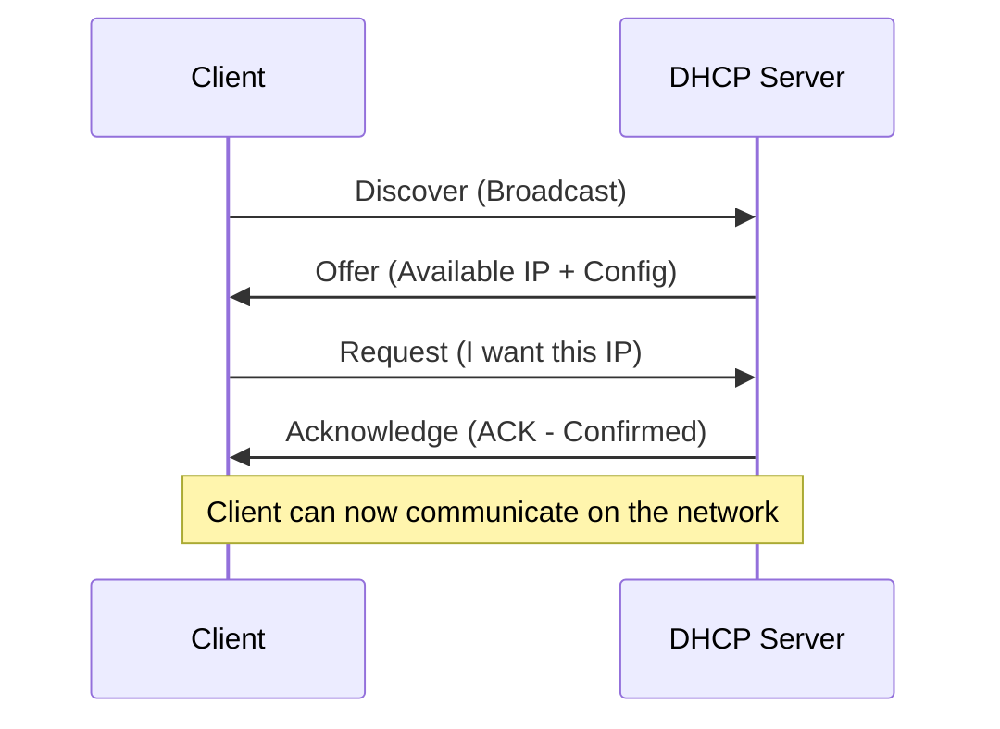
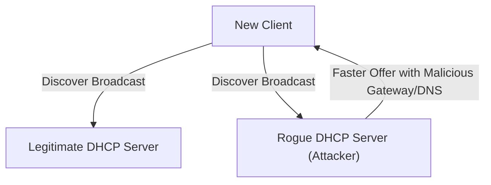
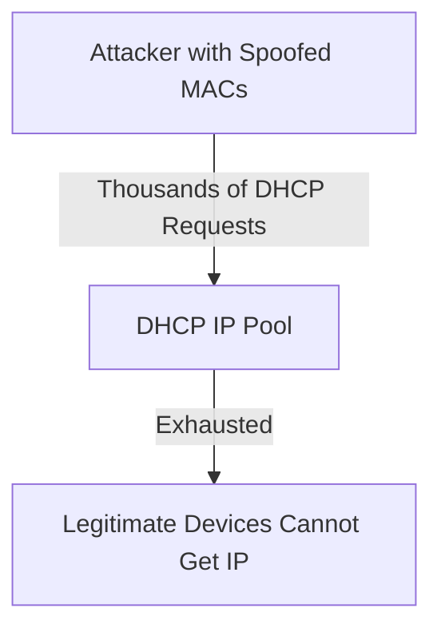
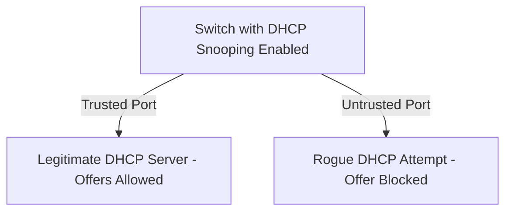

> **Goal of this section:**
> You'll understand how DHCP distributes network settings automatically through the DORA process, you'll learn in detail about the two best-known attacks targeting DHCP, the Rogue DHCP Server and DHCP Starvation, and you'll see how DHCP Snooping protects you from them.

## Table of Contents

- [Overview](#overview) 
- [How DHCP Works (DORA Process)](#how-dhcp-works-dora-process)
- [DHCP Message Types](#dhcp-message-types)
- [Static vs Dynamic Addressing](#static-vs-dynamic-addressing)
- [DHCP Security Risks](#dhcp-security-risks)
- [DHCP Protection](#dhcp-protection)
- [SOC Analyst Perspective](#soc-analyst-perspective)
- [Summary](#summary)

---

## Overview

**Dynamic Host Configuration Protocol (DHCP)** is a network service that automatically distributes IP settings to devices when they connect to the network.

Every device needs this information in order to communicate:

- IP Address
- Subnet Mask
- Default Gateway
- DNS Server

Instead of configuring these settings manually on every device, DHCP distributes them automatically.

> [!NOTE]
> Think of DHCP as a hotel receptionist: as soon as you arrive (that is, your device connects to the network), they give you a room number (IP Address) and tell you where the elevator is (Gateway) and where the directory service is (DNS), without you needing to know the hotel's details yourself.

---

## How DHCP Works (DORA Process)

The DHCP process takes place in 4 steps known as **DORA**:

### Discover

The client sends a Broadcast message to find a DHCP Server.

### Offer

The DHCP Server responds with an available IP Address and network settings.

### Request

The client requests the IP that was offered.

### Acknowledge (ACK)

The server confirms the assignment and records it in the Lease table.

After this process, the client can communicate on the network.

> [!TIP]
> An easy Mnemonic for remembering the order: **"Do Only Real Acknowledgments"** = Discover, Offer, Request, Acknowledge.

---

## DHCP Message Types

| Message | Sent By | Purpose |
|---|---|---|
| DHCPDISCOVER | Client | A Broadcast searching for any available DHCP Server |
| DHCPOFFER | Server | Offers the client an available IP Address and settings |
| DHCPREQUEST | Client | A formal request to confirm use of the offered IP (also used to renew an existing Lease) |
| DHCPACK | Server | Final confirmation, recording the assignment in the Lease table |
| DHCPNAK | Server | Rejects the request (if the IP is no longer available or isn't valid) |
| DHCPDECLINE | Client | The client reports that the IP offered to it is already in use (a conflict) |
| DHCPRELEASE | Client | The client returns the IP early, before the Lease period ends |

---

## Static vs Dynamic Addressing

| Aspect | Static Addressing | Dynamic Addressing (DHCP) |
|---|---|---|
| Configuration | Manual on every device | Automatic through a DHCP Server |
| Management Effort | High (especially on large networks) | Low, centralized management |
| IP Consistency | Always the same for the same device | May change with each new Lease (unless there's a Reservation) |
| Best Use Case | Servers, Printers, Network Devices that need a fixed IP | Regular user devices (Laptops, Phones) |
| Risk of Human Error | Higher (possible IP conflicts from a manual mistake) | Lower, DHCP manages assignment automatically |

> [!NOTE]
> In most work environments, Servers and critical devices (such as Domain Controllers or Network Devices) get a **Static IP** or a **DHCP Reservation** (a fixed IP that is still distributed by DHCP), while regular user devices get an ordinary **Dynamic IP**.

---

## DHCP Security Risks

### Rogue DHCP Server

An attacker introduces a fake DHCP Server on the network.

**Possible impacts**:

- Sends a malicious **Default Gateway** (traffic interception – Man-in-the-Middle)
- Sends a malicious **DNS server** (traffic redirection or phishing)

> [!WARNING]
> Since the DHCP Discover is sent as a **Broadcast**, any device on the same LAN Segment (legitimate or malicious) can respond to it. If the Rogue Server responds faster than the legitimate one, the client may accept its fake settings, which opens the door directly to a full **Man-in-the-Middle Attack** by controlling the Gateway or the DNS.

### DHCP Starvation Attack

The attacker sends a huge number of DHCP Requests using spoofed MAC Addresses.

**Result**:

- The IP pool becomes exhausted
- Legitimate devices cannot obtain an IP address
- Causes a **Denial of Service (DoS)**

> [!IMPORTANT]
> **DHCP Starvation** is often used as a preliminary step before carrying out a **Rogue DHCP Server Attack** - the attacker first exhausts all the legitimate IPs, then sets up their Rogue Server so it's the only available source of IPs, forcing all new devices to take the fake settings from it.

---

## DHCP Protection

### DHCP Snooping

A security feature on Switches that:

- Allows DHCP responses only from **trusted ports** (connected to the legitimate server)
- Blocks DHCP offers from **untrusted ports**

### Additional best practices

- Ensure only one authorized DHCP server exists
- Monitor DHCP activity regularly
- Restrict administrative access to DHCP configuration

> [!TIP]
> **DHCP Snooping** also builds a table called the **Binding Table** that maps the MAC Address, the IP Address, and the Port it was assigned from, and this table is also used with other techniques such as **Dynamic ARP Inspection (DAI)** to prevent ARP Spoofing attacks as well.

---

## SOC Analyst Perspective

| Threat | MITRE ATT&CK Reference |
|---|---|
| Rogue DHCP Server (leading to MITM) | T1557 - Adversary-in-the-Middle |
| DHCP Starvation Attack (DoS) | T1498 - Network Denial of Service |

> [!IMPORTANT]
> From a Detection standpoint, the most important indicator of a **Rogue DHCP Server** is devices appearing on the network with **Default Gateway** or **DNS Server** settings that don't match the officially approved values in the work environment.

### Detection & Best Practices

- Monitor the **DHCP Server Logs** for any abnormal number of Lease Requests in a short time (an indicator of DHCP Starvation)
- Enable **DHCP Snooping** on all Switches, marking only the Port connected to the legitimate DHCP Server as Trusted
- Use tools like **Arpwatch** or monitor the Binding Table to get an immediate alert if a second, unauthorized DHCP Server appears
- Periodically review the Gateway/DNS settings that new devices receive to make sure they match the official values

> [!TIP]
> If a device on the network suddenly starts receiving a different DNS Server from the rest of the devices, or its Default Gateway isn't the approved Gateway, that's a very strong indicator of a **Rogue DHCP Server** and warrants isolating that device and investigating immediately.

---

## Summary

- **DHCP** distributes network settings (IP, Subnet Mask, Gateway, DNS) automatically instead of manual configuration
- It works through the **DORA** process: Discover, Offer, Request, Acknowledge
- There are additional messages such as **DHCPNAK, DHCPDECLINE, DHCPRELEASE** for handling exceptional cases
- **Static Addressing** is better for critical devices (Servers), while **Dynamic (DHCP)** is better for regular user devices
- The main threats: the **Rogue DHCP Server** (leads to MITM - T1557) and the **DHCP Starvation Attack** (leads to DoS - T1498)
- The core protection: **DHCP Snooping** on the Switches + continuous monitoring + restricting administrative access to the DHCP settings

