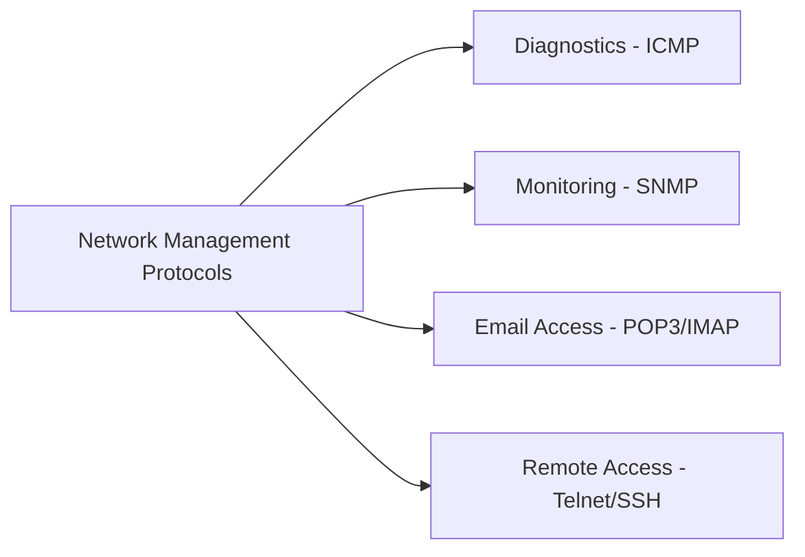
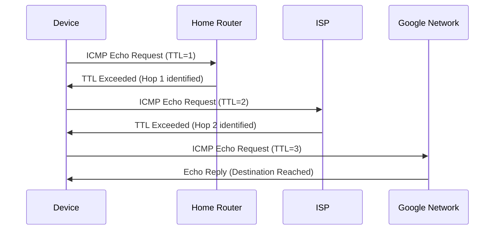
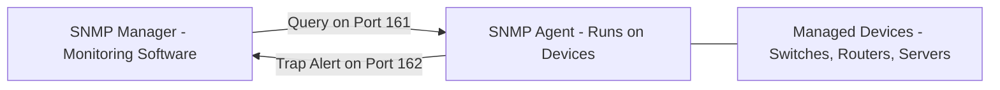
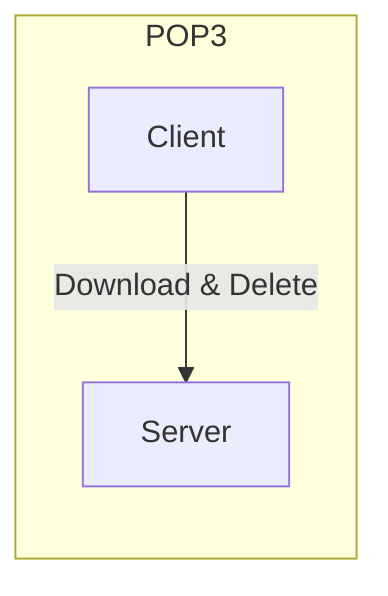
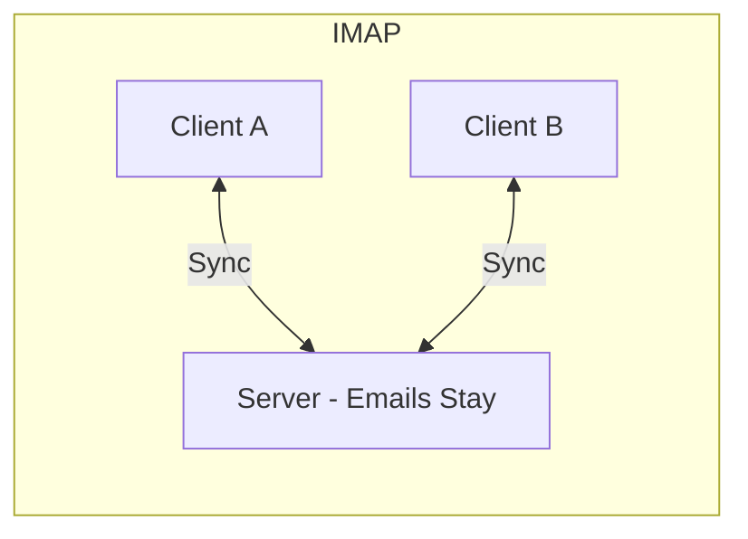

> **Goal of this section:**
> You'll get to know the most important network management and monitoring protocols (ICMP, SNMP, POP3, IMAP, Telnet, SSH), which don't carry user data but are essential for operating and monitoring the network, and you'll understand why some of them (such as Telnet) have become a real security risk that must be replaced immediately.

## Table of Contents

- [Overview](#overview)
- [1. ICMP – Internet Control Message Protocol](#1-icmp--internet-control-message-protocol)
- [2. SNMP – Simple Network Management Protocol](#2-snmp--simple-network-management-protocol)
- [3. POP3 – Post Office Protocol v3](#3-pop3--post-office-protocol-v3)
- [4. IMAP – Internet Message Access Protocol](#4-imap--internet-message-access-protocol)
- [POP3 vs IMAP](#pop3-vs-imap)
- [5. Telnet](#5-telnet)
- [6. SSH – Secure Shell](#6-ssh--secure-shell)
- [Comparison Table](#comparison-table)
- [Key Takeaways](#key-takeaways)
- [SOC Analyst Perspective](#soc-analyst-perspective)
- [Summary](#summary)

---

## Overview

Network management protocols **aren't used to transfer user data**. Their main job is to monitor, manage, and maintain the network to make sure everything is working correctly.

They help network and security teams detect problems, improve performance, and secure the infrastructure.



---

## 1. ICMP – Internet Control Message Protocol

| Property | Value |
|---|---|
| Layer | Network Layer (Layer 3) |
| Port | N/A (not TCP/UDP) |
| Purpose | Network diagnostics |

### How it works

ICMP doesn't carry data; it reports errors and helps diagnose the network.

### Common uses

**Ping**: Checks whether a device is online

```
ping google.com
```

- `Reply from 142.250.185.46` → the device is reachable
- `Request timed out` → the device isn't responding

**Traceroute**: Traces the path packets take from your device to the final destination

```
1. 192.168.1.1 (Home Router)
2. 10.0.0.1 (ISP)
3. 72.14.204.1 (Google Network)
4. 142.250.185.46 (google.com)
```



> [!NOTE]
> Traceroute works by manipulating the **TTL (Time To Live)** field in each packet. It starts with TTL=1, and each time it increases it by one, it can identify the next router along the path.

---

## 2. SNMP – Simple Network Management Protocol

| Property | Value |
|---|---|
| Layer | Application Layer (Layer 7) |
| Ports | 161 (queries) / 162 (traps) |
| Purpose | Monitor and manage network devices |

### Components



- **SNMP Manager**: Monitoring software
- **SNMP Agent**: Runs on devices, collects and sends data
- **Managed Devices**: Switches, routers, servers

### Monitored metrics

- CPU and RAM usage
- Device temperature
- Port status
- Network errors

> [!IMPORTANT]
> **SNMP** is the foundation that popular monitoring tools such as **Zabbix, PRTG, and SolarWinds** are built on.

---

## 3. POP3 – Post Office Protocol v3

| Property | Value |
|---|---|
| Layer | Application Layer (Layer 7) |
| Ports | 110 (normal) / 995 (SSL) |
| Purpose | Receive email on a single device |

### Behavior

- Downloads emails from the server
- Deletes emails from the server after download

### Use case

Suitable for accessing email from a single device only; not ideal for multiple devices.

---

## 4. IMAP – Internet Message Access Protocol

| Property | Value |
|---|---|
| Layer | Application Layer (Layer 7) |
| Ports | 143 (normal) / 993 (SSL) |
| Purpose | Receive and synchronize email across multiple devices |

### Behavior

- Emails remain on the server
- Changes are synchronized across all devices

### Use case

Ideal for accessing email from multiple devices (Desktop, Mobile, Tablet).

---

## POP3 vs IMAP

| Aspect | POP3 | IMAP |
|---|---|---|
| Email after download | Deleted from server | Remains on server |
| Multi-device access | ❌ No | ✅ Yes |
| Synchronization | ❌ No | ✅ Yes |
| Suitable for | Single device | Multiple devices |





---

## 5. Telnet

| Property | Value |
|---|---|
| Layer | Application Layer (Layer 7) |
| Port | 23 |
| Purpose | Remote device control via command line |

### Problem

The entire connection is in **Plaintext**:

- Username
- Password
- Commands

### Risk

Any network sniffer can capture this sensitive information.

### Recommendation

Telnet is a legacy protocol; use **SSH** instead.

> [!WARNING]
> Using Telnet in any modern work environment is an **immediate security red flag**. If you find any device still running Telnet (port 23 open), it's the first thing that needs to be fixed in any security assessment.

---

## 6. SSH – Secure Shell

| Property | Value |
|---|---|
| Layer | Application Layer (Layer 7) |
| Port | 22 |
| Purpose | Secure remote device management |

### Advantages over Telnet

- Fully encrypted connection
- Supports **SFTP** for secure file transfer
- Supports tunneling of other protocols securely
- Key-based authentication supported

> [!IMPORTANT]
> SSH is the standard for secure remote access. **Key-Based Authentication** is much stronger than ordinary password authentication because it relies on a key pair (Public/Private Key) instead of a password that could be guessed or stolen.

---

## Comparison Table

| Protocol | Purpose | Layer | Port | Security |
|---|---|---|---|---|
| ICMP | Network diagnostics | 3 | N/A | Limited |
| SNMP | Device monitoring | 7 | 161/162 | Medium |
| POP3 | Receive email | 7 | 110/995 | Weak (without SSL) |
| IMAP | Email sync | 7 | 143/993 | Good (with SSL) |
| Telnet | Remote control | 7 | 23 | Very weak |
| SSH | Secure remote control | 7 | 22 | Excellent |

---

## Key Takeaways

- **Monitoring & Diagnostics**: ICMP (ping, traceroute), SNMP (device metrics)
- **Email Protocols**: POP3 (single-device) vs IMAP (multi-device, preferred)
- **Remote Access**: SSH is secure; Telnet is insecure

> [!IMPORTANT]
> **Security Rule**: Any protocol that transfers data without encryption (such as Telnet, FTP, or POP3 without SSL) must be replaced with a secure version or shut down completely.

---

## SOC Analyst Perspective

| Protocol | Common Threat | MITRE ATT&CK Reference |
|---|---|---|
| ICMP | Ping Flood / ICMP Flood (DoS), as well as its use for network/host discovery during reconnaissance | T1499 - Network Denial of Service / T1018 - Remote System Discovery |
| SNMP | Exploiting **Default Community Strings** (such as "public"/"private") to pull sensitive information about network devices | T1552 - Unsecured Credentials |
| Telnet | Capturing login credentials and commands in full through network sniffing, because it's plaintext | T1040 - Network Sniffing |
| SSH | **Brute Force** attempts against passwords, especially if key-based authentication isn't enabled | T1110 - Brute Force / T1021.004 - Remote Services: SSH |

> [!WARNING]
> If **SNMP** is left on its default settings (default community strings such as "public" for read and "private" for write), it becomes a very serious weakness, because anyone who knows the default community string can pull detailed information about network devices and, in some cases, even modify their configuration.

### Detection & Best Practices

- Change the default **SNMP Community Strings** immediately, and move to **SNMPv3**, which supports authentication and encryption
- Disable **Telnet completely** and replace it with **SSH** on all devices
- Enable **Fail2Ban** or similar mechanisms on SSH to block repeated brute-force attempts
- Monitor for abnormal volumes of **ICMP Traffic**, because it could indicate a ping flood or even its use as a data exfiltration channel (**ICMP Tunneling**)
- Use only **IMAP/POP3 over SSL** (ports 993/995), and block unencrypted connections entirely

> [!TIP]
> If you notice a large number of failed SSH login attempts from the same IP within a short time, that's a classic indicator of **SSH Brute Force**, and rate limiting or IP blocking should be enabled immediately.

---

## Summary

- Network management protocols don't carry user data, but they are essential for monitoring, maintenance, and diagnostics
- **ICMP**: Network diagnostics through Ping and Traceroute; it operates at Layer 3 without a specific port
- **SNMP**: Monitoring network devices (CPU, RAM, Temperature); the foundation of tools such as Zabbix, PRTG, and SolarWinds
- **POP3 vs IMAP**: POP3 downloads email and deletes it from the server (single device); IMAP keeps email on the server and synchronizes it (multiple devices, preferred)
- **Telnet vs SSH**: Telnet is legacy and completely unencrypted (a security risk); SSH is the secure, standard alternative
- From the SOC perspective: the key risks are **SNMP Default Credentials (T1552)**, **Telnet Sniffing (T1040)**, **SSH Brute Force (T1110)**, and **ICMP Flood/Discovery (T1499/T1018)**
- **The golden rule**: Any unencrypted protocol must be replaced with a secure version or shut down completely

