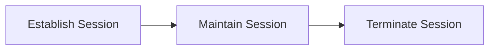
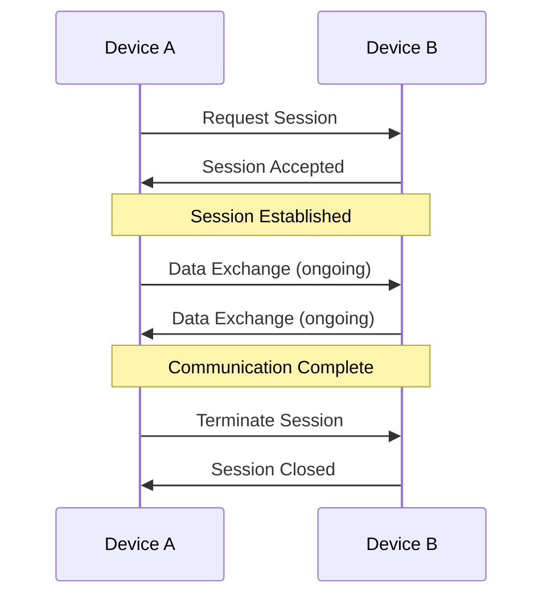
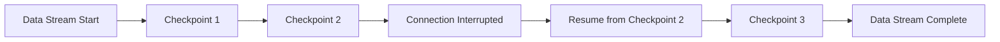
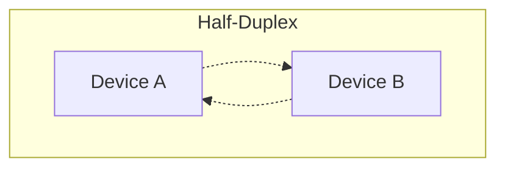
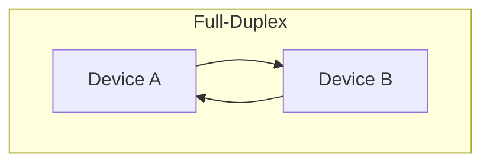
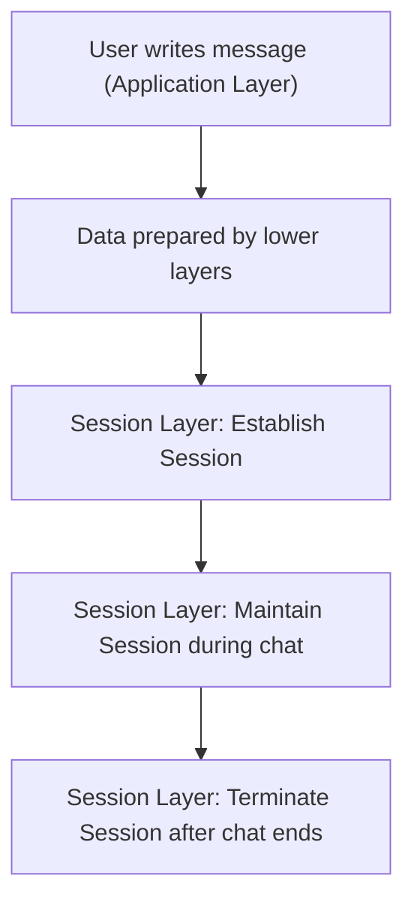

> **Goal of this section:**
>  You will understand how the Session Layer manages the "conversation" between two devices from the moment it opens until it closes, how it uses checkpoints so data isn't lost if the connection drops, and you will be able to connect this to real risks such as Session Hijacking and cookie theft.

## Table of Contents

- [Overview](#overview)
- [Key Responsibilities](#key-responsibilities)
  - [1. Session Establishment, Maintenance, and Termination](#1-session-establishment-maintenance-and-termination)
  - [2. Synchronization](#2-synchronization)
  - [3. Dialog Control](#3-dialog-control)
- [Protocols Used in the Session Layer](#protocols-used-in-the-session-layer)
- [Practical Example](#practical-example)
- [SOC Analyst Perspective](#soc-analyst-perspective)
- [Summary](#summary)

---

## Overview

The **Session Layer** is the fifth layer of the OSI Model. It is responsible for establishing, managing, and terminating communication sessions between two devices. This layer ensures that communication happens in an organized, secure, and synchronized way.

Simply put, the Session Layer acts like a "communication manager" that controls the dialog between applications while they exchange data.

> [!NOTE]
> Think of a session like a phone call: there's the moment the call is answered (Establishment), the period of talking (Maintenance), and the moment the line is hung up (Termination). The Session Layer is responsible for organizing this entire event.

---

## Key Responsibilities

### 1. Session Establishment, Maintenance, and Termination

- Initiates a communication session between two devices
- Maintains the session while data is being exchanged
- Gracefully terminates the session once communication is complete

This ensures that the two devices are properly connected before data transfer begins, and that they disconnect safely afterward.

### 2. Synchronization

- Inserts **checkpoints** (synchronization points) into the data stream
- If a connection is interrupted, communication can resume from the last checkpoint instead of restarting from the beginning
- Helps prevent data loss and incomplete message transmission

This is especially important when transferring large amounts of data.

> [!TIP]
> The idea of checkpoints is similar to downloading a large file when the internet cuts out: when you reconnect, the file resumes from the same point instead of starting the download over from the beginning.

### 3. Dialog Control

It manages how devices communicate with each other, and supports:

- **Half-Duplex Communication**: Data flows in one direction at a time
- **Full-Duplex Communication**: Data flows in both directions simultaneously

This allows flexible, efficient communication based on the application's needs.

---

## Protocols Used in the Session Layer

- **NetBIOS** – Provides session-level services for applications over a network
- **PPTP (Point-to-Point Tunneling Protocol)** – Used to create secure VPN connections

> [!WARNING]
> Both **NetBIOS** and **PPTP** are relatively old protocols with known vulnerabilities (such as Null Sessions in NetBIOS and weak encryption in PPTP), and we'll cover this in detail in the SOC Perspective section below.

---

## Practical Example

Consider a user sending a message through a messaging app inside a web browser:

1. The user writes the message using the application's interface (**Application Layer**)
2. The data is prepared for sending by the lower layers of the OSI Model
3. The **Session Layer**:
   - Establishes a session between the sender and the receiver
   - Keeps the session active throughout the message exchange
   - Terminates the session once the conversation is over

> [!IMPORTANT]
> Without the Session Layer, communication would lack organization, synchronization, and reliability: every message would be sent as if it were a completely separate connection, without any context linking it to the full conversation.

---

## SOC Analyst Perspective

> [!IMPORTANT]
> The Session Layer is directly tied to a very important concept in cybersecurity, **Session Management**, and any weakness in it opens the door to dangerous attacks such as Session Hijacking.

### Common Threats at the Session Layer

| Threat | Description | MITRE ATT&CK Reference |
|---|---|---|
| Session Hijacking | The attacker steals or impersonates a legitimate user's Session ID/Token to take over their privileges without needing to know the password | T1563 - Remote Service Session Hijacking |
| Session Cookie Theft | Stealing the cookies that hold the session state in web applications (usually through XSS or malware) | T1539 - Steal Web Session Cookie |
| NetBIOS Null Session Enumeration | Abusing old NetBIOS settings to enumerate information about users and shares without authentication | T1046 - Network Service Discovery |
| PPTP Cryptographic Weaknesses | Exploiting the known weak encryption in PPTP (especially the MS-CHAPv2 mechanism) to decrypt or intercept VPN session data | T1557 - Adversary-in-the-Middle |

> [!WARNING]
> The **PPTP** protocol is no longer recommended in modern environments because of a known weakness in its authentication mechanism (**MS-CHAPv2**), which makes it easy for an attacker to break the encryption and intercept VPN session data. Newer protocols such as **OpenVPN** or **IKEv2/IPSec** are more secure.

### Detection & Best Practices

- Monitor any **Session Token** used from more than one IP address within a very short time (a strong indicator of Session Hijacking)
- Enable an appropriate **Session Timeout** to reduce the window for exploiting any stolen token
- Disable **NetBIOS** if it isn't required for business, or at least restrict Null Sessions
- Always use **HTTPS** to protect session cookies from interception in transit

> [!TIP]
> If you see in the logs that the same Session ID was used from two devices with different characteristics (such as a different User-Agent) or from two geographically distant locations within a very short time, that is a very strong indicator of **Session Hijacking** and deserves immediate investigation.

---

## Summary

- The **Session Layer** is the fifth layer of the OSI Model, responsible for establishing, managing, and terminating **Sessions** between two devices
- Its most important functions: **Session Establishment/Maintenance/Termination**, **Synchronization** (through checkpoints), and **Dialog Control** (Half-Duplex/Full-Duplex)
- Its most important protocols include **NetBIOS** and **PPTP**
- From the SOC's perspective: the most dangerous threats associated with this layer are **Session Hijacking (T1563)** and theft of **Session Cookies (T1539)**, in addition to the known weaknesses of the old PPTP and NetBIOS
- The most important protective measures: monitor the use of Session Tokens from different sources, enable Session Timeout, and avoid old, weak protocols such as PPTP
