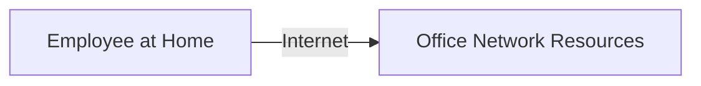
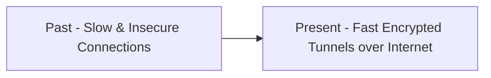
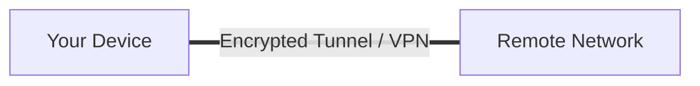
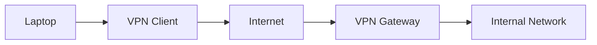
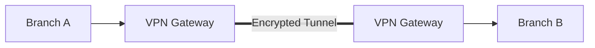
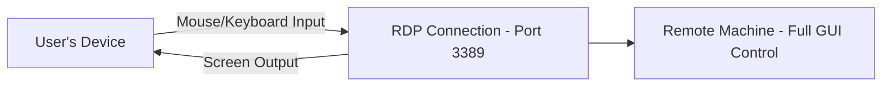
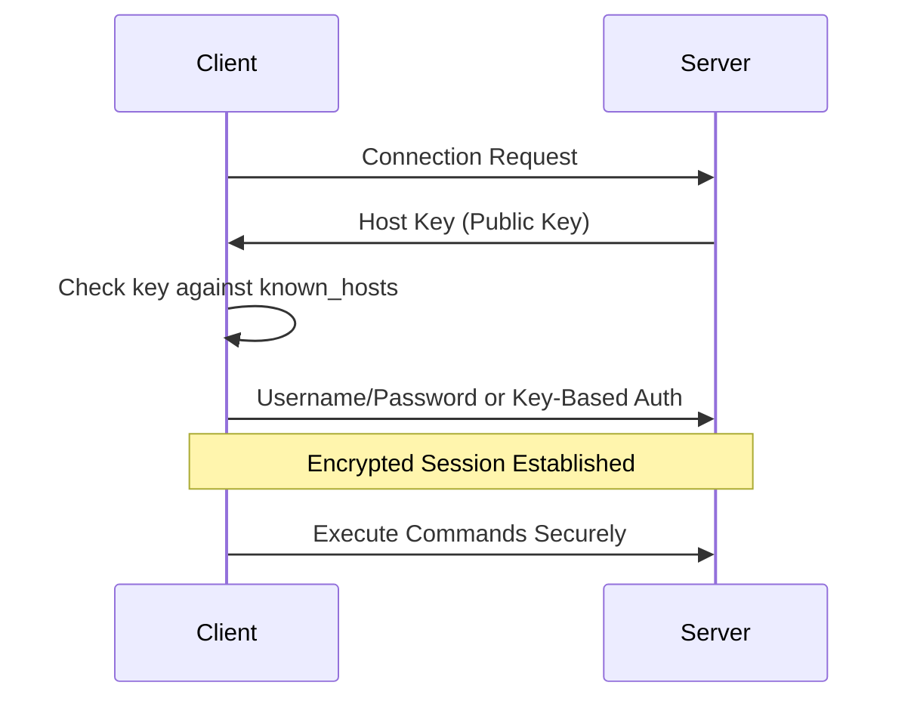

> **Goal of this section:**
> You'll understand how Remote Access works through VPN, RDP, and SSH, the difference between each one and its practical use, and you'll be able to connect this to the most dangerous threats targeting remote access, such as RDP Brute Force and VPN Exploitation.

## Table of Contents

- [What is Remote Access?](#what-is-remote-access)
- [Remote Access: Past vs Present](#remote-access-past-vs-present)
- [1. VPN – Virtual Private Network](#1-vpn--virtual-private-network)
- [2. Remote Desktop Protocol (RDP)](#2-remote-desktop-protocol-rdp)
- [3. SSH – Secure Shell](#3-ssh--secure-shell)
- [Remote Access Methods Comparison](#remote-access-methods-comparison)
- [Remote Access Security Challenges](#remote-access-security-challenges)
- [SOC Analyst Perspective](#soc-analyst-perspective)
- [Final Summary](#final-summary)

---

## What is Remote Access?

**Remote Access** lets you connect to a network or device remotely without being physically connected to it. The connection usually happens over the internet, which makes the user feel as if they're directly inside the network.

**Example**: an employee working from home can reach files, printers, and network resources as if they were in the office.

---

## Remote Access: Past vs Present

The key evolution: from slow, insecure connections to fast, encrypted tunnels over the internet.

---

## 1. VPN – Virtual Private Network

The VPN is the core solution for modern Remote Access. It creates an encrypted tunnel between your device and the remote network, which guarantees security even over the public internet.

### VPN Types

#### a) Remote Access VPN

- Used by employees working from home
- Requires a **VPN Client** on the device
- Requires **User Authentication**
- Once connected, the user feels as if they're directly inside the network

**Connection Flow**:

#### b) Site-to-Site VPN

- Connects two networks permanently
- Fully automatic, no human intervention needed
- Devices on both networks don't even need to know there's a VPN
- Ideal for connecting a company's branch offices

**Connection Flow**:

> [!NOTE]
> The key difference between the two types: a **Remote Access VPN** connects **a single user** to a network, while a **Site-to-Site VPN** connects **two entire networks** to each other permanently and completely transparently to users.

---

## 2. Remote Desktop Protocol (RDP)

Remote Desktop allows full graphical control of a remote machine.

- The remote screen is displayed on your device
- Mouse and keyboard movements on your device are actually executed on the remote machine

| Property | Value |
|---|---|
| Protocol | Microsoft RDP |
| Port | 3389 |

### Use Cases

- IT support for remote employees
- System administrators managing servers
- Access work computers from home

---

## 3. SSH – Secure Shell

SSH is the core protocol for command-line Remote Access.

- Runs on **Port 22** with full encryption
- Used to manage servers
- Supports secure file transfer through **SFTP**
- Allows **Key-Based Authentication** for extra security

### Connection Flow

1. Client sends a connection request
2. Server sends **Host Key** (Public Key) for identity verification
3. Client checks the key (exists in `known_hosts`?)
4. Client sends username/password or uses key-based auth
5. Encrypted session is established ✅, commands can be executed securely

### Host Key

- Confirms the server's identity
- Any unexpected key change indicates a potential **MITM attack**

> [!WARNING]
> If you connect to a server over SSH and get a warning that the **Host Key has changed** unexpectedly from the one saved in `known_hosts`, **never ignore it**. It's a very strong indicator of a **Man-in-the-Middle Attack** attempt, not just an ordinary technical message.

---

## Remote Access Methods Comparison

| Method | Purpose | Port | Interface | Encryption | Best For |
|---|---|---|---|---|---|
| Remote Access VPN | Connecting an individual user to the internal network | Varies (e.g., 443, 1194, 500) | Network-level access | Yes | Employees working from home |
| Site-to-Site VPN | Connecting two networks permanently | Varies (e.g., 500, 4500) | Network-level access | Yes | Connecting company branches |
| RDP | Full graphical control of a remote machine | 3389 | Full GUI | Yes (with proper configuration) | Technical support, managing Windows servers |
| SSH | Remote command-line administration | 22 | Command-Line | Yes (always) | Managing Linux servers/Network Devices |

---

## Remote Access Security Challenges

- Remote devices are not fully controlled — may contain malware
- Internet-based connections increase interception risks
- User identity verification is harder → **MFA (Multi-Factor Authentication)** is recommended

### Best Practices

**VPN + MFA + Endpoint Security + Monitoring = Secure Remote Access ✅**

---

## SOC Analyst Perspective

| Threat | Description | MITRE ATT&CK Reference |
|---|---|---|
| RDP Brute Force | Repeated password-guessing attempts on Port 3389 exposed to the internet | T1110 - Brute Force |
| RDP Exploitation (e.g., BlueKeep) | Exploiting known vulnerabilities in the RDP implementation itself to gain access without authentication | T1210 - Exploitation of Remote Services |
| External Remote Services Abuse | Using stolen or leaked credentials to gain access via VPN/RDP/SSH as an initial entry point | T1133 - External Remote Services |
| SSH Brute Force | Credential-guessing attempts on Port 22, especially if Key-Based Authentication isn't enabled | T1110 - Brute Force / T1021.004 - Remote Services: SSH |
| VPN Credential Theft / Session Hijacking | Stealing VPN credentials through phishing or malware to gain direct access to the internal network | T1078 - Valid Accounts |

> [!IMPORTANT]
> **RDP** is one of the most targeted protocols in attacks worldwide, because it's often left directly exposed to the internet without enough protection. Vulnerabilities such as **BlueKeep (CVE-2019-0708)** proved that simply having RDP exposed to the internet, without even a login attempt, can be enough to fully compromise the machine.

### Detection & Best Practices

- **Don't leave RDP directly exposed to the internet** - use a VPN or a Jump Server as a mandatory intermediate layer
- Enable **MFA** on every Remote Access channel (VPN, RDP, SSH) without exception
- Monitor for a large number of failed login attempts on Port 3389 or 22 from the same source (a Brute Force indicator)
- Use **Network Level Authentication (NLA)** in RDP to reduce the attack surface before any session even starts
- Review **VPN Access Logs** regularly to make sure there are no connections from unusual geographic locations or at unusual times (**Impossible Travel** as an indicator of compromise)

> [!TIP]
> If you see in the logs a successful VPN connection for the same user from two geographically different countries within a very short time of each other (it's impossible for them to have traveled between them in that time), that's a strong indicator of **Compromised Credentials**, and immediate action must be taken, such as disabling the account and investigating.

---

## Final Summary

- **Remote Access**: accessing a remote network over the internet
- **The solutions**:
  - **Remote Access VPN** → employee access from home
  - **Site-to-Site VPN** → connecting branch networks
  - **RDP** → full control of the machine (GUI)
  - **SSH** → server administration (Command Line) ✅
- From the SOC perspective: the most important risks are **RDP Brute Force/Exploitation (T1110/T1210)**, **External Remote Services Abuse (T1133)**, and **SSH Brute Force (T1021.004)**
- The ideal protection: **VPN + MFA + Endpoint Security + Monitoring**

> [!IMPORTANT]
> **Golden Rule**: any Remote Access without encryption is considered a major security risk ❌
