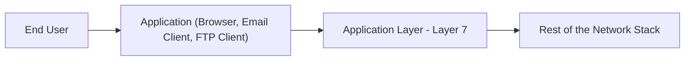
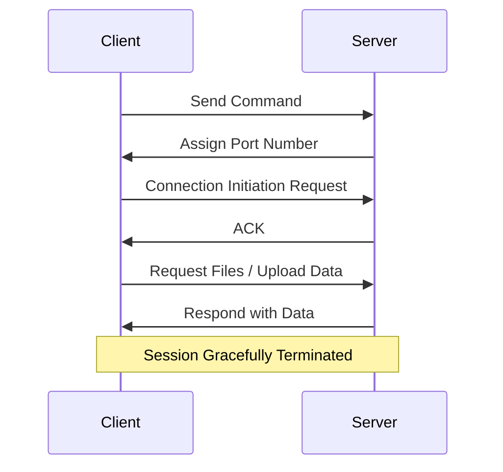

> **Goal of this section:**
> You'll understand how the Application Layer is the layer closest to the end user and how protocols such as HTTP, DNS, and SMTP work on it, and you'll be able to connect this to how most of the attacks you face as a SOC Analyst (such as phishing and web attacks) actually happen at this layer.

## Table of Contents

- [Overview](#overview)
- [Key Features](#key-features)
- [Functions of Application Layer](#functions-of-application-layer)
- [How the Application Layer Works](#how-the-application-layer-works)
- [Services Provided by Application Layer Protocols](#services-provided-by-application-layer-protocols)
- [Common Application Layer Protocols](#common-application-layer-protocols)
- [SOC Analyst Perspective](#soc-analyst-perspective)
- [Summary](#summary)

---

## Overview

The **Application Layer** is the top layer (Layer 7) of the OSI Model, and it enables direct interaction between end-user applications and the network. It acts as the interface between user programs and the network.

> [!NOTE]
> This is the layer closest to the user, but it's important to clarify that it isn't the application itself (such as Chrome or Outlook) - it's the layer that provides the services the application uses to communicate with the network.

---

## Key Features

- Closest layer to the end user
- Provides network services to applications
- Enables file transfer, email, web access, and remote login
- Acts as an interface between user software and the network

---

## Functions of Application Layer

### Data Representation

- Ensures data is in a format both sender and receiver can understand
- Converts user-entered information into network-compatible formats (ASCII, JPEG, HTML)

### Network Service Access

- Provides direct access to network services
- Example: Using email clients or FTP to send/receive files

### Application Protocols

- Defines rules and procedures for communication between applications
- Examples: **HTTP** (web), **FTP** (file transfer), **SMTP** (email), **DNS** (domain resolution)

### Session Management

- Establishes, manages, and terminates communication sessions between applications
- Maintains synchronization during data exchange

> [!NOTE]
> Note that "Session Management" here happens at the level of the application itself (such as a login session on a website), which is different from the Session Layer (Layer 5), which manages the session at the level of the underlying connection between the two devices.

---

## How the Application Layer Works

1. The client sends a command to the server
2. The server assigns a port number to the client
3. The client sends a connection initiation request; the server replies with an ACK
4. The client can now request files or upload data to the server
5. Once communication is complete, the session is gracefully terminated

---

## Services Provided by Application Layer Protocols

- Defines processes for both communicating parties
- Specifies the type of messages sent/received
- Sets the basic syntax and formatting of messages
- Manages sending, receiving, and expected responses
- Coordinates interaction with lower layers

---

## Common Application Layer Protocols

| Protocol | Purpose | Default Port |
|---|---|---|
| HTTP | Web browsing (unencrypted) | 80 |
| HTTPS | Secure web browsing (encrypted via TLS) | 443 |
| FTP | File transfer | 20/21 |
| SMTP | Sending email | 25 |
| POP3 | Retrieving email (downloads and removes from server) | 110 |
| IMAP | Retrieving email (syncs with server) | 143 |
| DNS | Domain name resolution | 53 |
| DHCP | Automatic IP address assignment | 67/68 |
| Telnet | Remote login (unencrypted) | 23 |
| SSH | Secure remote login (encrypted) | 22 |

> [!IMPORTANT]
> Notice the difference between **Telnet** and **SSH**: both provide remote login, but Telnet sends data (including credentials) **without encryption**, while SSH encrypts everything. Using Telnet in a modern work environment is considered a major security **Red Flag**.

---

## SOC Analyst Perspective

> [!IMPORTANT]
> The Application Layer is **the layer where attacks most often** actually happen in practice, because it's the layer closest to the user and to sensitive data, and most of the attack surface is concentrated here.

### Common Threats at the Application Layer

| Threat | Description | MITRE ATT&CK Reference |
|---|---|---|
| Phishing | Fake emails (abusing SMTP) that trick the user into opening a malicious link or file | T1566 - Phishing |
| Web Application Attacks (SQLi, XSS) | Exploiting vulnerabilities in web applications (abusing HTTP/HTTPS) to steal data or execute malicious code | T1190 - Exploit Public-Facing Application |
| DNS Tunneling / DNS Spoofing | Abusing the DNS protocol to smuggle data out or redirect the user to a malicious site | T1071.004 - Application Layer Protocol: DNS |
| C2 Communication over HTTP/HTTPS | Using ordinary web protocols to communicate with command and control servers to avoid detection | T1071.001 - Application Layer Protocol: Web Protocols |
| Credential Harvesting via Fake Login Pages | Fake login pages served over HTTP/HTTPS to steal login credentials | T1056.003 - Input Capture: Web Portal Capture |

> [!WARNING]
> Using ordinary web protocols such as **HTTP/HTTPS** for **Command and Control (C2)** communication has become very common among attackers, because this traffic blends in easily with normal web traffic and is hard to distinguish without advanced analysis tools.

### Detection & Best Practices

- Use a **Web Application Firewall (WAF)** to protect web applications from attacks such as SQL injection and XSS
- Monitor **DNS Query Logs** to detect abnormal patterns (such as very long or unusually repetitive queries) that may indicate DNS tunneling
- Analyze **Email Gateway Logs** to detect phishing attempts before they reach the user's inbox
- Monitor the **User-Agent** and **Traffic Patterns** in HTTP/HTTPS connections, because malware tools often have a different fingerprint from real browsers

> [!TIP]
> When you analyze any incident, ask yourself: "Which Application Layer protocol did this attack abuse?" The answer will point you directly to the right log source (Email Gateway for phishing, Web Server/WAF logs for a web attack, DNS logs for tunneling).

---

## Summary

- The **Application Layer** (Layer 7) is the layer closest to the end user, and it provides the interface between programs and the network
- Its most important functions: **Data Representation, Network Service Access, Application Protocols, Session Management**
- Its best-known protocols: **HTTP/HTTPS, FTP, SMTP, POP3/IMAP, DNS, DHCP, Telnet, SSH**
- From a SOC standpoint: this layer is **the most exposed to attacks in practice**, including **Phishing (T1566), Web Application Attacks (T1190), DNS Tunneling (T1071.004), and C2 over HTTP/HTTPS (T1071.001)**
- The core protection tools: **WAF, Email Gateway Filtering, DNS Monitoring,** and analysis of abnormal traffic patterns
