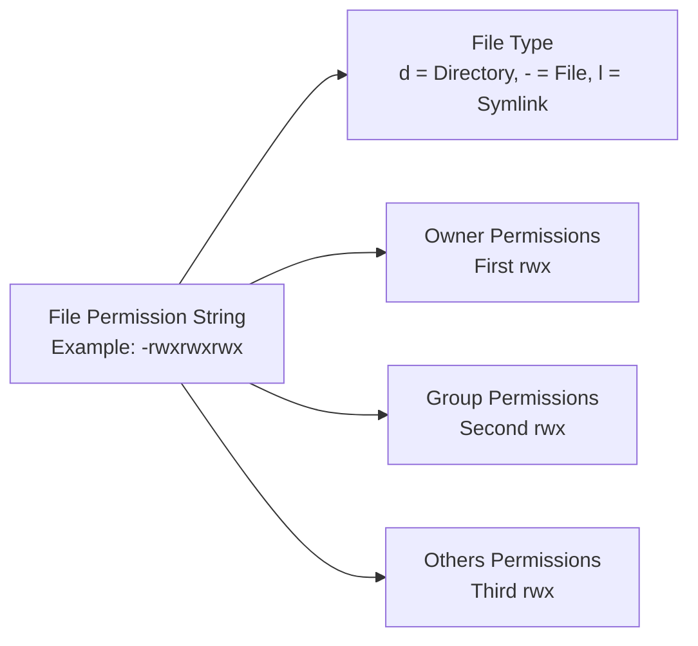
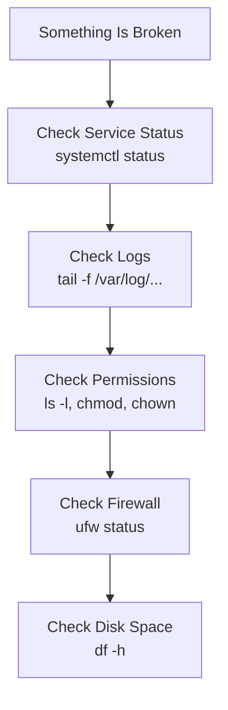

| Topic | Level | Reading Time | Prerequisites |
|---|---|---|---|
| Linux Fundamentals | Beginner | ~40 min | None (no prior Linux or command-line experience needed) |

> **الهدف من الـ Section ده:**  
>  هتاخد أول خطوة حقيقية في عالم Linux، من غير أي خلفية سابقة. هتفهم إزاي نظام Linux مبني من جوه، هتتعلم أهم أوامر التعامل مع الملفات والمجلدات، هتفهم نظام المستخدمين والصلاحيات، وهتاخد لمحة عملية عن إدارة الباكدجات، الخدمات، والشبكة. لو دي أول مرة تفتح Terminal في حياتك، إنت في المكان الصح.


## Learning Objectives

By the end of this section, you will be able to:

- Explain what **Linux** is and why it's the backbone of servers, cloud platforms, and cybersecurity tools.
- Trace how a command travels through the system: `User → Shell → Kernel → Hardware`.
- Navigate the Linux file system and explain the purpose of key directories like `/etc`, `/home`, and `/var`.
- Use essential commands for navigation, file management, and viewing file content.
- Explain how **Users**, **Groups**, and **File Permissions** work together to control access.
- Manage packages with **APT** and services with **systemd**.
- Monitor running processes, disk space, and memory usage.
- Perform basic networking checks and understand how the **UFW firewall** and **log files** help you troubleshoot problems.

## Table of Contents

- [What Is Linux](#what-is-linux)
- [Why Linux](#why-linux)
- [Common Distributions](#common-distributions)
- [Linux Architecture: How a Command Travels](#linux-architecture-how-a-command-travels)
  - [The User Layer](#the-user-layer)
  - [The Shell Layer](#the-shell-layer)
  - [The Kernel Layer](#the-kernel-layer)
  - [The Hardware Layer](#the-hardware-layer)
- [Important Concept: Everything Is a File](#important-concept-everything-is-a-file)
- [The Linux File System Structure](#the-linux-file-system-structure)
- [Basic Navigation Commands](#basic-navigation-commands)
- [Getting Help](#getting-help)
- [File Management: Creating and Organizing Files](#file-management-creating-and-organizing-files)
- [Viewing File Content](#viewing-file-content)
- [Linux Users and Groups](#linux-users-and-groups)
  - [Three Types of Users](#three-types-of-users)
  - [Creating and Managing Users](#creating-and-managing-users)
  - [Understanding Groups](#understanding-groups)
  - [Important System Files](#important-system-files)
  - [Real Admin Scenario](#real-admin-scenario)
  - [The Sudo Group](#the-sudo-group)
- [File Permissions](#file-permissions)
- [Package Management with APT](#package-management-with-apt)
- [Service Management with Systemd](#service-management-with-systemd)
- [Process Management](#process-management)
- [Disk and Memory Monitoring](#disk-and-memory-monitoring)
- [Networking Basics](#networking-basics)
- [The Firewall: UFW](#the-firewall-ufw)
- [Logs in Linux](#logs-in-linux)
- [Putting It All Together: A Practice Scenario](#putting-it-all-together-a-practice-scenario)
- [Troubleshooting Checklist](#troubleshooting-checklist)
- [Career Connection](#career-connection)
- [Key Terms Glossary](#key-terms-glossary)
- [Summary](#summary)

## What Is Linux

**Linux** مش مجرد نظام تشغيل عادي. هو العمود الفقري (**backbone**) اللي بيشغّل السيرفرات، منصات الكلاود، خطوط الـ DevOps، أدوات الأمن السيبراني، وبنية تحتية كاملة للشركات الكبيرة حوالين العالم.

> [!NOTE]
> لو إنت بتشتغل في أي مجال تقني، تقريبًا مستحيل تتجنب Linux. حتى لو جهازك الشخصي شغّال Windows أو macOS، السيرفرات اللي بتشغّل معظم مواقع الإنترنت، تطبيقات الموبايل، وأدوات الأمان، غالبًا شغالة على Linux.

## Why Linux

فيه أسباب واضحة ليه Linux منتشر بالشكل ده:

- **Open Source**: الكود مفتوح المصدر، أي حد يقدر يشوفه، يعدّله، ويحسّنه.
- **Stable & Secure**: مستقر جدًا وآمن، بيشتغل شهور من غير ما يحتاج إعادة تشغيل.
- **Lightweight**: خفيف، بيقدر يشتغل حتى على أجهزة بموارد محدودة.
- **Used in Servers, Cloud, Containers, Networking**: مستخدم في السيرفرات، الكلاود، الـ containers، وأجهزة الشبكات.

## Common Distributions

Linux مش نظام واحد بس، هو "عائلة" كاملة من الأنظمة اسمها **distributions** (أو Distros). من أشهرها:

| التوزيعة (Distribution) | ملاحظات |
|---|---|
| **Ubuntu** | الأسهل للمبتدئين، هنستخدمها كمرجع أساسي في الشرح ده |
| **CentOS / Rocky Linux** | شائعة جدًا في بيئات السيرفرات في الشركات |
| **Debian** | معروفة باستقرارها الشديد، وUbuntu نفسها مبنية عليها |
| **RedHat Enterprise Linux (RHEL)** | نسخة مدفوعة ومدعومة رسميًا، شائعة في الشركات الكبيرة |

> [!TIP]
> كل التوزيعات دي بتشترك في نفس المفاهيم الأساسية اللي هنشرحها هنا (الـ Kernel، نظام الملفات، المستخدمين والصلاحيات). لما تتعلم Ubuntu، إنت فعليًا بتتعلم أساس Linux كله.

## Linux Architecture: How a Command Travels

لما نتكلم عن **بنية Linux (architecture)**، إحنا بنوصف إزاي نظام التشغيل متركّب من جوه، وإزاي أمر المستخدم بيسافر عبر النظام لحد ما يتنفذ فعليًا.

المسار المبسط هو:

```
User → Shell → Kernel → Hardware
```

هنكسّر الرحلة دي طبقة طبقة.

### The User Layer

دي الطبقة العلوية. الـ **User** ممكن يكون:

- مسؤول نظام (**system administrator**).
- مطوّر (**developer**).
- مستخدم عادي.
- حتى خدمة (**service**) زي `nginx` بتنفذ أوامر بنفسها.

المستخدم بيتفاعل مع Linux عن طريق:

- الطرفية (**Terminal / CLI**).
- واجهة رسومية (**GUI / Desktop Environment**).
- جلسة SSH عن بعد (**Remote SSH session**).

لما المستخدم يكتب:

```bash
ls
```

الأمر ده **مبيكلمش الهاردوير مباشرة**. هو بيعدي على طبقات.

### The Shell Layer

الـ **Shell** هو مترجم أوامر (**command interpreter**).

أشهر shell في Ubuntu هو **bash (Bourne Again Shell)**.

تقدر تتحقق من الـ shell بتاعك بالأمر:

```bash
echo $SHELL
```

**الـ Shell بيعمل إيه بالظبط؟**

- بيقرا الأمر اللي إنت كتبته.
- بيفسّره.
- بيحوّله لـ **system calls** (استدعاءات نظام).
- بيبعته للـ kernel.

> [!TIP]
> فكّر في الـ Shell زي **مترجم** بين البشر والنظام.

**مثال**: لما تكتب:

```bash
mkdir test
```

الـ Shell بيفهم:

- إنت عايز تنشئ مجلد.
- بيترجم ده لـ system call.
- بيبعتها للـ kernel.

فيه shells تانية زي `sh`، `zsh`، و`fish`، لكن كلهم بيعملوا نفس الشغلانة الأساسية: تفسير الأوامر.

### The Kernel Layer

**الـ Kernel هو الجزء الأهم**. هو "مخ" نظام التشغيل.

هو المسؤول عن إدارة:

- المعالج (**CPU**).
- الذاكرة (**Memory / RAM**).
- عمليات القرص (**Disk I/O**).
- العمليات (**Processes**).
- تعريفات الأجهزة (**Device Drivers**).
- الشبكة (**Networking**).

الـ Kernel دايمًا شغال في الذاكرة. تقدر تتحقق من نسخته بالأمر:

```bash
uname -r
```

**الـ Kernel بيعمل إيه بالتفصيل؟**

**إدارة العمليات (Process Management)**

لما تشغّل برنامج، زي:

```bash
top
```

الـ Kernel:

- بينشئ process (عملية).
- بيخصصلها ذاكرة.
- بيوزّع وقت المعالج عليها.
- بيدير جدولتها (**scheduling**).

**إدارة الذاكرة (Memory Management)**

لو عندك 10 تطبيقات شغالة:

- الـ Kernel بيقرر مين ياخد قد إيه من الـ RAM.
- بيمنع أي process من إنه يوصل لذاكرة process تاني.

> [!IMPORTANT]
> ده أمر حرج جدًا لاستقرار النظام. من غير الحماية دي، أي برنامج ممكن "يتدخل" في ذاكرة برنامج تاني ويسبب انهيار كامل للنظام.

**إدارة نظام الملفات (File System Management)**

لما تفتح ملف زي:

```bash
cat file.txt
```

الـ Kernel:

- بيدوّر على مكان الملف على القرص.
- بيقرا البيانات.
- بيرجّعها للـ Shell.

**إدارة الأجهزة (Device Management)**

لما توصّل USB:

- الـ Kernel بيكتشف الجهاز.
- بيحمّل الـ driver الصحيح.
- بيخليه متاح تحت `/dev`.

> [!IMPORTANT]
> أي حاجة متوصلة بالنظام، بتعدي عبر الـ Kernel.

### The Hardware Layer

دي الطبقة الفيزيائية:

- المعالج (**CPU**).
- الذاكرة (**RAM**).
- القرص الصلب (**Hard Disk**).
- كارت الشبكة (**Network Card**).
- أجهزة USB.

> [!WARNING]
> الهاردوير **أبدًا مش بيكلم المستخدم مباشرة**. هو بيتواصل بس من خلال الـ Kernel.

## Important Concept: Everything Is a File

من أهم مفاهيم Linux: **كل حاجة هي ملف (Everything is a File)**.

| العنصر | بيتمثل كـ |
|---|---|
| الأقراص الصلبة | `/dev/sda` |
| الأقسام (Partitions) | `/dev/sda1` |
| USB | `/dev/sdb` |
| العمليات (Processes) | `/proc` |
| معلومات النظام | `/sys` |

حتى **أجهزة الهاردوير** بتتمثل كملفات.

مثال:

```bash
ls /dev
```

التصميم ده بيخلي Linux:

- مرن (**Flexible**).
- قابل للسكربتة (**Scriptable**).
- سهل الأتمتة (**Easy to automate**).

## The Linux File System Structure

هنستكشف نظام الملفات، وممكن تجرّب الأمر التالي على أي جهاز Linux أو VM عندك:

```bash
ls /
```

الجدول التالي بيلخّص أهم المجلدات وليه هي موجودة:

| المجلد | الوصف |
|---|---|
| `/bin` | ملفات تنفيذية أساسية (زي `ls`, `cp`, `grep`) متاحة لكل المستخدمين حتى في وضع الطوارئ |
| `/sbin` | ملفات تنفيذية خاصة بالصيانة، مخصصة لمسؤول النظام (root) (زي `iptables`, `fdisk`) |
| `/boot` | كل حاجة محتاجة لبدء تشغيل النظام: الـ kernel، الـ Initial RAM Disk، وإعدادات الـ GRUB |
| `/dev` | تمثيلات الأجهزة الفيزيائية (زي `/dev/sda` للقرص الصلب) |
| `/etc` | مركز إعدادات النظام بالكامل، زي `/etc/passwd` لمعلومات المستخدمين |
| `/home` | المجلدات الشخصية للمستخدمين، مثلًا ملفاتك في `/home/amr` |
| `/root` | المجلد الشخصي لمستخدم root، منفصل عن `/home` لأسباب أمنية |
| `/var` | ملفات بتكبر مع الوقت، زي سجلات النظام في `/var/log` |
| `/lib` و `/lib64` | المكتبات المشتركة اللازمة لتشغيل أوامر `/bin` و `/sbin` |
| `/usr` | أكبر جزء من النظام، فيه البرامج والمكتبات اللي المستخدم ثبّتها |
| `/usr/local` | مكان تثبيت البرامج من الكود المصدري، عشان متتعارضش مع ملفات النظام |
| `/opt` | برامج إضافية أو تابعة لطرف ثالث، زي Google Chrome أو Zoom |
| `/proc` | نظام ملفات وهمي (**pseudo-filesystem**)، فيه معلومات عن العمليات الشغالة، مش موجود فعليًا على القرص |
| `/tmp` | ملفات مؤقتة، بتتمسح عادةً عند إعادة تشغيل النظام |
| `/media` | نقاط تحميل تلقائية لوسائط قابلة للإزالة (USB، CD-ROM) |
| `/mnt` | نقاط تحميل يدوية لأنظمة ملفات أو محركات شبكة |

> [!TIP]
> ملحوظة سريعة: `/proc` مش موجود فعليًا على القرص الصلب، هو بيتولّد في الذاكرة بشكل مباشر ويعكس حالة النظام في اللحظة دي بالتحديد.

## Basic Navigation Commands

الأوامر دي هي أول حاجة لازم تتريّح فيها كمبتدئ:

| الأمر | الوصف | يُستخدم لـ |
|---|---|---|
| `pwd` | يطبع مسار المجلد الحالي | معرفة مكانك بالظبط قبل إنشاء أو حذف ملفات |
| `ls` | يعرض الملفات والمجلدات | استعراض محتوى مجلد |
| `ls -l` | يعرض الملفات بصيغة تفصيلية (صلاحيات، مالك، حجم) | التحقق من الصلاحيات والملكية |
| `ls -a` | يعرض الملفات المخفية (اللي بتبدأ بـ `.`) | استعراض ملفات إعدادات زي `.bashrc` |
| `cd` | تغيير المجلد الحالي | التنقل بين المجلدات |
| `cd ..` | الانتقال مستوى واحد لفوق | الرجوع للمجلد الأب |
| `clear` | تنظيف شاشة الطرفية | تنظيف مساحة العمل لرؤية أوضح |
| `history` | عرض الأوامر المستخدمة سابقًا | إعادة استخدام أو مراجعة أوامر سابقة |

## Getting Help

لو محتاج مساعدة في أي أمر، إنت مش لوحدك، Linux عنده أدوات مدمجة لكده:

```bash
man ls
ls --help
```

| الأمر | الوصف | يُستخدم لـ |
|---|---|---|
| `whoami` | يعرض المستخدم المسجل دخوله حاليًا | التحقق من الصلاحيات بتاعتك |
| `uname -a` | يعرض معلومات النظام والـ kernel | معرفة نسخة النظام وتفاصيل الـ kernel |
| `man command` | يفتح صفحة الدليل (manual) الخاصة بالأمر | تعلم الاستخدام التفصيلي والخيارات |

> [!TIP]
> `man` هي اختصار لـ **manual**. أي أمر مش متأكد منه، اكتب `man` قبله وهتلاقي شرح كامل. لو حابب تخرج من صفحة الـ man، دوس على حرف `q`.

## File Management: Creating and Organizing Files

دلوقتي هنتعلم إزاي ننشئ، ننسخ، ننقل، ونمسح ملفات ومجلدات.

### إنشاء الملفات والمجلدات

```bash
touch file.txt
```

**الوصف**: بينشئ ملف فاضي. **يُستخدم لـ**: عمل ملفات تجريبية أو placeholders.

```bash
mkdir myfolder
```

**الوصف**: بينشئ مجلد. **يُستخدم لـ**: تنظيم الملفات.

### نسخ الملفات

```bash
cp file1.txt myfolder/
```

الصيغة العامة: `cp source destination`

**الوصف**: بينسخ ملفات أو مجلدات. **يُستخدم لـ**: عمل نسخة احتياطية أو تكرار ملف.

### نقل وإعادة تسمية الملفات

```bash
mv file1.txt file2.txt
```

الصيغة العامة: `mv source destination`

**الوصف**: بينقل أو بيعيد تسمية الملفات. **يُستخدم لـ**: إعادة تسمية أو نقل ملف لمكان تاني.

> [!TIP]
> ملحوظة مهمة: `mv` بتُستخدم في الحالتين، النقل وإعادة التسمية. لو الوجهة في نفس المجلد بس باسم مختلف، ده بيبقى "إعادة تسمية". لو الوجهة مجلد مختلف، ده بيبقى "نقل".

### حذف الملفات والمجلدات

```bash
rm file2.txt
```

**الوصف**: بيمسح ملف. **يُستخدم لـ**: إزالة ملفات غير مرغوب فيها.

```bash
rm -r myfolder
```

**الوصف**: بيمسح مجلد بكل محتوياته (**recursively**). **يُستخدم لـ**: إزالة مجلدات فيها محتوى.

> [!WARNING]
> خد بالك جدًا مع `rm`، خصوصًا مع `-r`. مفيش "سلة مهملات" في الطرفية بشكل افتراضي، الملف بيتمسح فورًا ونهائيًا. اتأكد دايمًا من المسار قبل ما تدوس Enter.

## Viewing File Content

فيه أدوات مختلفة لعرض محتوى الملفات، كل واحدة ليها استخدام مناسب:

| الأمر | الوصف | يُستخدم لـ |
|---|---|---|
| `cat file` | يعرض محتوى الملف كاملًا مرة واحدة | عرض ملفات نصية صغيرة |
| `less file` | يعرض الملف صفحة بصفحة، بيمكنك التمرير للأمام وللخلف | قراءة ملفات كبيرة بأمان من غير ما تغرق الشاشة |
| `more file` | يعرض المحتوى صفحة بصفحة (نسخة أبسط من `less`) | عرض ملفات نصية |
| `head file` | يعرض أول 10 أسطر | معاينة سريعة لملف كبير |
| `tail file` | يعرض آخر 10 أسطر | التحقق من سجلات (logs) حديثة |
| `tail -f /var/log/syslog` | يتابع الملف بشكل حي وبيعرض أي إضافات جديدة فورًا | مراقبة سجلات مباشرة أثناء حدوثها |

> [!TIP]
> استخدام حقيقي جدًا في الشغل: مراقبة الـ logs الحية (**monitoring logs**) وتشخيص مشاكل الخدمات (**debugging services**) بيعتمدوا بشكل أساسي على `tail -f`.

## Linux Users and Groups

في Linux، التحكم في الوصول (**access control**) بيعتمد على:

- المستخدمين (**Users**).
- المجموعات (**Groups**).
- ملكية الملفات (**File Ownership**).
- الصلاحيات (**Permissions**).

كل ملف وكل عملية بتنتمي لـ:

- مستخدم واحد.
- مجموعة واحدة.

### Three Types of Users

فيه ثلاث أنواع من المستخدمين في Linux:

**Root User (المستخدم الجذري)**

- المسؤول الأعلى (**super administrator**).
- الـ User ID (UID) بتاعه = `0`.
- وصول كامل للنظام بالكامل.

**System Users (مستخدمو النظام)**

- بتُستخدم من طرف الخدمات (زي `nginx`, `mysql`).
- عادةً معندهاش صلاحية تسجيل دخول مباشر.
- الـ UID بتاعها أقل من 1000 (في Ubuntu).

**Regular Users (المستخدمون العاديون)**

- المستخدمين البشريين العاديين.
- الـ UID بيبدأ من 1000.
- بيُستخدموا للشغل اليومي العادي.

### Creating and Managing Users

**إنشاء مستخدم جديد**

```bash
sudo adduser user1
```

**الوصف**: بينشئ حساب مستخدم جديد ومجلده الشخصي. **يُستخدم لـ**: إضافة مستخدم حقيقي جديد للنظام.

الأمر ده بيعمل:

- ينشئ `/home/user1`.
- يضبط الـ shell الافتراضي.
- ينشئ مجموعة خاصة (**private group**) للمستخدم.

**أمر بديل**

```bash
sudo useradd user1
```

**الوصف**: أمر أساسي أكتر لإنشاء المستخدمين، على مستوى أقل (**low-level**). **يُستخدم لـ**: السكربتة المتقدمة أو الإعداد اليدوي للمستخدم.

> [!TIP]
> **الفرق بينهم**: `adduser` تفاعلي (بيسألك أسئلة) وهو الموصى بيه في Ubuntu، بينما `useradd` أكتر يدوي ومناسب للسكربتة.

**ضبط أو تغيير كلمة المرور**

```bash
sudo passwd user1
```

**الوصف**: بيضبط أو يغيّر كلمة مرور المستخدم. **يُستخدم لـ**: إدارة بيانات اعتماد المصادقة (**authentication credentials**).

**حذف المستخدمين**

```bash
sudo deluser user1
```

**الوصف**: بيمسح حساب المستخدم. **يُستخدم لـ**: إزالة مستخدمين غير نشطين.

```bash
sudo deluser --remove-home user1
```

**الوصف**: بيمسح المستخدم **مع** المجلد الشخصي بتاعه. **يُستخدم لـ**: إزالة كاملة للمستخدم وبياناته.

### Understanding Groups

الـ **Group** هي مجموعة من المستخدمين.

الغرض منها:

- إدارة صلاحيات أسهل.
- مشاركة وصول للملفات.
- تحكم في الوصول مبني على الأدوار (**role-based access control**).

**مثال**: بدل ما تدّي 10 مستخدمين صلاحية وصول واحد واحد، إنت بتنشئ مجموعة واحدة وتضيف كل المستخدمين ليها.

**عرض المجموعات**

```bash
cat /etc/group
```

**التحقق من مجموعات مستخدم معين**

```bash
groups user1
```

أو:

```bash
id user1
```

**الوصف**: بيعرض الـ user ID وعضوية المجموعات. **يُستخدم لـ**: التحقق من صلاحيات الوصول.

**إنشاء مجموعة**

```bash
sudo groupadd developers
```

**الوصف**: بينشئ مجموعة جديدة. **يُستخدم لـ**: تنظيم المستخدمين حسب الدور الوظيفي.

**حذف مجموعة**

```bash
sudo groupdel developers
```

**الوصف**: بيمسح مجموعة. **يُستخدم لـ**: تنظيف الأدوار الغير مستخدمة.

**إضافة مستخدم لمجموعة**

```bash
sudo usermod -aG developers user1
```

**الوصف**: بيضيف المستخدم لمجموعة موجودة. **يُستخدم لـ**: منح صلاحيات إضافية.

> [!WARNING]
> مهم جدًا: `-a` معناها **append** (إضافة)، و `-G` معناها **group** (مجموعة). من غير `-a`، المستخدم ممكن **يتشال** من مجموعات تانية كان عضو فيها.

**تغيير المجموعة الأساسية**

```bash
sudo usermod -g developers user1
```

**الوصف**: بيغيّر المجموعة الأساسية (**primary group**) بتاعة المستخدم. **يُستخدم لـ**: إعادة هيكلة الأدوار.

### Important System Files

**`/etc/passwd`**

```bash
cat /etc/passwd
```

بيحتوي على:

- اسم المستخدم.
- الـ UID.
- الـ GID.
- المجلد الشخصي.
- الـ shell الافتراضي.

مثال على الصيغة:

```
user1:x:1001:1001::/home/user1:/bin/bash
```

**`/etc/group`**

```bash
cat /etc/group
```

بيحتوي على:

- اسم المجموعة.
- الـ GID.
- أعضاء المجموعة.

**`/etc/shadow` (متقدم)**

```bash
sudo cat /etc/shadow
```

بيحتوي على:

- كلمات المرور المشفّرة.

> [!WARNING]
> الملف ده مقيّد لـ **root فقط**، لأنه بيحتوي على بيانات حساسة جدًا.

### Real Admin Scenario

**السيناريو**: عندك 3 مطورين و2 مختبرين، وعايز تنظّم صلاحيات الوصول بينهم.

**الحل**:

```bash
sudo groupadd developers
sudo groupadd testers
sudo usermod -aG developers dev1
sudo usermod -aG developers dev2
sudo usermod -aG developers dev3
sudo usermod -aG testers test1
sudo usermod -aG testers test2
```

بعد كده، اضبط صلاحية المجلد للمجموعة:

```bash
sudo chown :developers /project
sudo chmod 770 /project
```

**دلوقتي**: بس مجموعة الـ `developers` هي اللي تقدر توصل للمجلد ده.

### The Sudo Group

في Ubuntu، المستخدمين اللي جوه مجموعة **sudo** يقدروا ينفذوا أوامر إدارية.

**التحقق**:

```bash
groups user1
```

**إضافة مستخدم لمجموعة sudo**:

```bash
sudo usermod -aG sudo user1
```

ده بيدّي المستخدم صلاحيات إدارية (**administrative privileges**).

> [!IMPORTANT]
> امنح صلاحيات `sudo` بحذر شديد. أي مستخدم في مجموعة `sudo` عمليًا يقدر يتحكم في النظام بالكامل، زي الـ root تقريبًا.

## File Permissions

الصلاحيات (**Permissions**) من أهم المفاهيم في Linux. خليني أوريك إزاي بتتقرأ:

```
- rwx rwx rwx
```

الجزء ده بيتقسم لأربع أجزاء أساسية:

| الجزء | يمثل |
|---|---|
| أول حرف (`-`, `d`, `l`) | نوع الملف |
| أول ثلاث حروف (`rwx`) | صلاحيات **المالك (User/Owner)** |
| ثاني ثلاث حروف (`rwx`) | صلاحيات **المجموعة (Group)** |
| ثالث ثلاث حروف (`rwx`) | صلاحيات **الآخرين (Others)** |

**نوع الملف**:

- `d` = مجلد (**Directory**)
- `-` = ملف عادي (**Regular File**)
- `l` = رابط رمزي (**Symbolic Link**)

**رموز الصلاحيات**:

- `r` = قابل للقراءة (**Readable**)
- `w` = قابل للكتابة (**Writeable**)
- `x` = قابل للتنفيذ (**Executable**)
- `-` = ممنوع (**Denied**)

كل صلاحية كمان ليها قيمة رقمية:

| الرمز | المعنى | القيمة الرقمية |
|---|---|---|
| `r` | قراءة (read) | 4 |
| `w` | كتابة (write) | 2 |
| `x` | تنفيذ (execute) | 1 |

القيم دي بتتجمع لكل مجموعة (مالك، مجموعة، آخرين). مثلًا، `rwx` = `4+2+1 = 7`، و`rw-` = `4+2 = 6`، و`r--` = `4`.

المخطط التالي بيوضح إزاي أي صلاحية بتتقرأ:



**عرض الصلاحيات**:

```bash
ls -l
```

**الوصف**: بيعرض الصلاحيات والملكية. **يُستخدم لـ**: التحقق من التحكم في الوصول.

**تغيير الصلاحيات**:

```bash
chmod 755 script.sh
```

**الوصف**: بيغيّر صلاحيات الملف. **يُستخدم لـ**: التحكم في مستويات الوصول.

> [!TIP]
> `755` معناها: المالك عنده `7` (rwx، قراءة+كتابة+تنفيذ)، المجموعة عندها `5` (r-x، قراءة+تنفيذ بس)، والآخرين عندهم `5` (r-x) كمان.

```bash
chmod 644 file.txt
```

**الوصف**: بيغيّر صلاحيات الملف بحيث المالك يقدر يقرا ويكتب (`6` = rw-)، بينما المجموعة والآخرين يقدروا يقروا بس (`4` = r-- لكل واحد منهم). **يُستخدم لـ**: ملفات نصية عادية مش المفروض تتنفذ أو تتعدل من غير صلاحية.

**تغيير الملكية**:

```bash
chown user1 file.txt
```

**الوصف**: بيغيّر مالك الملف. **يُستخدم لـ**: إصلاح مشاكل الصلاحيات.

> [!TIP]
> **سيناريو حقيقي من الواقع**: "ليه Apache مش قادر يقرا ملفات الموقع؟" الإجابة غالبًا: **مشكلة صلاحيات (permission issue)**. الخدمة (زي Apache) بتشتغل بمستخدم معين، ولو الملفات مالهاش صلاحية قراءة لنفس المستخدم أو المجموعة دي، الخدمة هتفشل توصلها.

## Package Management with APT

Ubuntu بتستخدم نظام إدارة باكدجات اسمه **APT (Advanced Package Tool)**.

```bash
sudo apt update
```

**الوصف**: بيحدّث قائمة الباكدجات المتاحة. **يُستخدم لـ**: تحديث بيانات الـ repository.

```bash
sudo apt upgrade
```

**الوصف**: بيحدّث الباكدجات المثبتة فعليًا. **يُستخدم لـ**: تطبيق التحديثات.

```bash
sudo apt install nginx
```

**الوصف**: بيثبّت باكدج معين. **يُستخدم لـ**: تثبيت تطبيقات زي `nginx`.

```bash
sudo apt remove nginx
```

**الوصف**: بيمسح باكدج مثبت. **يُستخدم لـ**: إلغاء تثبيت برامج.

مفاهيم مهمة لازم تفهمها:

- **Repository**: مخزن مركزي فيه آلاف الباكدجات الجاهزة للتثبيت.
- **Dependency**: باكدج معين ممكن يحتاج باكدجات تانية عشان يشتغل، دي بتتسمى dependencies.
- **ليه تعمل `update` قبل `install`**: عشان تتأكد إن قائمة الباكدجات عندك محدّثة، فتقدر تثبت أحدث نسخة متاحة فعليًا.

## Service Management with Systemd

**Systemd** هو النظام المسؤول عن إدارة الخدمات (**services**) في Ubuntu الحديثة.

```bash
sudo systemctl status nginx
```

**الوصف**: بيعرض حالة الخدمة. **يُستخدم لـ**: التحقق هل الخدمة شغالة ولا لأ.

```bash
sudo systemctl start nginx
```

**الوصف**: بيشغّل الخدمة. **يُستخدم لـ**: تشغيل خدمة متوقفة.

```bash
sudo systemctl stop nginx
```

**الوصف**: بيوقف الخدمة. **يُستخدم لـ**: إيقاف خدمة شغالة.

```bash
sudo systemctl restart nginx
```

**الوصف**: بيعيد تشغيل الخدمة. **يُستخدم لـ**: تطبيق تغييرات في الإعدادات.

```bash
sudo systemctl enable nginx
```

**الوصف**: بيفعّل الخدمة عشان تشتغل تلقائيًا عند إقلاع النظام. **يُستخدم لـ**: التشغيل التلقائي عند إعادة تشغيل النظام.

مفاهيم مهمة:

- **Active**: الخدمة شغالة دلوقتي فعليًا.
- **Enabled**: الخدمة متضبطة إنها تشتغل تلقائيًا عند الإقلاع (لكن مش بالضرورة شغالة دلوقتي).
- **Disabled**: الخدمة مش متضبطة للتشغيل التلقائي عند الإقلاع.

## Process Management

```bash
ps aux
```

**الوصف**: بيعرض قائمة العمليات الشغالة. **يُستخدم لـ**: التعرف على البرامج النشطة.

```bash
top
```

**الوصف**: مراقبة حية للنظام في الوقت الفعلي. **يُستخدم لـ**: التحقق من استخدام المعالج والذاكرة.

```bash
htop
```

**الوصف**: مراقب نظام تفاعلي متقدم (لو متثبت). **يُستخدم لـ**: إدارة عمليات أفضل وأسهل بصريًا من `top`.

```bash
kill PID
```

**الوصف**: بينهي عملية معينة برقمها (**PID**). **يُستخدم لـ**: إيقاف برامج غير مرغوب فيها.

```bash
kill -9 PID
```

**الوصف**: بيجبر إنهاء العملية بالقوة. **يُستخدم لـ**: قتل عمليات عالقة (**stuck processes**) مش برضاها بـ `kill` العادي.

> [!TIP]
> **مثال من الواقع**: المعالج شغال بنسبة عالية جدًا؟ افتح `top`، شوف مين العملية اللي مستهلكة الموارد، وبعدين اقتلها بـ `kill`.

## Disk and Memory Monitoring

```bash
df -h
```

**الوصف**: بيعرض مساحة القرص المستخدمة بصيغة سهلة القراءة (**human-readable**). **يُستخدم لـ**: مراقبة مساحة القرص.

```bash
du -sh *
```

**الوصف**: بيعرض حجم كل مجلد. **يُستخدم لـ**: اكتشاف المجلدات الكبيرة اللي بتاخد مساحة.

```bash
free -m
```

**الوصف**: بيعرض استخدام الذاكرة. **يُستخدم لـ**: التحقق من مدى توفر الـ RAM.

```bash
uptime
```

**الوصف**: بيعرض مدة تشغيل النظام ومتوسط الحمل (**load average**). **يُستخدم لـ**: مراقبة أداء النظام العام.

مفاهيم مهمة لازم تفهمها:

- **Load Average**: متوسط عدد العمليات اللي بتستنى معالجة، كل ما الرقم أعلى، النظام مشغول أكتر.
- **Disk Usage**: مقدار المساحة المستخدمة على القرص.
- **Memory Usage**: مقدار الذاكرة المستخدمة حاليًا.

## Networking Basics

**التحقق من عنوان الـ IP**:

```bash
ip a
```

**الوصف**: بيعرض واجهات الشبكة وعناوين الـ IP. **يُستخدم لـ**: التحقق من IP السيرفر.

```bash
hostname -I
```

**الوصف**: بيعرض عنوان IP النظام بسرعة. **يُستخدم لـ**: بحث سريع عن الـ IP.

**التحقق من الاتصال**:

```bash
ping google.com
```

**الوصف**: بيختبر الاتصال بجهاز أو موقع معين. **يُستخدم لـ**: التحقق من الوصول للشبكة.

**التحقق من البورتات المفتوحة**:

```bash
ss -tulnp
```

**الوصف**: بيعرض البورتات والخدمات اللي بتستمع (**listening**) حاليًا. **يُستخدم لـ**: التحقق من البورتات المفتوحة على السيرفر.

## The Firewall: UFW

Ubuntu بتستخدم فايروول اسمه **UFW (Uncomplicated Firewall)**.

```bash
sudo ufw status
```

**الوصف**: بيعرض حالة الفايروول. **يُستخدم لـ**: التحقق من قواعد الفايروول الحالية.

```bash
sudo ufw enable
```

**الوصف**: بيفعّل الفايروول. **يُستخدم لـ**: تفعيل الحماية.

```bash
sudo ufw allow 22
sudo ufw allow 80
```

**الوصف**: بيفتح بورت معين. **يُستخدم لـ**: السماح بحركة مرور معينة (زي بورت 80 للويب، أو بورت 22 لـ SSH).

> [!TIP]
> ده مثال عملي جدًا على مفهوم **Default Deny** اللي درسناه في مواضيع أمان الشبكات: UFW بيقفل كل حاجة افتراضيًا، وإنت بتفتح بس البورتات اللي فعليًا محتاجها.

## Logs in Linux

سجلات النظام (**logs**) موجودة في:

```
/var/log
```

من أهم السجلات:

- `syslog`: سجل عام لأحداث النظام.
- `auth.log`: سجل خاص بمحاولات المصادقة وتسجيل الدخول.
- `nginx logs`: سجلات خاصة بخدمة nginx (لو مثبتة).

**مثال عملي**:

```bash
tail -f /var/log/syslog
```

**الوصف**: مراقبة حية لسجل النظام. **يُستخدم لـ**: تشخيص الأخطاء أثناء حدوثها.

> [!IMPORTANT]
> السجلات (**Logs**) هي أفضل صديق لأي مسؤول نظام (**sysadmin**). أي مشكلة، أول حاجة تدوّر عليها هي الـ logs.

## Putting It All Together: A Practice Scenario

خلينا نطبّق كل حاجة اتعلمناها في سيناريو واحد بسيط ومتكامل:

1. ثبّت `nginx`.
2. شغّل الخدمة.
3. تحقق من حالتها.
4. افتح بورت الفايروول المناسب.
5. تحقق من عنوان الـ IP بتاعك.
6. اختبر الوصول من خلال المتصفح.

```bash
sudo apt install nginx
sudo systemctl start nginx
sudo systemctl status nginx
sudo ufw allow 80
ip a
```

بعد كده افتح المتصفح واكتب عنوان الـ IP بتاع السيرفر، ولو كل حاجة شغالة صح، هتشوف صفحة nginx الافتراضية.

## Troubleshooting Checklist

لو حاجة معطلة أو مش شغالة زي المتوقع، اتبع الترتيب ده لما تحاول تشخّص المشكلة:



## Career Connection

فهم أساسيات Linux مهم جدًا مهما كان مسارك المهني في المجال التقني:

- في مجال **SOC**، معظم أدوات الأمان وأنظمة تحليل السجلات بتشتغل على سيرفرات Linux.
- في مجال **Cloud Security**، معظم بيئات الكلاود (AWS, Azure, GCP) بتعتمد بشكل كبير على أنظمة Linux.
- في مجال **DevOps**، Linux هو الأساس اللي بتُبنى عليه خطوط الـ CI/CD والـ containers (زي Docker).
- في مجال **Pentesting**، أغلب أدوات اختبار الاختراق (زي Nmap وWireshark اللي درسناهم قبل كده) بتشتغل بشكل أساسي على توزيعات Linux زي Kali Linux.

## Key Terms Glossary

| Term | Definition |
|---|---|
| **Kernel** | نواة نظام التشغيل، المسؤولة عن إدارة المعالج، الذاكرة، والأجهزة. |
| **Shell** | مترجم أوامر يقرأ أوامر المستخدم ويحوّلها لاستدعاءات نظام. |
| **Distribution (Distro)** | نسخة معينة من نظام Linux، زي Ubuntu أو CentOS. |
| **Root User** | المستخدم الأعلى صلاحية في النظام، الـ UID بتاعه هو صفر. |
| **UID / GID** | رقم تعريف فريد للمستخدم أو المجموعة. |
| **Permissions** | صلاحيات القراءة، الكتابة، والتنفيذ المطبقة على ملف أو مجلد. |
| **chmod** | أمر لتغيير صلاحيات الملفات. |
| **chown** | أمر لتغيير مالك الملف. |
| **APT** | نظام إدارة الباكدجات المستخدم في Ubuntu وDebian. |
| **Systemd** | نظام إدارة الخدمات والعمليات في توزيعات Linux الحديثة. |
| **Process** | برنامج قيد التشغيل حاليًا على النظام. |
| **PID** | رقم تعريف فريد لكل عملية شغالة. |
| **UFW** | فايروول مبسط الاستخدام في Ubuntu. |
| **Log File** | ملف يسجل الأحداث والأخطاء التي تحدث في النظام أو خدمة معينة. |

## Summary

- **Linux** هو العمود الفقري لمعظم السيرفرات، الكلاود، وأدوات الأمن السيبراني، وهو مفتوح المصدر، مستقر، وخفيف.
- بنية Linux بتتبع مسار: `User → Shell → Kernel → Hardware`، وكل طبقة ليها دور واضح ومحدد.
- من أهم مفاهيم Linux: **"كل حاجة هي ملف"**، حتى الهاردوير بيتمثل كملفات جوه `/dev`.
- نظام الملفات في Linux منظم في مجلدات واضحة الغرض، زي `/etc` للإعدادات، `/home` للمستخدمين، و `/var` للسجلات.
- التحكم في الوصول بيعتمد على **Users**، **Groups**، وملكية الملفات (**File Ownership**)، مع ثلاث أنواع مستخدمين: root، system، وregular.
- **الصلاحيات (Permissions)** بتتحدد بصيغة `rwx` لكل من المالك، المجموعة، والآخرين، وبتترجم لأرقام (4، 2، 1) تُستخدم مع أمر `chmod`.
- إدارة الباكدجات بتتم عن طريق **APT**، وإدارة الخدمات عن طريق **systemd**.
- مراقبة العمليات، القرص، والذاكرة أدوات أساسية لأي مسؤول نظام يومي.
- **UFW** فايروول بسيط بيتبع مبدأ "افتح بس اللي محتاجه"، والسجلات في `/var/log` هي أفضل نقطة بداية لتشخيص أي مشكلة.

